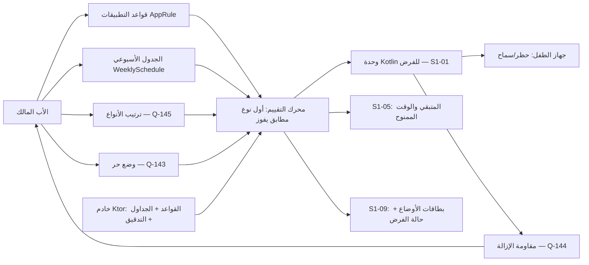
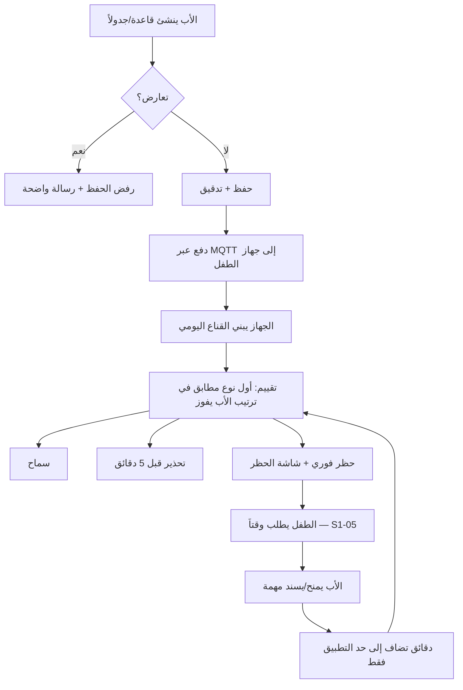
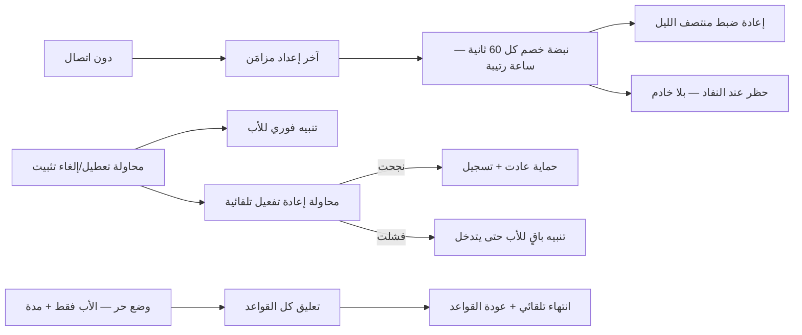

# S1-10: الحماية والفرض (Protection & Enforcement)

- **الحالة:** approved | **المرحلة:** 1 (نواة الحماية) · **آخر تحديث:** 2026-11-06
- **القرارات الحاكمة:** Q-001 · Q-002 · Q-003 · Q-005 · Q-006 · Q-007 · Q-008 · Q-022 · Q-031 · Q-061 · Q-062 · Q-063 · Q-064 · Q-065 · Q-068 · Q-106 · Q-141 · Q-142 · Q-143 · Q-144 · Q-145 · Q-146 · D-021 · D-023 · D-038 · G-006 · G-007 · G-009 · Q-183 · Q-184 · Q-189 · Q-190 · Q-222 · Q-223 · Q-224 · Q-230
- **حالة المراجعة:** §§1–8 + §10 معتمدة بالكامل في التخطيط (حكم المالك 2026-11-06) · **§9 في مرحلة التصميم (Q-091)**.
- **الأدلة المرجعية:** المراجعة الناقدة الكاملة 2026-11-06 (الحرجة ح1) · `ARCHITECTURE.md` §5.2/§5.3 · `CONTEXT-MAP.md` سياق #3 · Qustodio (حصص + تسلسل + نبضة دون اتصال) · FamiSafe (قائمة الجدول الأسبوعي) · Qustodio Kids + Bark Kids (مقاومة الإزالة) · S1-01 (معتمد) · S1-05 (معتمد) · S1-09 (معتمد)

## 1. الهدف والتحليل والنطاق

**الهدف:** هذا النظام هو قلب نواة الحماية (Q-002) — المالك الذي أشارت إليه المعمارية (`ARCHITECTURE.md` §5.2: `ScheduleEngine` · `CommandDispatcher` · `EnforcementSync`؛ و§5.3: `DEVICE — APP_RULE` / `WEEKLY_SCHEDULE`) والمواصفات التسع دون أن يملكه أحد (الحرجة ح1 من المراجعة الناقدة 2026-11-06). الغلاف (S1-01) يستضيف التنفيذ في وحدة Kotlin؛ وهذا النظام يملك **القرار**: أي قاعدة، وأي جدول، وأي ترتيب، ومتى يُحظر التطبيق ومتى يُسمح — على جهاز الطفل، متصلاً كان أو دون اتصال. والجهاز المقترن كطفل يعمل في وضع الطفل حصراً في المرحلة 1 (Q-062 — الوضع المزدوج).

**القواعد الثلاث الحاكمة:**
1. **الترتيب الافتراضي يعمل فوراً (Q-145):** النوم > المدرسة > حدود التطبيقات > الحصة الإجمالية — بلا أي إعداد من الأب.
2. **الأب يملك الترتيب (Q-145 + Q-003):** يعيد ترتيب أنواع القواعد بحرية لكل عائلة ولكل طفل؛ وعند التعارض يفوز أول نوع مطابق في ترتيبه.
3. **الوقت المكتسب لا يتفوق على أي قاعدة (Q-145):** الوقت الممنوح أو المصروف من النقاط يضيف دقائق إلى حصة التطبيق فقط — لا يفتح تطبيقاً في وقت نوم أو مدرسة.

**مخطط سياق النظام (§1 — بصري):**



**داخل النطاق:**
- قواعد التطبيقات (`AppRule`): لكل طفل ولكل تطبيق — سماح (`ALLOW`) / حظر (`BLOCK`) / حد دقائق يومي (`LIMIT`) لكل يوم أسبوع (0–1440 دقيقة).
- الجدول الأسبوعي (`WeeklySchedule`): نوافذ نوم ومدرسة لكل يوم أسبوع، بترميز قائمة 7 أيام (نمط FamiSafe المستخلص) وكشف تعارض عند الحفظ؛ والتقييم يبني قناعاً يومياً (bitmask) في الذاكرة عند كل مزامنة لتقييم O(1).
- تسلسل الفرض (Q-145): الأنواع الأربعة (نوم / مدرسة / حدود تطبيقات / حصة إجمالية) بترتيب افتراضي + إعادة ترتيب بيد الأب لكل عائلة ولكل طفل.
- الفرض دون اتصال: القواعد تُفرض من آخر إعداد مزامَن؛ نبضة خصم كل 60 ثانية؛ ساعة رتيبة (Monotonic) ضد العبث بالساعة؛ إعادة ضبط منتصف الليل.
- شاشة الحظر + تحذير قبل 5 دقائق من نفاد الحد + حظر فوري عند النفاد؛ ومن شاشة الحظر يطلب الطفل وقتاً إضافياً (دورة S1-05).
- الوضع الحر (Q-143): تعليق كل القواعد مؤقتاً بأمر الأب وحده وبمدة محددة، ينتهي تلقائياً وتعود القواعد.
- مقاومة الإزالة (Q-144): كشف محاولة إلغاء التثبيت أو تعطيل إمكانية الوصول أو سحب DeviceAdmin أو فصل VPN + تنبيه فوري للأب + محاولة إعادة تفعيل تلقائية.
- إعدادات الأوضاع المسبقة: وضع الدراسة / وضع النوم / وضع حر — يملكها هذا النظام وتعرضها بطاقات S1-09 السريعة (S1-09 REQ-007).
- حالة الفرض: القواعد النشطة والوقت المتبقي لكل تطبيق والحد التالي — تُعرض في ودجة S1-09 وتُستهلك في S1-05.

**خارج النطاق (أنظمة أخرى):**
- الغلاف والوضعان وبوابة الوالدين وزر SOS والـ Outbox → S1-01 (هذا النظام يستهلك قناة `familyos/enforcement` ولا يعيد تعريفها).
- الهوية والتسجيل وOTP وربط الأجهزة → S1-02.
- محرك الصلاحيات والتفويض والقوالب → S1-03 (هذا النظام يفحص مفاتيح `protection.*` عبره).
- محاسبة النقاط والمحفظة ودورة الكسب → S1-05 (هذا النظام يستهلك المتبقي والوقت الممنوح ولا يملك المحفظة).
- المهام والتحقق بالذكاء → S1-06.
- الموقع والأسوار وتوصيل SOS → S1-07 (زر SOS لا يُحظر أبداً — ثابت صلب هنا وفي S1-07).
- الخطط والدفع وحصص SMS → S1-04.
- تصفية المحتوى عبر VPN (قواعد فئات المحتوى) → خارج نطاق هذه المواصفة؛ التنفيذ في وحدة Kotlin (S1-01)؛ وملكية قواعد التصفية سؤال مفتوح (Q-159: هل تعيش في S1-10 أم في نظام لاحق؟ — قبل تنفيذ المرحلة 1).

**يعتمد على:** S1-01 (الغلاف ووحدة Kotlin للفرض + Outbox + Parent Gate) + S1-02 (العضوية) + S1-03 (مفاتيح الصلاحيات) + S1-05 (المتبقي والوقت الممنوح) + S1-09 (بطاقات الأوضاع + التنبيهات).

**المصطلحات:** قاعدة تطبيق (`AppRule`) · جدول أسبوعي (`WeeklySchedule`) · نوع قاعدة (نوم / مدرسة / حد تطبيق / حصة إجمالية) · ترتيب الأنواع (الأول المطابق يفوز) · وضع حر (`Free Mode`) · مقاومة إزالة (Anti-Removal) · نبضة خصم (Deduction Pulse) · ساعة رتيبة (Monotonic Clock) · شاشة الحظر (Block Screen).

## 2. سيناريوهات المستخدم

### 10-1: الأب يضع الجدول الأسبوعي لعمر
- **الممثل:** الأب (المالك). **السياق:** عمر (10 سنوات)؛ الأب يريد نوماً من 9 مساءً ومدرسة الأحد–الخميس 7 صباحاً – 1 ظهراً.
- **التدفق:** 1) الأب يفتح قواعد عمر من لوحة الأهل. 2) يضيف نافذة نوم (21:00–06:00 كل يوم) ونافذة مدرسة (الأحد–الخميس 07:00–13:00). 3) النظام يكشف تعارضاً (نافذة مدرسة تتداخل مع نافذة نوم قديمة) فيرفض الحفظ مع رسالة واضحة. 4) الأب يصحح التداخل فيُحفظ الجدول. 5) يُدفع الجدول إلى جهاز عمر عبر MQTT؛ والجهاز يبني القناع اليومي ويطبق القواعد فوراً. **النتيجة:** جدول أسبوعي سارٍ بلا تعارض، ومزامَن على جهاز الطفل.

### 10-2: نفاد وقت اللعبة — شاشة الحظر ودورة النقاط
- **الممثل:** عمر (طفل). **السياق:** الساعة 4 عصراً؛ لعبة عمر لها حد 60 دقيقة؛ استخدمها كلها.
- **التدفق:** 1) قبل 5 دقائق من النفاد يظهر تحذير "بقي 5 دقائق". 2) عند النفاد تُحظر اللعبة فوراً وتظهر شاشة الحظر (اسم التطبيق + الوقت المتبقي + زر "اطلب وقتاً إضافياً"). 3) عمر يطلب 30 دقيقة. 4) يظهر الطلب في بطاقة "يتطلب انتباهك" في S1-09. 5) الأب يمنح 30 دقيقة مباشرة (S1-05 REQ-011) — أو يرفض ويسند مهمة (S1-05 REQ-013). 6) الوقت الممنوح يضاف إلى حد اللعبة لهذا اليوم فقط وينتهي بنهايته. **النتيجة:** حظر فوري عند النفاد، ودورة النقاط كاملة تعمل عبر شاشة الحظر.

### 10-3: حظر وقت المدرسة رغم بقاء الرصيد
- **الممثل:** عمر. **السياق:** الثلاثاء 10 صباحاً (وقت مدرسة)؛ عمر يفتح لعبة وما زال له 40 دقيقة من حصتها.
- **التدفق:** 1) عمر يفتح اللعبة. 2) محرك التقييم يفحص الترتيب الافتراضي: النوم لا يطابق (ليس وقت نوم) → المدرسة تطابق → القرار: حظر (تطبيقات الدراسة فقط). 3) لا ينظر المحرك إلى حد التطبيق ولا إلى الحصة الإجمالية — أول نوع مطابق يفوز. 4) تظهر شاشة الحظر "وقت مدرسة — تطبيقات الدراسة فقط". **النتيجة:** وقت المدرسة يحظر اللعبة رغم بقاء الرصيد؛ والترتيب الافتراضي يعمل كما حُكم.

### 10-4: وقت النوم، وأسبوع الامتحانات
- **الممثل:** عمر + الأب. **السياق:** الخميس 10 مساءً؛ عمر يراجع للامتحان بتطبيق دراسة؛ قاعدة النوم تقول "مقفل".
- **التدفق:** 1) عمر يفتح تطبيق الدراسة — يُحظر (النوم أولاً في الترتيب الافتراضي). 2) الأب يسحب "المدرسة/الدراسة" فوق "النوم" في ترتيب عمر لهذا الأسبوع فقط. 3) عمر يفتح تطبيق الدراسة — يُسمح (المدرسة تطابق أولاً، والدراسة مسموحة فيها)؛ ويفتح لعبة — تُحظر (النوم ما زال فوق حد التطبيق والحصة). 4) بعد الامتحانات يعيد الأب الترتيب كما كان. **النتيجة:** الترتيب بيد الأب يعبّر عن أولوية العائلة دون حذف أي قاعدة.

### 10-5: الوضع الحر في عطلة نهاية الأسبوع
- **الممثل:** الأب. **السياق:** الجمعة؛ الأب يريد تعليق القواعد ساعتين لزيارة عائلية.
- **التدفق:** 1) الأب يضغط بطاقة [وضع حر] في S1-09 ويختار الطفل ثم المدة (ساعتان). 2) تُعلَّق كل قواعد الفرض على جهاز ذلك الطفل؛ وتظهر لافتة واضحة في لوحة الأهل "وضع حر — ينتهي خلال 1:47". 3) زر SOS يعمل كالعادة؛ والاستخدام أثناء الوضع الحر يُحسب في التقارير ولا يُحدَّد. 4) تنتهي الساعتان — تعود القواعد تلقائياً بلا أي إجراء؛ ويُسجَّل التفعيل والانتهاء في التدقيق. **النتيجة:** تعليق مؤقت صريح بلا ثغرة دائمة.

### 10-6: محاولة تعطيل الحماية
- **الممثل:** عمر يحاول تعطيل إمكانية الوصول (Accessibility) من إعدادات النظام. **السياق:** جهاز الطفل.
- **التدفق:** 1) عمر يعطّل Accessibility. 2) وحدة Kotlin تكشف التعطيل فوراً (مستمع حالة الخدمة). 3) تنبيه فوري للأب (MQTT/دفع؛ وإن كان دون اتصال يُحفظ في Outbox بأولوية قصوى) + محاولة إعادة تفعيل تلقائية (إعادة طلب تفعيل الخدمة). 4) إن نجحت إعادة التفعيل يُسجَّل الحدث ويُشعَر الأب بالنجاح؛ وإن فشلت تستمر المحاولة عند كل نبضة تقييم حتى تنجح أو يتدخل الأب، ويبقى التنبيه ظاهراً للأب ولا يُسكَت من جهاز الطفل. **النتيجة:** لا تعطيل صامت — الأب يعلم فوراً، والحماية تحاول العودة وحدها.

### 10-7: فرض دون اتصال في اليمن
- **الممثل:** عمر في اليمن. **السياق:** لا اتصال يومان؛ القواعد المزامنة آخر مرة ما زالت سارية.
- **التدفق:** 1) عمر يستخدم التطبيقات؛ نبضة الخصم كل 60 ثانية تخصم من الحدود بالساعة الرتيبة (تغيير ساعة الجهاز يدوياً لا يغيّر شيئاً). 2) عند منتصف الليل تُعاد الحصص اليومية (بالمرساة — منتصف ليل تقويمي مخزَّن + إزاحة رتيبة، REQ-005). 3) الأب يغيّر قاعدة أثناء انقطاع عمر — التغيير ينتظر في Outbox/الخادم؛ وجهاز عمر يفرض الإعداد القديم حتى يتصل. 4) عند عودة الاتصال: تُدفع القاعدة الجديدة + تُزامَن أحداث الاستخدام دون تكرار. **النتيجة:** الحماية لا تتوقف بانقطاع الاتصال؛ ولا خصم مكرر ولا التفاف بالساعة.

**مخطط دورة حياة القاعدة (§2 — بصري):**



**مخطط التقييم دون اتصال ومقاومة الإزالة (§2 — بصري):**



## 3. المتطلبات الوظيفية

### قواعد التطبيقات
- **REQ-001:** قاعدة تطبيق واحدة لكل طفل ولكل تطبيق: إجراء `ALLOW` (سماح دائم) / `BLOCK` (حظر دائم) / `LIMIT` (حد دقائق يومي)؛ وحد الدقائق لكل يوم أسبوع (0–1440 دقيقة)؛ والتطبيق بلا قاعدة = سماح (لا حظر ضمني). [Q-002 · RE-Qustodio `AppRuleDto` · DIRECT]
- **REQ-002:** الحصة اليومية الإجمالية لكل طفل ولكل يوم أسبوع (0–1440 دقيقة)؛ والمتبقي = الحصة + الإضافي − المستهلك (صيغة Qustodio المستخلصة)؛ والوقت الممنوح/المصروف من S1-05 يدخل في "الإضافي" لحساب المتبقي؛ وتُعيَّن الحصة عبر `PUT .../daily-total-quota` (المالك فقط)؛ والقيمة الافتراضية 60 دقيقة لكل يوم أسبوع (Q-223 — Q-114). **البذر:** يُزرع صف `daily_total_quota` عند إقران جهاز الطفل (S1-02) بقيم 60 لكل يوم أسبوع — فكل طفل مقترن له صف قبل أي إجراء من الأب؛ و`GET .../daily-total-quota` يرجع الصف دائماً بعد الإقران ولا يرجع 404 أبداً. **والحالة الفارغة في S10-03** تعني «بلا حصة مخصصة — تسري الافتراضية 60 دقيقة» لا «بلا حصة»؛ وصيغة المتبقي تستخدم 60 عند غياب تخصيص الأب. [Q-002 · RE-Qustodio `screenTime.ts` · DIRECT — أُضيف جدول التخزين `daily_total_quota` بتعديل 2026-11-07 (Q-176)] [Q-184]
- **REQ-003:** عند نفاد حد تطبيق تظهر شاشة الحظر فوراً: اسم التطبيق + الوقت المتبقي (صفر) + زر "اطلب وقتاً إضافياً" (→ S1-05 REQ-012)؛ ولا يفتح التطبيق بأي طريق آخر. [Q-002 · S1-05 REQ-012 · DERIVED]
- **REQ-004:** تحذير قبل 5 دقائق من نفاد حد أي تطبيق (إشعار + اهتزاز خفيف)؛ والتحذير لكل تطبيق مرة واحدة في اليوم عند أول اقتراب من حده. [RE-Qustodio · DERIVED]
- **REQ-005:** حظر فوري عند النفاد — بلا مهلة إضافية بعد التحذير؛ والحد يُعاد ضبطه منتصف الليل. و«منتصف الليل» = منتصف الليل بالتوقيت المحلي للعائلة (يُنفَّذ على الجهاز بالساعة الرتيبة — REQ-015). **المرساة (آلية إعادة الضبط — لا سياسة جديدة):** إعادة الضبط لا تُشتق من الساعة الرتيبة وحدها (فهي تقيس المنقضي فقط ولا تعرف منتصف ليل تقويمياً)؛ بل من زوج مخزَّن على الجهاز: (أ) منتصف الليل التقويمي المحلي القادم — محسوب من `family.time_zone` (IANA — S1-02 §5)؛ (ب) إزاحة رتيبة `elapsedRealtime` لحظة تثبيت المرساة. تُثبَّت المرساة عند كل مزامنة ناجحة مع الخادم (الخادم وحده مصدر الوقت التقويمي) وعند إقلاع الجهاز؛ وتُعاد تثبيتها عند إعادة التشغيل (الساعة الرتيبة تُصفَّر) وعند تغيير المنطقة الزمنية للجهاز (يُعاد حساب منتصف الليل من `family.time_zone`، لا من منطقة الجهاز)؛ ولا تُحرَّك المرساة أبداً من ساعة حائط الجهاز وحدها — فتغيير الساعة يدوياً لا يحرّك منتصف الليل ولا يعجّل إعادة الضبط (§7-2). وإن فُقدت المرساة (أول تثبيت قبل أي مزامنة) لا تُعاد الحصص حتى أول مزامنة ناجحة تثبّتها — فلا قواعد مزامَنة قبلها أصلاً. [RE-Qustodio · DERIVED] [Q-183]

### الجدول الأسبوعي
- **REQ-006:** الجدول الأسبوعي قائمة 7 أيام (نمط FamiSafe `ScreenTimeTool` المستخلص: `allow_time`/`start_time`/`end_time` لكل يوم)؛ وكل نافذة نوعها نوم أو مدرسة؛ وحفظ جدول فيه نافذتان متداخلتان في اليوم نفسه يُرفض مع رسالة واضحة. **ترميز النوافذ الليلية:** نافذة تنتهي قبل بدئها أو مساوية له (`end_time <= start_time`) تعني «حتى اليوم التالي» (مثال 21:00–06:00 = من 21:00 يومها حتى 06:00 اليوم التالي)؛ وذيل ما بعد منتصف الليل (00:00–06:00) ينتمي إلى قناع اليوم التالي لا يوم البدء (REQ-008)؛ وكشف التداخل يجري على الخط الزمني لا في اليوم نفسه فقط: نافذتان تتداخلان إن تقاطع مداهما [بدء، نهاية) بعد مدّ النوافذ الليلية إلى اليوم التالي — فتداخل ليلي مرفوض كما اليومي (مثال: نوم 21:00–06:00 ومدرسة 05:00–07:00 متداخلتان في 05:00–06:00). [Q-002 · RE-FamiSafe · DIRECT]
- **REQ-007:** نافذة النوم: لا يُفتح أي تطبيق أثناءها؛ وزر SOS يعمل دائماً (ثابت صلب). نافذة المدرسة: تطبيقات الدراسة فقط (قائمة يحددها الأب — وسم `is_study_app` في `app_rule`، افتراضي false؛ والقائمة = الصفوف الموسومة لذلك الطفل، Q-190)؛ وغيرها يُحظر. [Q-002 · Q-067 · Q-190 · DERIVED]
- **REQ-008:** التقييم يبني قناعاً يومياً (bitmask) في الذاكرة عند كل مزامنة: لكل دقيقة من اليوم حالة (مسموح/محظور) مشتقة من الجدول؛ والتقييم عند فتح تطبيق O(1) (قراءة موضع القناع). **وتُقسَّم كل نافذة ليلية عند بناء القناع إلى مقطعين:** يوم البدء من البدء حتى 24:00، واليوم التالي من 00:00 حتى النهاية — فاختبار «الأحد 00:00–06:00» يطابق نافذة السبت الليلية (21:00–06:00) لا نافذة الأحد؛ وبلا هذا التقسيم ينزاح حد النوم يوماً كاملاً. [ARCH §5.2 · DIRECT — تركيبنا، لا استخلاص]
- **REQ-009:** تغيير الجدول يسري على جهاز الطفل عند استلامه (دفع MQTT)؛ وإن صار الوقت الحالي محظوراً بالتغيير الجديد يُطبَّق الحظر فوراً دون انتظار الحد التالي. [Q-002 · DERIVED]

### تسلسل الفرض (Q-145)
- **REQ-010:** الترتيب الافتراضي لأنواع القواعد: النوم > المدرسة > حدود التطبيقات > الحصة الإجمالية؛ ويعمل فوراً بلا أي إعداد من الأب. [Q-145 · DIRECT]
- **REQ-011:** الأب يعيد ترتيب أنواع القواعد بحرية لكل عائلة؛ ولكل طفل تجاوز اختياري عن ترتيب العائلة؛ والتقييم يمشي الترتيب من الأعلى إلى الأسفل وأول نوع مطابق للّحظة يفوز — ولا ينظر إلى ما تحته. [Q-145 · DIRECT]
- **REQ-012:** الوقت المكتسب أو الممنوح (من S1-05: منح مباشر أو صرف نقاط) يضيف دقائق إلى حد التطبيق فقط؛ ولا يفتح تطبيقاً في وقت نوم أو مدرسة؛ ولا يرفع نوعاً فوق نوع في الترتيب. [Q-145 · DIRECT]
- **REQ-013:** شاشة ترتيب الأنواع تعرض للأب نتيجة ترتيبه بلغة صريحة قبل الحفظ (مثال: "بهذا الترتيب يستطيع طفلك استخدام رصيده حتى بعد وقت النوم")؛ والحفظ بلا معاينة النتيجة مرفوض تصميماً — لا ترتيب أعمى. [Q-145 · Q-003 · DERIVED]

### الفرض دون اتصال
- **REQ-014:** القواعد تُفرض دون اتصال من آخر إعداد مزامَن؛ ولا قاعدة تعتمد على الاتصال. [Q-002 · Q-064 · DIRECT]
- **REQ-015:** نبضة خصم كل 60 ثانية دون اتصال بالساعة الرتيبة (Monotonic) — تغيير ساعة الجهاز يدوياً لا يغيّر الخصم ولا يؤخر الحظر؛ وإعادة ضبط الحصص منتصف الليل بالمرساة المعرَّفة في REQ-005 (منتصف ليل تقويمي مخزَّن + إزاحة رتيبة)، لا بالساعة الرتيبة وحدها. [RE-Qustodio · DERIVED]
- **REQ-016:** أحداث الاستخدام دون اتصال تُسجَّل محلياً وتُزامَن عند عودة الاتصال عبر Outbox؛ والمزامنة idempotent بمفتاح (الطفل + التطبيق + التاريخ) — لا خصم مكرر. [Q-064 · S1-01 REQ-009 · DERIVED]
- **REQ-017:** تغيير قاعدة أثناء انقطاع جهاز الطفل ينتظر على الخادم؛ والجهاز يفرض الإعداد القديم حتى يتصل ويستلم الجديد؛ ولا يُطبَّق أي تغيير قبل استلامه كاملاً. [Q-002 · DERIVED]

### الوضع الحر (Q-143)
- **REQ-018:** الوضع الحر يعلّق كل قواعد الفرض مؤقتاً؛ والتفعيل للمالك (`is_owner`) وحده — لا يفعّله بالغ مفوَّض ولا يفعّله الطفل؛ والتفعيل لكل طفل على حدة (لا تفعيل عائلي — السيناريو 10-5 والشاشة S10-09)؛ و`evaluateNow` يفحص الوضع الحر أولاً قبل أي قاعدة (§4-1 — الحقل `free_mode_active` في `EnforcementDecision`)، ومصدر الحقيقة دون اتصال `free_mode_until` المزامَن آخر مرة. [Q-143 · DIRECT]
- **REQ-019:** التفعيل بمدة يحددها الأب بالدقائق عند التفعيل؛ ولا مدة افتراضية — بلا مدة لا تفعيل؛ وينتهي تلقائياً بانتهاء المدة وتعود القواعد دون أي إجراء؛ والتفعيل والانتهاء والإلغاء المبكر كلها تُسجَّل في التدقيق. **من يعلّم الانتهاء (EXPIRED):** الانتهاء حقيقة زمنية لا وظيفة مسح — فالجلسة منتهية متى بلغ الوقت `expires_at` ولو بقي `status` مخزَّناً `ACTIVE`؛ والجهاز ينهيها محلياً عند بلوغ `free_mode_until` ويبلّغ؛ والخادم يصحّح `status` إلى `EXPIRED` (ويملأ `marked_expired_at`) كسولاً عند أول قراءة/تفعيل لاحق أو عند أول تقرير/مزامنة من الجهاز — بلا وظيفة مسح دورية؛ وفحص تفعيل جديد لا يرفض `FREE_MODE_ACTIVE` (409) إن كان `expires_at` قد مضى (يُصحَّح أولاً ثم يُفعَّل)؛ وحدث التدقيق للانتهاء يحمل `expires_at` وقتاً للحدث لا وقت التعليم. [Q-143 · DIRECT]
- **REQ-020:** أثناء الوضع الحر: لافتة واضحة في لوحة الأهل (وضع حر — ينتهي خلال X)؛ وزر SOS يعمل كالعادة؛ والاستخدام أثناءه يُحسب في التقارير ولا يُحدَّد؛ والوضع الحر لا يمسح تنبيهات العبث المعلقة. [Q-143 · Q-067 · DERIVED]

### مقاومة الإزالة (Q-144)
- **REQ-021:** كشف العبث: محاولة إلغاء تثبيت التطبيق، تعطيل خدمة Accessibility، سحب DeviceAdmin، فصل VPN، قتل خدمة الخلفية — كل واحد حدث عبث: تنبيه فوري للأب (MQTT/دفع؛ وإن كان دون اتصال يُحفظ في Outbox بأولوية قصوى) + محاولة إعادة تفعيل تلقائية فوراً. [Q-144 · Q-031 · DIRECT]
- **REQ-022:** إعادة التفعيل: تستمر المحاولة عند كل نبضة تقييم حتى تنجح أو يتدخل الأب؛ وكل محاولة وكل فشل يُسجَّلان في التدقيق؛ والتنبيه يبقى ظاهراً للأب ولا يُسكَت من جهاز الطفل — إسكاته من لوحة أهل مصادق عليها فقط. [Q-144 · DIRECT]
- **REQ-023:** إلغاء تثبيت وكيل الطفل يتطلب PIN الأب (بوابة الوالدين — S1-01 REQ-006؛ نمط Bark Kids: رمز يصدره الأب). [Q-144 · Q-065 · RE-Bark · DIRECT]

### إعدادات الأوضاع والتكامل
- **REQ-024:** إعدادات الأوضاع المسبقة يملكها هذا النظام: وضع الدراسة (نوافذ مدرسة + تطبيقات الدراسة فقط) / وضع النوم (نافذة نوم الآن) / وضع حر (Q-143)؛ وكل إعداد حزمة قواعد تُطبَّق ذرّياً (كلها أو لا شيء)؛ وتعرضها بطاقات S1-09 السريعة. **محتويات كل إعداد (قابلة للاختبار — بلا مدة افتراضية في أي منها):**

| الإعداد | ما يُطبَّق بالضبط | النافذة | التطبيقات | الانتهاء | وحدة الذرّية |
|---|---|---|---|---|---|
| دراسة | نافذة مدرسة فورية + قيد «تطبيقات الدراسة فقط» | تبدأ الآن وتنتهي بانتهاء المدة التي يختارها الأب عند التطبيق (بالدقائق — بلا مدة افتراضية، وبلا مدة لا تطبيق) | القائمة الموسومة `is_study_app` لذلك الطفل (Q-190)؛ وغيرها يُحظر | بانتهاء المدة أو إلغاء الأب المبكر؛ وتُسجَّل في التدقيق | النافذة + القيد معاً أو لا شيء |
| نوم | نافذة نوم فورية | تبدأ الآن وتنتهي بانتهاء المدة التي يختارها الأب عند التطبيق (بالدقائق — بلا مدة افتراضية، وبلا مدة لا تطبيق) | لا يُفتح أي تطبيق (وزر SOS يعمل دائماً — Q-067) | بانتهاء المدة أو إلغاء الأب المبكر؛ وتُسجَّل في التدقيق | النافذة وحدها (قاعدة واحدة) |
| حر | جلسة وضع حر (REQ-018/019) — لا قواعد | بلا نافذة — تعليق كل القواعد | كل التطبيقات مسموحة (والاستخدام يُحسب ولا يُحدَّد — REQ-020) | بانتهاء `duration_minutes` أو إلغاء الأب المبكر؛ والتفعيل والانتهاء يُسجَّلان في التدقيق | إنشاء الجلسة (P5/D6) |

وتطبيق دراسة/نوم ينشئ نافذة مؤقتة تُحذف بانتهائها (لا يعدّل الجدول الأسبوعي الدائم)؛ ومعاينة الفرق في S10-10 تعرض المدة والنافذة والتطبيقات قبل التطبيق. [Q-092 · S1-09 REQ-007 · DIRECT]
- **REQ-025:** حالة الفرض مكشوفة للأنظمة: القواعد النشطة + الوقت المتبقي لكل تطبيق + الحد التالي + حالة الوضع الحر + حالة العبث — يستهلكها S1-09 (الودجة والتنبيهات) وS1-05 (المتبقي). [S1-09 · S1-05 · DERIVED]
- **REQ-026:** كل تغيير قاعدة/حصة إجمالية/جدول/ترتيب/وضع حر يُسجَّل في التدقيق (AuditEvent, domain=protection: من غيّر/ماذا/متى) ويُدفع إلى كل أجهزة الأهل. **والدفع عبر موضوع مخصص** `family/{family_id}/protection/audit` (خادم → أجهزة الأهل، QoS 1 — §4-3): ينشر الخادم ملخص حدث التدقيق (من غيّر/ماذا/متى) بعد كل كتابة تدقيق؛ ولا يُعاد استخدام `rules-updated` للدفع — فجمهوره جهاز الطفل لا أجهزة الأهل. [Q-003 · DERIVED] [Q-184]
- **REQ-027:** القواعد تتبع الطفل لا الجهاز: عند بلوغ الطفل 13 سنة وتحوله إلى مراهق (S1-03 REQ-003) تبقى قواعده سارية ويُشعَر الأب ليراجعها؛ ويُطلق بطاقة المراجعة حدث `member.turned-teen` الداخلي من مهمة S1-02 الخادمية اليومية عند منتصف الليل المحلي (Q-189)؛ **وتُطلق المهمة حدثَ بلوغ 13 في 1 يناير من سنة بلوغ الطفل 13 سنة (سنة الميلاد + 13 — سنة الميلاد وحدها في الملف، Q-073) (Q-235)** — الفحص يومي، لكن الحدث يُصدر في ذلك التاريخ؛ وتُشتق البطاقة من سجل العضوية (`membership.role` — S1-02) بلا جدول جديد. والفرض يسري على الطفل والمراهق معاً (المحفظة وحدها للأطفال — Q-109). وعند استبدال الجهاز تُعاد القواعد نفسها بالإقران الجديد؛ ويطلق بطاقة مراجعة استبدال الجهاز في S10-14 الحدث الداخلي `device.paired-new` (يطلقه S1-02 عند إقران جهاز لطفل لديه جهاز مقترن أصلاً)، والتخزين جدول `device_pairing` (S1-02 §5). [Q-080 · Q-109 · Q-189 · Q-235 · Q-230 · S1-03 REQ-003 · DERIVED]

## 4. الواجهات والعقود

### 4-1. قنوات المنصة (Flutter ↔ Kotlin) — امتداد لقناة S1-01، لا إعادة تعريف

قناة `MethodChannel("familyos/enforcement")` ملك S1-01 (§4.1) — طرقها الموروثة (`isEnforcementActive` · `applyAppRules` · `getDeviceHealth` · `requestParentGate`) تُستهلك كما هي. هذا النظام يضيف إليها الطرق التالية فقط:

| الطريقة الجديدة | الغرض |
|---|---|
| `applySchedule(schedule: WeeklySchedule) -> void` | دفع الجدول الأسبوعي إلى وحدة Kotlin؛ تبني القناع اليومي فوراً |
| `applyPriority(order: List<RuleType>) -> void` | دفع ترتيب أنواع القواعد (Q-145) إلى وحدة Kotlin |
| `getEnforcementState() -> EnforcementState {active_rule_type, remaining_by_app, next_boundary_at, free_mode_until}` | حالة الفرض الحالية للعرض في الغلاف وودجة S1-09 |
| `activateFreeMode(until: timestamp) -> void` | تفعيل الوضع الحر على الجهاز (يُستدعى عند استلام أمر التفعيل) |
| `evaluateNow() -> EnforcementDecision {allowed, blocking_rule_type, remaining_seconds, free_mode_active}` | تقييم فوري عند فتح تطبيق — أول نوع مطابق في ترتيب الأب يفوز؛ **والفحص الأول وضع حر**: إن كان الوضع الحر سارياً (`free_mode_until` من آخر مزامنة لم يمضِ) يرجع `allowed=true` و`blocking_rule_type=null` و`free_mode_active=true` بلا النظر إلى أي قاعدة — والتفعيل لكل طفل على حدة (لا تفعيل عائلي — REQ-018)؛ وإن انتهى `free_mode_until` فالوضع غير سارٍ (`free_mode_active=false`) ويُقيَّم الترتيب كاملاً |

قناة الأحداث `EventChannel("familyos/enforcement/events")` (S1-01) تبث `enforcement_state` — وتُضاف إليها أحداث `rule_blocked` و`tamper_detected` و`free_mode_changed`.

### 4-2. نقاط الوصول REST (Ktor — `/api/v1`)

| الطريقة والمسار | الغرض | المدخل | المخرج |
|---|---|---|---|
| `GET /api/v1/families/{id}/children/{childId}/app-rules` | قائمة قواعد التطبيقات | — | `[{rule_id, app_package, action, minutes_by_weekday}]` |
| `POST /api/v1/families/{id}/children/{childId}/app-rules` | إنشاء قاعدة (REQ-001) | `{app_package, action, minutes_by_weekday?}` — شرطية: `action=LIMIT` ⇒ `minutes_by_weekday` إلزامية (كل قيمة 0–1440)؛ و`action=ALLOW/BLOCK` ⇒ `minutes_by_weekday` مرفوضة إن حضرت (`400 INVALID_RULE`) | `201 {rule_id, ...}` — رد واحد بعد إقرار الجهاز (3-أ — كـ 3-ب) |
| `PATCH /api/v1/families/{id}/children/{childId}/app-rules/{ruleId}` | تعديل قاعدة | `{action?, minutes_by_weekday?, version}` — قفل تفاؤلي: `version` قديم → `409 VERSION_CONFLICT`؛ والقاعدة الشرطية نفسها: التحويل إلى `LIMIT` بلا دقائق ⇒ `400 INVALID_RULE`، ودقائق مع `ALLOW/BLOCK` ⇒ `400 INVALID_RULE` | القاعدة المعدَّلة |
| `DELETE /api/v1/families/{id}/children/{childId}/app-rules/{ruleId}` | حذف قاعدة (الأب + البالغ المفوَّض حسب القالب — Q-146) | — | `204` + دفع `rules-updated` |
| `GET /api/v1/families/{id}/children/{childId}/weekly-schedule` | الجدول الأسبوعي | — | `{schedule_id, windows, version}` |
| `PUT /api/v1/families/{id}/children/{childId}/weekly-schedule` | استبدال الجدول (REQ-006) | `{windows, version}` — قفل تفاؤلي: `version` قديم → `409` | الجدول المحفوظ |
| `GET /api/v1/families/{id}/children/{childId}/daily-total-quota` | قراءة الحصة اليومية الإجمالية (REQ-002) | — | `{minutes_by_weekday}` — الصف مزروع عند الإقران بقيم 60؛ ولا 404 أبداً بعد الإقران |
| `PUT /api/v1/families/{id}/children/{childId}/daily-total-quota` | تعيين الحصة اليومية الإجمالية (REQ-002) | `{minutes_by_weekday, version}` — المالك (الأب) فقط؛ وقفل تفاؤلي: `version` قديم → `409 VERSION_CONFLICT` (والمالك على جهازين قد يتصادم — القاعدة مصرح بها لا مستحيلة) | الحصة المحفوظة + دفع `rules-updated` |
| `GET /api/v1/families/{id}/rule-priority` | ترتيب الأنواع الحالي (ترتيب العائلة) | — | `{order: ["sleep","school","app_limit","total_quota"]}` |
| `PUT /api/v1/families/{id}/rule-priority` | إعادة ترتيب الأنواع للعائلة (REQ-011) | `{order, version}` — قفل تفاؤلي: `version` قديم → `409 VERSION_CONFLICT` | الترتيب المحفوظ |
| `GET /api/v1/families/{id}/children/{childId}/rule-priority` | ترتيب الأنواع لطفل (تجاوز عن ترتيب العائلة — REQ-011) | — | `{order: ["sleep","school","app_limit","total_quota"]}` |
| `PUT /api/v1/families/{id}/children/{childId}/rule-priority` | إعادة ترتيب الأنواع لطفل (REQ-011) | `{order, version}` — قفل تفاؤلي: `version` قديم → `409 VERSION_CONFLICT` | الترتيب المحفوظ |
| `POST /api/v1/families/{id}/children/{childId}/free-mode` | تفعيل الوضع الحر (REQ-018/019) | `{duration_minutes}` — المالك فقط | `{session_id, expires_at}` — `201` |
| `POST /api/v1/families/{id}/children/{childId}/free-mode/cancel` | إلغاء مبكر للوضع الحر | — | `{session_id, status: "cancelled"}` |
| `GET /api/v1/families/{id}/children/{childId}/enforcement-state` | حالة الفرض (REQ-025) | — | `{active_rule_type, remaining_by_app, next_boundary_at, free_mode_until, tamper_status}` |
| `GET /api/v1/families/{id}/children/{childId}/tamper-events` | قائمة أحداث العبث (REQ-021/022) — مصدر شاشة S10-11؛ والمفتاح `protection.tamper.view` (بلاه يستطيع طفل تعداد سجل عبث طفل آخر) | `?child_id&from&to&limit&before` (الترقيم: `limit` افتراضي 50 وأقصى 100، والأحدث أولاً، و`next_cursor` للصفحة التالية — نمط S1-08 `?before&limit`) | `{events: [{event_id, kind, detected_at, reactivation_attempted, resolved_at, notified}], next_cursor}` |
| `POST /api/v1/families/{id}/children/{childId}/tamper-events/{eventId}/resolve` | حلّ حدث عبث بعد تدخل الأب (REQ-022 — زر «حُلّ» في S10-11) | — | `{event_id, resolved_at}` — والمفتاح: يُربط في تمريرة العدّ النهائية مع R2-S110-22/23/24 (إذ يغيّر عدّ المفاتيح 82)؛ وحتى ذلك الحين يُفحص بملكية الأب (`is_owner`) وحدها |
| `POST /api/v1/families/{id}/children/{childId}/mode-presets/{preset}` | تطبيق إعداد مسبق (REQ-024) | `{duration_minutes?}` (للحر — ويدخل في جدول REQ-024؛ و`preset` في المسار وحده — بلا تكرار في الجسم، فالمسار حاكم) | القواعد المطبَّقة |
| `GET /api/v1/families/{id}/audit/protection` | سجل تدقيق الحماية (REQ-026) | `?child_id&from&to&limit&before` (الترقيم: `limit` افتراضي 50 وأقصى 100، والأحدث أولاً، و`next_cursor` للصفحة التالية — نمط S1-08 `?before&limit`؛ ونفس اتفاقية ترقيم تنبيهات S1-09) | `{events: [{event_id, actor, action, target, at}], next_cursor}` |

الأخطاء: صيغة موحدة `{code, message_ar, trace_id}`؛ كل طلب يحمل سياق `family_id`؛ رفض أي طلب خارج العائلة (403). رموز هذا النظام: `RULE_NOT_FOUND` · `INVALID_RULE` (دقائق خارج 0–1440 أو حزمة غير معروفة أو `LIMIT` بلا `minutes_by_weekday` أو دقائق مع `ALLOW`/`BLOCK` — §4-2) · `SCHEDULE_CONFLICT` (نوافذ متداخلة — REQ-006) · `FREE_MODE_NOT_OWNER` (التفعيل للمالك فقط — REQ-018) · `FREE_MODE_ACTIVE` (وضع حر سارٍ أصلاً) · `PRIORITY_INVALID` (نوع غير معروف أو مكرر في الترتيب) · `APP_NOT_MANAGED` (التطبيق خارج إدارة النظام) · `VERSION_CONFLICT` (قفل تفاؤلي — أعد التحميل).

### 4-3. أحداث MQTT (البادئة الموحدة `family/{family_id}/` — D-021)

| الموضوع | الاتجاه | الغرض |
|---|---|---|
| `family/{family_id}/protection/rules-updated` | خادم → طفل | تغيّرت قاعدة/جدول/ترتيب → الجهاز يعيد المزامنة ويبني القناع اليومي |
| `family/{family_id}/protection/free-mode` | خادم → طفل | تفعيل/إلغاء/انتهاء الوضع الحر (REQ-019) |
| `family/{family_id}/protection/audit` | خادم → أهل | دفع ملخص حدث التدقيق (من غيّر/ماذا/متى) إلى كل أجهزة الأهل بعد كل كتابة تدقيق (REQ-026) — QoS 1 |
| `family/{family_id}/protection/tamper` | طفل → خادم | حدث عبث (REQ-021) → تنبيه فوري للأب + تنبيه `alert` نوع `system` في S1-09 |
| `family/{family_id}/device/{device_id}/state` | طفل → خادم | حالة الفرض الدورية (S1-01 §4.3 — تُستهلك هنا مرآةً في `enforcement_state`) |
| `family/{family_id}/devices/{device_id}/commands` | خادم → طفل | الأوامر (حظر/قاعدة/وضع حر) — QoS 1 + `command_id` + إقرار إلزامي (Q-168) |
| `family/{family_id}/devices/{device_id}/acks` | طفل → خادم | إقرار تنفيذ أمر (`command_id` + النتيجة) — QoS 1 (Q-168) |
| `family/{family_id}/devices/{device_id}/status` | طفل → خادم | حالة الاتصال — محفوظة (retained) + last will = `offline` (Q-168) |

كل أمر يحمل `command_id` (idempotency)؛ والإقرار (ack) إلزامي؛ وتوصيل الأمر + الإقرار < 5 ثوانٍ (Q-061 — S1-01 REQ-022).

**قواعد النقل (Q-168 — `MQTT-BROKER-SPEC.md`):** QoS 1؛ والإقرار التطبيقي إلزامي للأوامر وSOS فقط؛ والموقع الحي والحالة الدورية QoS 0؛ وبلا QoS 2 (التكرار يُغطيه `command_id`)؛ والجلسة دائمة (clean session = false)؛ واللقطات المحفوظة (retained) للمنح والقواعد وحالة الجهاز.

## 5. البيانات — النموذج

**قاعدة ملزمة (الصياغة المصححة — S1-03 §5):** جداول العائلة تحمل `family_id` + عزل RLS (D-021)؛ ولا جداول سجل عالمية في هذا النظام — كل جداوله جداول عائلة. كل تغيير قاعدة/جدول/ترتيب/وضع حر يُسجَّل في `AuditEvent` (domain=`protection`).

| الجدول | الحقول الرئيسية | ملاحظة |
|---|---|---|
| `app_rule` | `rule_id` (PK) · `family_id` · `child_id` (FK → membership) · `app_package` · `action` (`ALLOW`/`BLOCK`/`LIMIT`) · `minutes_by_weekday` int[7] (الفهرس 0 = الأحد، 1 = الاثنين، 2 = الثلاثاء، 3 = الأربعاء، 4 = الخميس، 5 = الجمعة، 6 = السبت؛ كل قيمة 0–1440) · `is_study_app` boolean (افتراضي false — وسم تطبيق دراسة، Q-190) · `version` int (قفل تفاؤلي — يبدأ 1، يزيد عند كل تعديل؛ وقدمه في PATCH → `409 VERSION_CONFLICT`) · `created_by` · `created_at` · `updated_at` | قاعدة واحدة لكل (طفل، تطبيق) — قيد وحيد (REQ-001)؛ وقائمة تطبيقات الدراسة = الصفوف الموسومة لذلك الطفل (REQ-007) |
| `daily_total_quota` | `quota_id` (PK) · `family_id` · `child_id` (FK → membership) · `minutes_by_weekday` int[7] (الفهرس 0 = الأحد، 1 = الاثنين، 2 = الثلاثاء، 3 = الأربعاء، 4 = الخميس، 5 = الجمعة، 6 = السبت؛ كل قيمة 0–1440) · `version` int (قفل تفاؤلي — يبدأ 1، يزيد عند كل تعيين؛ وقدمه في PUT → `409 VERSION_CONFLICT`) · `created_by` · `created_at` · `updated_at` | حصة واحدة لكل طفل (صف واحد لكل طفل) — مصدر الحصة في صيغة المتبقي (REQ-002)؛ أُضيف الجدول بتعديل 2026-11-07 (Q-176)؛ ويُزرع الصف عند إقران جهاز الطفل بقيم 60 لكل يوم أسبوع (REQ-002) |
| `weekly_schedule` | `schedule_id` (PK) · `family_id` · `child_id` (FK → membership) · `windows` jsonb (قائمة 7 أيام: `[{day, start_time, end_time, kind: "sleep" \| "school"}]` — نمط FamiSafe) · `version` int (قفل تفاؤلي — REQ-006) · `updated_at` | جدول واحد لكل طفل؛ النوافذ المتداخلة في اليوم نفسه مرفوضة عند الحفظ (REQ-006)؛ والنافذة الليلية (`end_time <= start_time`) تمتد إلى اليوم التالي، وذيلها ينتمي إلى قناع اليوم التالي (REQ-006/008) |
| `rule_priority` | `priority_id` (PK) · `family_id` · `child_id` (nullable — فارغ = ترتيب العائلة الافتراضي) · `order` jsonb (مصفوفة الأنواع الأربعة: `["sleep","school","app_limit","total_quota"]` — الافتراضي Q-145) · `version` int (قفل تفاؤلي — يبدأ 1، يزيد عند كل إعادة ترتيب؛ وقدمه في PUT → `409 VERSION_CONFLICT`) · `updated_by` · `updated_at` | صف العائلة (child_id فارغ) هو الافتراضي؛ وصف الطفل تجاوز اختياري عنه (REQ-011) |
| `enforcement_state` | `child_id` (PK) · `family_id` · `last_evaluated_at` · `active_rule_type` (nullable) · `remaining_by_app` jsonb · `next_boundary_at` (nullable) · `free_mode_until` (nullable) · `tamper_status` (`none`/`active`/`unresolved`) · `updated_at` | مرآة خادمية لحالة الجهاز (لقراءات S1-09) — ليست المرجع؛ تقييم الجهاز المحلي هو المرجع دون اتصال (REQ-025) |
| `app_usage_daily` | `usage_id` (PK) · `family_id` · `child_id` · `app_package` · `usage_date` · `seconds_used` · `updated_at` | حقائق الاستهلاك اليومية؛ والمزامنة upsert بمفتاح (الطفل + التطبيق + التاريخ) — لا خصم مكرر (REQ-016)؛ وقيد وحيد معلن `UNIQUE (child_id, app_package, usage_date)` — وهو هدف تعارض الـ upsert، لا الفهارس المنفردة وحدها |
| `free_mode_session` | `session_id` (PK) · `family_id` · `child_id` · `activated_by` (المالك) · `activated_at` · `expires_at` · `cancelled_at` (nullable) · `marked_expired_at` (nullable — وقت تصحيح `status` إلى `EXPIRED` كسولاً؛ ووقت الحدث في التدقيق هو `expires_at` لا هذا الحقل — REQ-019) · `status` (`ACTIVE`/`EXPIRED`/`CANCELLED`) | جلسة وضع حر واحدة نشطة لكل طفل في الوقت الواحد (REQ-019) |
| `tamper_event` | `event_id` (PK) · `family_id` · `child_id` · `device_id` · `kind` (`UNINSTALL_ATTEMPT`/`ACCESSIBILITY_DISABLED`/`DEVICE_ADMIN_REVOKED`/`VPN_DISCONNECTED`/`SERVICE_KILLED`) · `detected_at` · `reactivation_attempted` bool · `resolved_at` (nullable) · `notified` bool | كل حدث عبث يُسجَّل ويُبلَّغ عنه؛ وحلّه بتدخل الأب أو نجاح إعادة التفعيل (REQ-021/022) |

**مراجع:** عضوية الطفل من S1-02 (membership)؛ الوقت الممنوح/المصروف من S1-05 (`granted_time` — يدخل في "الإضافي" لحساب المتبقي، REQ-002)؛ بوابة الوالدين المحلية من S1-01 (`parent_gate` — مخزن محلي، Q-142)؛ تنبيهات العبث تظهر في S1-09 كـ `alert` نوع `system` ونظام `S1-10` (نمط تنبيهات مصنف S1-08). **مخازن العميل (ليست جداول خادم):** القواعد + الجدول + الترتيب + القناع اليومي في Drift على جهاز الطفل؛ وأحداث الاستخدام والعبث في Outbox دون اتصال.

## 6. القواعد والصلاحيات

### مفاتيح الصلاحيات (`protection.*`)
- `protection.rule.view` — عرض قواعد التطبيقات والجدول (الأب + البالغ المفوَّض حسب القالب).
- `protection.rule.create` — إنشاء قاعدة تطبيق (الأب + البالغ المفوَّض حسب القالب).
- `protection.rule.edit` — تعديل قاعدة تطبيق (الأب + البالغ المفوَّض حسب القالب).
- `protection.rule.delete` — حذف قاعدة تطبيق (الأب + البالغ المفوَّض حسب القالب — Q-146).
- `protection.schedule.edit` — تعديل الجدول الأسبوعي (الأب + البالغ المفوَّض حسب القالب).
- `protection.priority.edit` — إعادة ترتيب أنواع القواعد (الأب + البالغ المفوَّض حسب القالب — Q-146؛ Q-145 "الأب يعيد ترتيب").
- `protection.free_mode.activate` — تفعيل/إلغاء الوضع الحر (المالك وحده — Q-143 "بأمر الأب فقط").
- `protection.tamper.view` — عرض أحداث العبث (الأب + البالغ المفوَّض حسب القالب).
- `protection.state.view` — عرض حالة الفرض والمتبقي (الأب + البالغ المفوَّض حسب القالب؛ والطفل يرى حالته في الغلاف بلا مفتاح — شاشة الحظر تعرضها بطبيعتها).

### ثوابت صلبة (لا تُكسر)
- زر SOS لا يُحظر أبداً — بأي قاعدة، وفي أي نافذة، وفي الوضع الحر (Q-067).
- القواعد تُفرض دون اتصال من آخر إعداد مزامَن (REQ-014) — لا قاعدة تعتمد على الاتصال.
- deny-override (Q-007)؛ والغموض يُفسَّر لصالح حماية الطفل؛ و`scope` و`valid_until` إلزاميان في كل منح (Q-007).
- الفرض لا يقرأ محتوى رسائل أبداً — يرى التطبيقات والأوقات فقط، لا محتواها؛ والفحص الآلي لمحتوى رسائل القاصرين مقصور على مصنف S1-08 على الخادم (Q-165 يعدّل الخط الأحمر Q-031).
- الوضع الحر للمالك وحده + بمدة محددة + ينتهي تلقائياً (Q-143).
- الأب يرى كل شيء؛ والبالغ المفوَّض يرى ما فُوِّض له فقط؛ ولا يرى أي طفل قواعد طفل آخر.
- تنبيه العبث لا يُسكَت من جهاز الطفل (REQ-022) — إسكاته من لوحة أهل مصادق عليها فقط.
- لا صلاحيات إشرافية للأطفال/المراهقين (D-038) — ولا يعدّل أي طفل قواعده بنفسه.

### قواعد التشغيل
- التقييم: أول نوع مطابق في ترتيب الأب يفوز (REQ-011)؛ وداخل النوع الواحد لا تعارض بالبناء (قاعدة واحدة لكل تطبيق؛ ونوافذ غير متداخلة — REQ-001/006).
- المتبقي = الحصة + الإضافي − المستهلك (REQ-002)؛ والإضافي = الوقت الممنوح المباشر + الوقت المصروف من النقاط (S1-05).
- إعداد مسبق يُطبَّق ذرّياً (كل قواعده أو لا شيء)؛ وفشله يعيد الحالة السابقة بلا تغيير جزئي.
- تغيير قاعدة يُدفع فوراً عبر MQTT؛ والجهاز يعيد بناء القناع اليومي عند الاستلام قبل أي تقييم جديد.

## 7. الحالات الحدية والأخطاء

1. **دون اتصال لأيام:** الجهاز يفرض الإعداد القديم؛ والتغييرات تنتظر على الخادم؛ وعند عودة الاتصال تُدفع القواعد الجديدة + تُزامَن أحداث الاستخدام دون تكرار (REQ-014/016/017).
2. **العبث بساعة الجهاز:** تغيير الساعة يدوياً لا يغيّر الخصم ولا يؤخر الحظر — النبضة بالساعة الرتيبة (REQ-015)؛ وفرق الساعة بين الجهاز والخادم يُسجَّل في التدقيق عند اكتشافه؛ وإعادة تشغيل الجهاز تُصفّر الساعة الرتيبة — تُعاد تثبيت المرساة (REQ-005) من الزوج المخزَّن عند أول مزامنة، وبلا اتصال بعد إعادة التشغيل يستمر الخصم بالساعة الرتيبة الجديدة ولا تُعاد الحصص حتى إعادة التثبيت (لا إعادة ضبط مبكرة)؛ وتغيير المنطقة الزمنية للجهاز لا يغيّر منتصف الليل — يُعاد حسابه من `family.time_zone` (S1-02 §5).
3. **تغيير جدول منتصف اليوم:** يسري عند الاستلام؛ وإن صار الوقت الحالي محظوراً يُطبَّق الحظر فوراً — حتى لو كان التطبيق مفتوحاً حينها (يُغلق مع شاشة الحظر) (REQ-009).
4. **بلوغ الطفل 13 سنة:** قواعده تبقى سارية؛ والأب يُشعَر ليراجعها (REQ-027)؛ والوقت المكتسب يتوقف (لا نقاط للمراهقين — Q-109) لكن حدود التطبيقات تستمر.
5. **استبدال الجهاز:** القواعد لكل طفل لا لكل جهاز — بالإقران الجديد تُعاد القواعد نفسها؛ ولا قواعد تُبنى من الصفر على جهاز جديد (REQ-027).
6. **انتهاء الوضع الحر أثناء استخدام تطبيق:** تحذير بالآلية نفسها (5 دقائق قبل الانتهاء)؛ وعند الانتهاء يُطبَّق الترتيب فوراً — والتطبيق المفتوح المخالف يُغلق مع شاشة الحظر (REQ-019/004).
7. **تعديلان متزامنان من والدين:** قفل تفاؤلي على `version` — يغطي `app_rule` و`weekly_schedule` و`rule_priority` و`daily_total_quota` (كلها تحمل `version` في §5)؛ والتعديل الثاني على نسخة قديمة يفشل (`VERSION_CONFLICT`)؛ يُعاد تحميل أحدث حالة قبل إعادة المحاولة (نمط S1-03 REQ-019).
8. **إلغاء تثبيت تطبيق ثم إعادة تثبيته:** القاعدة تبقى بالحزمة (package)؛ وعند إعادة التثبيت تسري فوراً (REQ-001).
9. **قاعدة لتطبيق غير مثبَّت:** تُحفظ وتسري عند تثبيته؛ ولا خطأ عند الإنشاء.
10. **تطبيق نظام (مثل المتجر):** القواعد تسري على أي تطبيق بالحزمة؛ والغلاف نفسه ومسار SOS لا يُحظران أبداً (ثابت صلب).
11. **قتل خدمة الخلفية (Battery Optimization):** إعادة تشغيل الخدمة مسؤولية الغلاف (S1-01)؛ وعند إعادة التشغيل يعيد S1-10 التقييم من آخر إعداد مزامَن قبل أي سماح.
12. **فصل VPN:** حدث عبث (REQ-021) لمسار التصفية فقط — فرض قواعد التطبيقات لا يعتمد على VPN (يُفرض عبر Accessibility/UsageStats)؛ وفصل VPN لا يوقف حظر التطبيقات.
13. **وضع حر أثناء حدث عبث غير محلول:** الوضع الحر لا يمسح تنبيهات العبث ولا يوقف محاولات إعادة التفعيل (REQ-020) — التعليق للقواعد وحدها، لا للتنبيهات.
14. **انتهاء الوضع الحر والطفل دون اتصال:** الجلسة منتهية متى بلغ الوقت `expires_at` ولو بقي `status` مخزَّناً `ACTIVE` (REQ-019)؛ والجهاز ينهيها محلياً ويعود للقواعد بلا اتصال؛ والخادم يصحّح الحالة كسولاً عند أول قراءة/تفعيل/مزامنة لاحقة؛ وتفعيل جديد بعد `expires_at` لا يرفض `FREE_MODE_ACTIVE` (409) — يُصحَّح أولاً ثم يُفعَّل؛ وحدث التدقيق للانتهاء يحمل `expires_at` لا وقت التعليم.
15. **قاعدة `LIMIT` بلا دقائق:** إنشاء/تعديل قاعدة `LIMIT` بلا `minutes_by_weekday` → `400 INVALID_RULE` (بلا قاعدة حد بلا حد — فالخادم يرفضها لا يخزّنها فارغة)؛ ودقائق مع `ALLOW`/`BLOCK` → `400 INVALID_RULE` أيضاً (§4-2).

## 8. معايير القبول

- **ACC-001:** قاعدة تطبيق (ALLOW/BLOCK/LIMIT + دقائق لكل يوم أسبوع) تُنشأ وتسري على جهاز الطفل؛ والتطبيق بلا قاعدة = سماح. ← REQ-001
- **ACC-002:** المتبقي = الحصة + الإضافي − المستهلك في كل وقت؛ والوقت الممنوح من S1-05 يظهر في المتبقي. ← REQ-002
- **ACC-003:** عند نفاد حد تطبيق تظهر شاشة الحظر فوراً مع زر "اطلب وقتاً إضافياً"؛ ولا يفتح التطبيق بأي طريق آخر. ← REQ-003
- **ACC-004:** تحذير قبل 5 دقائق من نفاد الحد؛ وحظر فوري عند النفاد؛ وإعادة ضبط منتصف الليل. ← REQ-004/005
- **ACC-005:** جدول أسبوعي بلا نوافذ متداخلة؛ وحفظ جدول متداخل يُرفض مع رسالة واضحة. ← REQ-006
- **ACC-006:** نافذة النوم تحظر كل التطبيقات؛ وزر SOS يعمل فيها؛ ونافذة المدرسة تسمح بتطبيقات الدراسة فقط. ← REQ-007
- **ACC-007:** التقييم O(1) بالقناع اليومي؛ وتغيير الجدول يسري فور استلامه. ← REQ-008/009
- **ACC-008:** الترتيب الافتراضي (النوم > المدرسة > حدود التطبيقات > الحصة) يعمل بلا إعداد؛ وإعادة ترتيب الأب تغيّر الفائز عند التعارض فوراً. ← REQ-010/011
- **ACC-009:** الوقت المكتسب يضيف دقائق إلى حد التطبيق فقط؛ ولا يفتح تطبيقاً في وقت نوم أو مدرسة. ← REQ-012
- **ACC-010:** شاشة الترتيب تعرض نتيجة الترتيب بلغة صريحة قبل الحفظ. ← REQ-013
- **ACC-011:** دون اتصال يومان: القواعد تُفرض من آخر إعداد؛ ونبضة 60 ثانية بالساعة الرتيبة؛ وتغيير الساعة يدوياً لا يؤثر؛ ولا خصم مكرر عند المزامنة. ← REQ-014/015/016/017
- **ACC-012:** الوضع الحر: تفعيله للمالك وحده؛ وبلا مدة لا تفعيل؛ وينتهي تلقائياً وتعود القواعد؛ وكل شيء مسجَّل في التدقيق؛ والجلسة منتهية متى بلغ الوقت `expires_at` ولو بقي `status` مخزَّناً `ACTIVE` — وتفعيل جديد بعد `expires_at` لا يرفض `FREE_MODE_ACTIVE`؛ وحدث التدقيق للانتهاء يحمل `expires_at`. ← REQ-018/019/020
- **ACC-013:** تعطيل Accessibility: تنبيه فوري للأب + محاولة إعادة تفعيل تلقائية؛ والتنبيه لا يُسكَت من جهاز الطفل؛ وإلغاء التثبيت يتطلب PIN الأب. ← REQ-021/022/023
- **ACC-014:** إعداد مسبق (دراسة/نوم/حر) يُطبَّق ذرّياً ويظهر في بطاقات S1-09 السريعة؛ وحالة الفرض مكشوفة لـ S1-09 وS1-05؛ وتطبيق «دراسة» على طفل تجريبي ينشئ بالضبط نافذة مدرسة فورية حتى انتهاء المدة المختارة + قيد تطبيقات الدراسة فقط ولا شيء آخر؛ وتطبيق «نوم» ينشئ بالضبط نافذة نوم فورية حتى انتهاء المدة؛ وتطبيق «حر» ينشئ جلسة وضع حر واحدة بلا قواعد. ← REQ-024/025
- **ACC-015:** كل تغيير قاعدة/جدول/ترتيب/وضع حر مسجَّل في التدقيق (domain=protection) ومدفوع إلى كل أجهزة الأهل؛ والقواعد تتبع الطفل عند بلوغ 13 وعند استبدال الجهاز. ← REQ-026/027

## 9. قائمة الشاشات

**الحالة:** مسودة (drafted) — للمراجعة الصباحية؛ لا اعتماد ليلاً.


## قيود صريحة (تسري على كل شاشات هذا النظام)

- **Q-042 / Q-044:** بلا خط عربي نهائي وبلا درجات ألوان 50–950 نهائية — المسودات البصرية على رموز نظام التصميم الحالية فقط (DS-BR / DS-CL)، والقيد مسجَّل.
- **Q-043:** لا شعار SVG ولا شخصية مرشد مخترعة — علامة نصية «عائلتي» بألوان الشعار (DS-BR) كبديل مؤقت في رأس شاشات الأهل، والفجوة مسجَّلة (G-S10-09).
- **Q-045:** التصميم للهاتف أولاً؛ والحد الأدنى على اللوحي «عدم الكسر» (S-001) — النطاق الكامل للوحي/الطيّ بطاقة صباحية.
- **Q-046:** بلا سياسة تحليلات للأطفال — لا أحداث تحليلية في شاشتي الطفل (S10-07/S10-08)؛ ولا بيانات شخصية في أي حدث.
- **Q-157:** لا هدف «24 ساعة» في أي شاشة — لا قائمة إعداد أولي زمنية هنا.
- **Q-159 — استبعاد صريح:** شاشات تصفية المحتوى عبر VPN **مستبعدة من §9 صراحةً** — الاستبعاد مسجَّل بانتظار الحكم (هل تعيش قواعد التصفية في S1-10 أم في نظام لاحق؟ — قبل تنفيذ المرحلة 1)؛ **ولا شاشة تصفية تُرسم** في هذه المسودة. وفصل VPN حدث عبث فقط (REQ-021) — فرض قواعد التطبيقات لا يعتمد على VPN (SPEC §7، بند 12).
- **Q-201:** لا شاشة حذف/تصدير في هذا النظام — القيد لا ينطبق مباشرةً؛ وسجل التدقيق (S10-13) للقراءة فقط، ولا حذف له من الواجهة.
- **Q-070:** العربية أولاً RTL؛ وكل نص أدناه مصدر ترجمة بمفتاح `screens.<screen-id>.<element>` (DS-MC-01) — لا نص مخترع داخل الشيفرة.
- **«منتصف الليل» (حُسم — Q-183):** إعادة ضبط الحصص «منتصف الليل» (REQ-005/015) = **منتصف الليل بالتوقيت المحلي للعائلة** (حكم المالك 2026-11-07، الخيار أ)، يُنفَّذ على الجهاز بالساعة الرتيبة (REQ-015). فجوة G-S10-05 **مغلقة**.
- **زر SOS لا يُحظر أبداً** (Q-067) — بأي قاعدة، وفي أي نافذة، وفي الوضع الحر؛ ويظهر فوق كل الطبقات في كل شاشة (DS-SP-07، DS-CM-04: ضغط مطوّل 3 ثوانٍ).


### 9.1 فهرس الشاشات

| المعرف | الاسم | الوضع | الأدوار المستهدفة | الغرض | REQ | معايير DS |
|---|---|---|---|---|---|---|
| S10-01 | قواعد التطبيقات لطفل | أهل | الأب؛ البالغ المفوَّض حسب القالب (`protection.rule.view`) | قائمة قواعد تطبيقات طفل واحد مع المتبقي لكل تطبيق | REQ-001/002/025 | DS-SE-01، DS-SE-02، DS-ST-01، DS-CC-05 |
| S10-02 | تحرير قاعدة تطبيق | أهل | الأب؛ البالغ المفوَّض حسب القالب (`protection.rule.create/edit/delete`) | إنشاء/تعديل/حذف قاعدة: سماح/حظر/حد دقائق لكل يوم أسبوع | REQ-001 | DS-SE-06، DS-CM-02، DS-ST-02، DS-RT-07 |
| S10-03 | الحصة الإجمالية اليومية | أهل | الأب وحده (Q-184) | تحديد الحصة اليومية الإجمالية لكل يوم أسبوع وعرض صيغة المتبقي | REQ-002/012 | DS-SE-06، DS-CM-02، DS-ST-01، DS-MC-04 |
| S10-04 | الجدول الأسبوعي | أهل | الأب؛ البالغ المفوَّض حسب القالب (`protection.schedule.edit`) | نوافذ نوم ومدرسة لكل يوم أسبوع مع كشف تعارض عند الحفظ | REQ-006/007/009 | DS-CM-10، DS-SE-06، DS-ST-02، DS-RT-07 |
| S10-05 | قائمة تطبيقات الدراسة | أهل | الأب؛ البالغ المفوَّض حسب القالب | اختيار التطبيقات المسموحة في نافذة المدرسة | REQ-007 | DS-SE-06، DS-CM-02، DS-ST-07 |
| S10-06 | ترتيب أنواع القواعد مع المعاينة | أهل | الأب؛ البالغ المفوَّض حسب القالب (`protection.priority.edit`) | إعادة ترتيب الأنواع الأربعة مع عرض النتيجة بلغة صريحة قبل الحفظ | REQ-010/011/013 | DS-SE-04، DS-SE-06، DS-MC-04، DS-ST-04 |
| S10-07 | شاشة الحظر (للطفل) | طفل | الطفل/المراهق (كل قالب) | ما يراه الطفل عند الحظر: اسم التطبيق + المتبقي + زر طلب وقت إضافي | REQ-003/005/012 | DS-CH-03، DS-CH-05، DS-CH-07، DS-MC-05، DS-ST-10 |
| S10-08 | التحذير قبل 5 دقائق | طفل | الطفل/المراهق (كل قالب) | تنبيه الاقتراب من نفاد الحد: إشعار + اهتزاز خفيف، مرة واحدة في اليوم لكل تطبيق | REQ-004/005 | DS-CH-04، DS-CH-07، DS-MC-05، DS-ST-10 |
| S10-09 | الوضع الحر | أهل | الأب المالك وحده (`protection.free_mode.activate`) | تفعيل الوضع الحر بمدة محددة + لافتة العد التنازلي + إلغاء مبكر | REQ-018/019/020 | DS-SE-05، DS-CM-05، DS-ST-01، DS-CC-02 |
| S10-10 | الأوضاع المسبقة | أهل | الأب (مالك)؛ البالغ المفوَّض (عرض؛ والتطبيق حسب القالب) | تطبيق حزمة دراسة/نوم/حر ذرّياً (كلها أو لا شيء) | REQ-024 | DS-SE-04، DS-CC-05، DS-ST-02، DS-MC-04 |
| S10-11 | تنبيهات العبث وإعادة التفعيل | أهل | الأب؛ البالغ المفوَّض حسب القالب (`protection.tamper.view`) | عرض أحداث العبث وحالة إعادة التفعيل؛ والتنبيه لا يُسكَت من جهاز الطفل | REQ-021/022/023 | DS-CC-02، DS-ST-10، DS-SE-05، DS-MC-08 |
| S10-12 | حالة الفرض | أهل | الأب؛ البالغ المفوَّض حسب القالب (`protection.state.view`) | القواعد النشطة + المتبقي لكل تطبيق + الحد التالي + حالة الوضع الحر والعبث والمزامنة | REQ-014/015/016/017/020/025 | DS-CC-04، DS-ST-05، DS-ST-11، DS-CC-08 |
| S10-13 | سجل تدقيق الحماية | أهل | الأب؛ البالغ المفوَّض حسب القالب | كل تغيير قاعدة/جدول/ترتيب/وضع حر: من غيّر/ماذا/متى | REQ-026 | DS-SE-12، DS-CM-01، DS-ST-01 |
| S10-14 | مراجعة القواعد: بلوغ 13 سنة واستبدال الجهاز | أهل | الأب (مالك) | إشعار مراجعة عند بلوغ الطفل 13 سنة؛ وإعادة القواعد نفسها عند استبدال الجهاز | REQ-027 | DS-SE-09، DS-MC-04، DS-ST-07 |

- **عدد الشاشات:** 14 شاشة — 12 وضع أهل، و2 وضع طفل (S10-07 شاشة الحظر، S10-08 التحذير).
- **الدخول:** من لوحة الأهل (قواعد طفل)؛ ومن بطاقات S1-09 السريعة (الأوضاع المسبقة + الوضع الحر — S1-09 REQ-007)؛ ومن تنبيهات العبث (إلى S10-11)؛ وشاشة الحظر تظهر تلقائياً عند الحظر على جهاز الطفل.

### 9.2 تفصيل الشاشات

#### S10-01 — قواعد التطبيقات لطفل

- **المصدر:** REQ-001/REQ-002/REQ-025 + DS-SE-01/DS-SE-02/DS-ST-01/DS-CC-05.
- **الحقول الرئيسية:** مبدّل الطفل (شرائح بأسماء الأطفال)؛ قائمة التطبيقات المُدارة على جهاز الطفل (الاسم + الأيقونة + الإجراء الحالي: سماح/حظر/حد)؛ المتبقي اليوم لكل تطبيق محدود (الحصة + الإضافي − المستهلك)؛ شارة «بلا قاعدة = سماح» للتطبيقات غير المُدارة؛ زر «أضف قاعدة»؛ بحث تطبيقات (تطبيع عربي — DS-RT-05)؛ رابط الجدول الأسبوعي والترتيب والحصة الإجمالية.
- **التنقل:** من: لوحة الأهل / بطاقة فرد في S1-09. إلى: S10-02 (تحرير قاعدة) / S10-03 (الحصة الإجمالية) / S10-04 (الجدول) / S10-06 (الترتيب) / S10-12 (حالة الفرض).
- **الحالات (DS-ST):** تحميل — Skeleton للقائمة من الكاش المحلي فوراً (DS-ST-01)؛ فارغة — طفل بلا قواعد: «لم تضع قواعد بعد — كل التطبيقات مسموحة» + زر «أضف قاعدة» (DS-ST-07)؛ خطأ — فشل تحميل القواعد: بطاقة خطأ + إعادة محاولة، وباقي الشاشة يعمل (DS-ST-06)؛ بلا اتصال — عرض آخر قواعد مزامَنة مع عمرها (DS-ST-05)؛ نجاح — عرض القواعد والمتبقي؛ جزئي — فشل متبقي تطبيق واحد لا يعطّل القائمة (DS-ST-06).
- **وايرفريم ASCII:**
```
┌──────────────────────────────┐
│ عائلتي  [قواعد عمر]          │
│ [عمر] [سارة]                 │
│ ┌──────────────────────────┐ │
│ │ 🎮 لعبة — حد 60 د/اليوم  │ │
│ │ المتبقي اليوم: 40 دقيقة   │ │
│ ├──────────────────────────┤ │
│ │ 📚 دراسة — سماح دائم      │ │
│ ├──────────────────────────┤ │
│ │ 🎬 فيديو — محظور          │ │
│ └──────────────────────────┘ │
│ [+ أضف قاعدة] [الجدول] [الترتيب]│
└──────────────────────────────┘
```
- **رموز DS المستخدمة:** DS-SE-01، DS-SE-02، DS-ST-01، DS-ST-05، DS-CC-05، DS-RT-05.
- **النصوص الدقيقة (مصدر الترجمة):**
  - `screens.s10-01.title` — «قواعد التطبيقات»
  - `screens.s10-01.no_rules` — «لم تضع قواعد بعد — كل التطبيقات مسموحة»
  - `screens.s10-01.remaining_today` — «المتبقي اليوم»
  - `screens.s10-01.add_rule` — «أضف قاعدة»
  - `screens.s10-01.no_rule_means_allow` — «التطبيق بلا قاعدة مسموح»

#### S10-02 — تحرير قاعدة تطبيق

- **المصدر:** REQ-001 + DS-SE-06/DS-CM-02/DS-ST-02/DS-RT-07.
- **الحقول الرئيسية:** التطبيق (الاسم + الحزمة)؛ الإجراء: سماح دائم (`ALLOW`) / حظر دائم (`BLOCK`) / حد دقائق يومي (`LIMIT`) — شرائح بوصف لكل خيار؛ حد الدقائق لكل يوم أسبوع (0–1440 دقيقة) — منزلق + حقل + اختيارات سريعة — إلزامي عند اختيار `LIMIT` (بلا دقائق → `400 INVALID_RULE`) ويُخفى عند `ALLOW`/`BLOCK` (وحضوره معهما مرفوض — §4-2)؛ زر حفظ صريح + زر إلغاء + زر حذف القاعدة (بتأكيد يشرح الأثر + step-up عبر Parent Gate — DS-SE-05)؛ تحذير مغادرة عند تغييرات غير محفوظة (DS-SE-06).
- **التنقل:** من: S10-01. إلى: S10-01 (بعد الحفظ/الحذف).
- **الحالات (DS-ST):** تحميل — مؤشر في زر الحفظ؛ فارغة — لا تنطبق؛ خطأ — `INVALID_RULE` (دقائق خارج 0–1440 أو حزمة غير معروفة): خطأ مضمَّن بجانب الحقل (DS-ST-02)؛ `VERSION_CONFLICT`: عرض الفرق وخيارات الدمج بلا فقدان صامت (DS-ST-04) — والتعديل يرسل `version` المقروءة (§4-2)، وقدمها → `409 VERSION_CONFLICT`؛ بلا اتصال — الحفظ معطّل بشرح؛ والقراءة من الكاش (DS-ST-05)؛ نجاح — «حُفظت القاعدة وسارية على جهاز الطفل» + تراجع 10 ثوانٍ (DS-MT-07).
- **وايرفريم ASCII:**
```
┌──────────────────────────────┐
│ [قاعدة: لعبة]                │
│ الإجراء:                     │
│ [سماح] [حظر] [حد دقائق]      │
│ حد اليوم: [60 دقيقة ▾]       │
│ الأحد [60] الاثنين [60] …    │
│ [حفظ] [إلغاء] [حذف القاعدة]  │
└──────────────────────────────┘
```
- **رموز DS المستخدمة:** DS-SE-06، DS-CM-02، DS-ST-02، DS-ST-04، DS-RT-07، DS-MT-07.
- **النصوص الدقيقة (مصدر الترجمة):**
  - `screens.s10-02.title` — «قاعدة تطبيق»
  - `screens.s10-02.action_allow` — «سماح دائم»
  - `screens.s10-02.action_block` — «حظر دائم»
  - `screens.s10-02.action_limit` — «حد دقائق يومي»
  - `screens.s10-02.save` — «حفظ»
  - `screens.s10-02.saved` — «حُفظت القاعدة وسارية على جهاز الطفل»
  - `screens.s10-02.delete_confirm` — «سيُحذف حد هذا التطبيق ويعود مسموحاً»

#### S10-03 — الحصة الإجمالية اليومية

- **الحقول الرئيسية:** الحصة اليومية الإجمالية لكل يوم أسبوع (0–1440 دقيقة) — منزلق + حقل لكل يوم؛ صيغة المتبقي المعروضة: «المتبقي = الحصة + الإضافي − المستهلك»؛ الإضافي (الوقت الممنوح/المصروف من S1-05) والمستهلك اليوم؛ نقطة التعيين: `PUT .../daily-total-quota` (المالك وحده — Q-184)؛ هذه الشاشة مرسومة على أساس REQ-002 (الحصة موجودة ومخزَّنة في `daily_total_quota`)، ومكانها النهائي في التنقل: شاشة مستقلة كما رُسمت (Q-224 — G-S10-02 مغلقة)؛ زر حفظ صريح.
- **التنقل:** من: S10-01. إلى: S10-01.
- **الحالات (DS-ST):** تحميل — Skeleton؛ فارغة — بلا حصة مخصصة: «بلا حصة مخصصة — تسري الحصة الافتراضية 60 دقيقة لكل يوم أسبوع» + زر تحديد (DS-ST-07) — فالافتراضية 60 مزروعة عند الإقران (REQ-002) ولا حالة «بلا حصة» إطلاقاً؛ خطأ — قيمة خارج 0–1440: خطأ مضمَّن بجانب الحقل (DS-ST-02)؛ `VERSION_CONFLICT`: عرض الفرق وإعادة تحميل أحدث حصة قبل إعادة المحاولة (DS-ST-04) — والتعيين يرسل `version` المقروءة (§4-2)؛ بلا اتصال — الحفظ معطّل بشرح (DS-ST-05)؛ نجاح — حفظ + تراجع 10 ثوانٍ.
- **وايرفريم ASCII:**
```
┌──────────────────────────────┐
│ [الحصة اليومية الإجمالية]    │
│ الأحد [120 دقيقة]            │
│ الاثنين [120 دقيقة] …        │
│ المتبقي = الحصة + الإضافي    │
│ − المستهلك                    │
│ المتبقي اليوم: 85 دقيقة      │
│ [حفظ]                        │
└──────────────────────────────┘
```
- **رموز DS المستخدمة:** DS-SE-06، DS-CM-02، DS-ST-01، DS-MC-04، DS-ST-07.
- **النصوص الدقيقة (مصدر الترجمة):**
  - `screens.s10-03.title` — «الحصة اليومية الإجمالية»
  - `screens.s10-03.remaining_formula` — «المتبقي = الحصة + الإضافي − المستهلك»
  - `screens.s10-03.no_quota` — «بلا حصة مخصصة — تسري الحصة الافتراضية 60 دقيقة لكل يوم أسبوع»

#### S10-04 — الجدول الأسبوعي

- **الحقول الرئيسية:** قائمة 7 أيام (الأحد أولاً — الفهرس 0 = الأحد)؛ نافذة نوم (بداية/نهاية لكل يوم)؛ نافذة مدرسة (بداية/نهاية + أيام الأحد–الخميس)؛ والنافذة الليلية (نهاية قبل البدء — مثال 21:00–06:00) تعني «حتى اليوم التالي» وذيلها لقناع اليوم التالي (REQ-006/008)؛ كشف تعارض عند الحفظ: نافذتان متداخلتان في اليوم نفسه تُرفض مع رسالة واضحة — ويشمل التداخل الليلي عبر منتصف الليل؛ ملاحظة «تغيير الجدول يسري فور استلامه؛ وإن صار الوقت الحالي محظوراً يُطبَّق الحظر فوراً» (REQ-009)؛ محرر جدول بالسحب + بديل قائمة نصية قابل للوصول بالكامل (DS-CM-10)؛ زر حفظ صريح + تحذير مغادرة (DS-SE-06).
- **التنقل:** من: S10-01 / S10-10 (وضع النوم/الدراسة). إلى: S10-05 (تطبيقات الدراسة) / S10-01.
- **الحالات (DS-ST):** تحميل — Skeleton للجدول؛ فارغة — بلا نوافذ: «بلا نوافذ بعد — أضف نافذة نوم أو مدرسة» (DS-ST-07)؛ خطأ — `SCHEDULE_CONFLICT`: «نافذتان متداخلتان في اليوم نفسه — صحّح التداخل» (DS-ST-02)؛ `VERSION_CONFLICT`: عرض الفرق (DS-ST-04)؛ بلا اتصال — الحفظ معطّل بشرح (DS-ST-05)؛ نجاح — «حُفظ الجدول وطُبّق على جهاز الطفل».
- **وايرفريم ASCII:**
```
┌──────────────────────────────┐
│ [الجدول الأسبوعي — عمر]      │
│ الأحد: نوم 21:00–06:00       │
│       مدرسة 07:00–13:00      │
│ الاثنين: نوم 21:00–06:00 …   │
│ [+ أضف نافذة نوم]            │
│ [+ أضف نافذة مدرسة]          │
│ [حفظ الجدول]                 │
└──────────────────────────────┘
```
- **رموز DS المستخدمة:** DS-CM-10، DS-SE-06، DS-ST-02، DS-ST-04، DS-RT-07، DS-ST-07.
- **النصوص الدقيقة (مصدر الترجمة):**
  - `screens.s10-04.title` — «الجدول الأسبوعي»
  - `screens.s10-04.sleep_window` — «نافذة نوم»
  - `screens.s10-04.school_window` — «نافذة مدرسة»
  - `screens.s10-04.conflict` — «نافذتان متداخلتان في اليوم نفسه — صحّح التداخل»
  - `screens.s10-04.applies_immediately` — «تغيير الجدول يسري فور استلامه على جهاز الطفل»

#### S10-05 — قائمة تطبيقات الدراسة

- **الحقول الرئيسية:** قائمة تطبيقات الجهاز مع تحديد (متعدد) للتطبيقات المسموحة في نافذة المدرسة؛ بحث تطبيقات (تطبيع عربي — DS-RT-05)؛ التخزين: وسم `is_study_app` في `app_rule` (Q-190)؛ وحدث التغيير: `family/{family_id}/protection/rules-updated` القائم (تعديل القاعدة عبر P1)؛ زر حفظ صريح.
- **التنقل:** من: S10-04. إلى: S10-04.
- **الحالات (DS-ST):** تحميل — Skeleton؛ فارغة — بلا تطبيق محدد: «لم تختر تطبيقات دراسة بعد — كل التطبيقات تُحظر في وقت المدرسة» (DS-ST-07)؛ خطأ — فشل الحفظ: Snackbar + إعادة محاولة (DS-ST-02)؛ بلا اتصال — الحفظ معطّل بشرح (DS-ST-05)؛ نجاح — حفظ القائمة.
- **وايرفريم ASCII:**
```
┌──────────────────────────────┐
│ [تطبيقات الدراسة]            │
│ تطبيقات مسموحة في وقت المدرسة │
│ [✓] تطبيق القراءة            │
│ [✓] تطبيق الرياضيات          │
│ [ ] لعبة                     │
│ [حفظ]                        │
└──────────────────────────────┘
```
- **رموز DS المستخدمة:** DS-SE-06، DS-CM-02، DS-ST-07، DS-ST-02، DS-RT-05.
- **النصوص الدقيقة (مصدر الترجمة):**
  - `screens.s10-05.title` — «تطبيقات الدراسة»
  - `screens.s10-05.none_selected` — «لم تختر تطبيقات دراسة بعد — كل التطبيقات تُحظر في وقت المدرسة»

#### S10-06 — ترتيب أنواع القواعد مع المعاينة

- **الحقول الرئيسية:** الأنواع الأربعة قابلة للسحب لإعادة الترتيب: النوم / المدرسة / حدود التطبيقات / الحصة الإجمالية؛ الترتيب الافتراضي المعروض: النوم > المدرسة > حدود التطبيقات > الحصة الإجمالية (Q-145)؛ معاينة النتيجة بلغة صريحة قبل الحفظ (مثال: «بهذا الترتيب يستطيع طفلك استخدام رصيده حتى بعد وقت النوم») — والحفظ بلا معاينة النتيجة مرفوض تصميماً (REQ-013)؛ مبدّل النطاق: ترتيب العائلة أو تجاوز لطفل محدد (REQ-011)؛ زر حفظ صريح.
- **التنقل:** من: S10-01 / لوحة الأهل. إلى: S10-01.
- **الحالات (DS-ST):** تحميل — Skeleton للترتيب؛ فارغة — لا تنطبق (الترتيب الافتراضي موجود دائماً)؛ خطأ — `PRIORITY_INVALID` (نوع غير معروف أو مكرر): خطأ مضمَّن (DS-ST-02)؛ `VERSION_CONFLICT`: عرض الفرق وإعادة تحميل أحدث ترتيب قبل إعادة المحاولة (DS-ST-04) — وإعادة الترتيب ترسل `version` المقروءة (§4-2)؛ بلا اتصال — الحفظ معطّل بشرح (DS-ST-05)؛ نجاح — «حُفظ الترتيب ويُطبَّق فوراً عند التعارض».
- **وايرفريم ASCII:**
```
┌──────────────────────────────┐
│ [ترتيب أنواع القواعد]        │
│ اسحب لإعادة الترتيب:         │
│ 1 ↕ النوم                    │
│ 2 ↕ المدرسة                  │
│ 3 ↕ حدود التطبيقات           │
│ 4 ↕ الحصة الإجمالية          │
│ ──────────────────────────── │
│ بهذا الترتيب يستطيع طفلك      │
│ استخدام رصيده حتى بعد وقت     │
│ النوم                         │
│ [حفظ الترتيب]                │
└──────────────────────────────┘
```
- **رموز DS المستخدمة:** DS-SE-04، DS-SE-06، DS-MC-04، DS-ST-04، DS-ST-02، DS-RT-07.
- **النصوص الدقيقة (مصدر الترجمة):**
  - `screens.s10-06.title` — «ترتيب أنواع القواعد»
  - `screens.s10-06.preview_example` — «بهذا الترتيب يستطيع طفلك استخدام رصيده حتى بعد وقت النوم»
  - `screens.s10-06.family_or_child` — «ترتيب العائلة»
  - `screens.s10-06.child_override` — «تجاوز خاص بهذا الطفل»

#### S10-07 — شاشة الحظر (للطفل)

- **الحقول الرئيسية:** اسم التطبيق المحظور + أيقونته؛ سبب الحظر بلغة صريحة حسب النوع الفائز: «وقت نوم» / «وقت مدرسة — تطبيقات الدراسة فقط» / «نفد وقت هذا التطبيق» / «نفدت حصتك اليومية»؛ الوقت المتبقي (صفر عند النفاد)؛ زر «اطلب وقتاً إضافياً» (→ S1-05 REQ-012)؛ زر SOS ظاهر دائماً (لا يُحظر أبداً — Q-067)؛ بلا أي طريق آخر لفتح التطبيق (REQ-003)؛ بلا لغة لوم أو تخويف (DS-CH-07، DS-MC-05).
- **التنقل:** من: فتح تطبيق محظور (تلقائياً من وحدة Kotlin عبر `evaluateNow`). إلى: طلب وقت إضافي (S1-05) / إغلاق إلى الغلاف.
- **الحالات (DS-ST):** تحميل — لا تنطبق (تظهر فوراً من التقييم المحلي O(1))؛ فارغة — لا تنطبق؛ خطأ — لا تنطبق (الحظر نفسه ليس خطأ)؛ بلا اتصال — تعمل كاملة دون اتصال من آخر إعداد مزامَن (DS-ST-05)؛ نجاح — عرض سبب الحظر + زر الطلب؛ أخطاء الطفل الحرجة تُنشئ إشعاراً للأب (DS-ST-10 — لا ينطبق هنا لأن الحظر سلوك متوقع لا خطأ).
- **وايرفريم ASCII (قالب `standard` — طفل 7–12):**
```
┌──────────────────────────────┐
│ 🎮 لعبة                      │
│ نفد وقت هذا التطبيق اليوم     │
│ المتبقي: 0 دقيقة             │
│ [اطلب وقتاً إضافياً]         │
│ [SOS]                        │
└──────────────────────────────┘
```
- **وايرفريم ASCII (قالب `minimal` — دون 7):** بلاطة كبيرة بأيقونة التطبيق + صوت + نص قصير جداً («انتهى وقت اللعبة») + زر كبير واحد «اطلب من بابا» + زر SOS (DS-CH-03: أهداف لمس 72–88، ونص مقروء أقل ما يمكن).
- **رموز DS المستخدمة:** DS-CH-03، DS-CH-05، DS-CH-07، DS-MC-05، DS-ST-10، DS-SP-07.
- **النصوص الدقيقة (مصدر الترجمة):**
  - `screens.s10-07.blocked_sleep` — «وقت نوم»
  - `screens.s10-07.blocked_school` — «وقت مدرسة — تطبيقات الدراسة فقط»
  - `screens.s10-07.blocked_app` — «نفد وقت هذا التطبيق اليوم»
  - `screens.s10-07.blocked_quota` — «نفدت حصتك اليومية»
  - `screens.s10-07.remaining_zero` — «المتبقي: 0 دقيقة»
  - `screens.s10-07.ask_more` — «اطلب وقتاً إضافياً»
  - `screens.s10-07.ask_father_minimal` — «اطلب من بابا»

#### S10-08 — التحذير قبل 5 دقائق

- **الحقول الرئيسية:** إشعار + اهتزاز خفيف: «بقي 5 دقائق» من حد التطبيق؛ مرة واحدة في اليوم عند أول اقتراب من حده لكل تطبيق (REQ-004)؛ زر «حسناً» (إغلاق)؛ بلا لغة لوم (DS-CH-07)؛ زر SOS ظاهر (Q-067).
- **التنقل:** من: وحدة Kotlin عند الاقتراب من النفاد (تلقائياً). إلى: إغلاق والعودة للتطبيق.
- **الحالات (DS-ST):** تحميل — لا تنطبق؛ فارغة — لا تنطبق؛ خطأ — لا تنطبق؛ بلا اتصال — يعمل دون اتصال (نبضة الخصم محلية) (DS-ST-05)؛ نجاح — ظهور التحذير مرة واحدة في اليوم.
- **وايرفريم ASCII:**
```
┌──────────────────────────────┐
│ ⏰ بقي 5 دقائق من وقت اللعبة  │
│ [حسناً]                      │
└──────────────────────────────┘
```
- **رموز DS المستخدمة:** DS-CH-04، DS-CH-07، DS-MC-05، DS-ST-10، DS-ST-05.
- **النصوص الدقيقة (مصدر الترجمة):**
  - `screens.s10-08.title` — «بقي 5 دقائق»
  - `screens.s10-08.ok` — «حسناً»

#### S10-09 — الوضع الحر

- **الحقول الرئيسية:** زر «وضع حر» (من بطاقة S1-09 أو من لوحة الأهل)؛ اختيار الطفل أولاً — التفعيل لكل طفل على حدة (لا تفعيل عائلي)؛ اختيار المدة بالدقائق عند التفعيل — بلا مدة افتراضية، وبلا مدة لا تفعيل (REQ-019)؛ لافتة واضحة في لوحة الأهل: «وضع حر — ينتهي خلال X»؛ زر «إلغاء الوضع الحر» (إلغاء مبكر)؛ ملاحظة «زر SOS يعمل كالعادة؛ والاستخدام أثناءه يُحسب في التقارير ولا يُحدَّد؛ والوضع الحر لا يمسح تنبيهات العبث المعلقة» (REQ-020)؛ التفعيل للمالك وحده — غير المالك يرى 403 `FREE_MODE_NOT_OWNER` كحالة صادقة (DS-ST-02).
- **التنقل:** من: بطاقة S1-09 السريعة / لوحة الأهل. إلى: S10-12 (حالة الفرض) / S10-01.
- **الحالات (DS-ST):** تحميل — مؤشر في زر التفعيل؛ فارغة — لا تنطبق؛ خطأ — `FREE_MODE_ACTIVE` (وضع حر سارٍ أصلاً): حالة صادقة مع العد التنازلي (DS-ST-02)؛ بلا اتصال — التفعيل معطّل بشرح (أمر خادم) (DS-ST-05)؛ نجاح — لافتة العد التنازلي + تسجيل التفعيل في التدقيق.
- **وايرفريم ASCII:**
```
┌──────────────────────────────┐
│ [الوضع الحر]                 │
│ الطفل: [اسم الطفل ▾]         │
│ مدة التعليق: [120 دقيقة ▾]   │
│ [فعّل الوضع الحر]            │
│ ──────────────────────────── │
│ ⚠ وضع حر — ينتهي خلال 1:47  │
│ زر SOS يعمل كالعادة           │
│ [إلغاء الوضع الحر]           │
└──────────────────────────────┘
```
- **رموز DS المستخدمة:** DS-SE-05، DS-CM-05، DS-ST-01، DS-CC-02، DS-ST-02.
- **النصوص الدقيقة (مصدر الترجمة):**
  - `screens.s10-09.title` — «الوضع الحر»
  - `screens.s10-09.activate` — «فعّل الوضع الحر»
  - `screens.s10-09.banner` — «وضع حر — ينتهي خلال {time}»
  - `screens.s10-09.cancel` — «إلغاء الوضع الحر»
  - `screens.s10-09.owner_only` — «الوضع الحر يفعّله الأب وحده»
  - `screens.s10-09.sos_note` — «زر SOS يعمل كالعادة»

#### S10-10 — الأوضاع المسبقة

- **الحقول الرئيسية:** بطاقات الأوضاع الثلاثة: وضع الدراسة (نوافذ مدرسة + تطبيقات الدراسة فقط) / وضع النوم (نافذة نوم الآن) / وضع حر (Q-143 + مدة)؛ وكل بطاقة تطلب المدة بالدقائق عند التطبيق لدراسة/نوم/حر — بلا مدة افتراضية في أي منها (REQ-024)؛ ومحتويات كل إعداد كما في جدول REQ-024 (دراسة: نافذة مدرسة فورية حتى انتهاء المدة + تطبيقات الدراسة فقط؛ نوم: نافذة نوم فورية حتى انتهاء المدة؛ حر: جلسة وضع حر بلا قواعد)؛ معاينة فرق دقيقة قبل التطبيق (DS-SE-04) تعرض المدة والنافذة والتطبيقات؛ تطبيق ذرّي: كل قواعد الحزمة أو لا شيء، وفشله يعيد الحالة السابقة بلا تغيير جزئي (REQ-024)؛ زر «طبّق» + تراجع دفعة واحدة (DS-SE-04).
- **التنقل:** من: بطاقات S1-09 السريعة / لوحة الأهل. إلى: S10-01 (مراجعة القواعد المطبَّقة) / S10-12.
- **الحالات (DS-ST):** تحميل — مؤشر في زر التطبيق؛ فارغة — لا تنطبق؛ خطأ — فشل التطبيق: «لم يُطبَّق شيء — بقيت قواعدك كما هي» + إعادة محاولة (DS-ST-02)؛ بلا اتصال — التطبيق معطّل بشرح (DS-ST-05)؛ نجاح — «طُبّق وضع الدراسة» + تراجع دفعة واحدة.
- **وايرفريم ASCII:**
```
┌──────────────────────────────┐
│ [الأوضاع المسبقة]            │
│ ┌──────────┬──────────┬─────┐ │
│ │ دراسة    │ نوم      │ حر  │ │
│ │ [طبّق]   │ [طبّق]   │[طبّق]│ │
│ └──────────┴──────────┴─────┘ │
│ معاينة: سيُحظر كل شيء عدا     │
│ تطبيقات الدراسة               │
└──────────────────────────────┘
```
- **رموز DS المستخدمة:** DS-SE-04، DS-CC-05، DS-ST-02، DS-MC-04، DS-ST-05.
- **النصوص الدقيقة (مصدر الترجمة):**
  - `screens.s10-10.title` — «الأوضاع المسبقة»
  - `screens.s10-10.study` — «وضع الدراسة»
  - `screens.s10-10.sleep` — «وضع النوم»
  - `screens.s10-10.free` — «وضع حر»
  - `screens.s10-10.apply_failed` — «لم يُطبَّق شيء — بقيت قواعدك كما هي»

#### S10-11 — تنبيهات العبث وإعادة التفعيل

- **الحقول الرئيسية:** قائمة أحداث العبث: محاولة إلغاء تثبيت / تعطيل Accessibility / سحب DeviceAdmin / فصل VPN / قتل خدمة الخلفية (REQ-021)؛ مصدرها `GET .../tamper-events` (§4-2 — المفتاح `protection.tamper.view`)؛ كل حدث: النوع + وقت الكشف + حالة إعادة التفعيل (نجحت/جارية/فشلت)؛ تنبيه ثابت لا يُغلق بالخطأ ولا يُسكَت من جهاز الطفل — إسكاته من لوحة أهل مصادق عليها فقط (REQ-022)؛ زر «أعد التفعيل الآن» (محاولة يدوية)؛ ملاحظة إلغاء التثبيت: «إلغاء تثبيت وكيل الطفل يتطلب PIN الأب» (REQ-023)؛ زر «حُلّ» بعد تدخل الأب (`POST .../tamper-events/{eventId}/resolve` — §4-2).
- **التنقل:** من: تنبيه العبث في S1-09 (نوع `system`، نظام S1-10) / لوحة الأهل. إلى: S10-12 (حالة الفرض) / S10-13 (التدقيق).
- **الحالات (DS-ST):** تحميل — Skeleton للقائمة؛ فارغة — بلا أحداث عبث: «كل شيء على ما يرام — لم تُرصد محاولات تعطيل» (DS-ST-07)؛ خطأ — فشل تحميل الأحداث: بطاقة خطأ + إعادة محاولة (DS-ST-02)؛ بلا اتصال — عرض الأحداث المحفوظة مع عمرها؛ والأحداث الجديدة تُحفظ في Outbox بأولوية قصوى (DS-ST-05)؛ نجاح — عرض الأحداث وحالات إعادة التفعيل؛ حرج — بانر ثابت وإشعار لا يُغلق بالخطأ (DS-ST-02 §4.3).
- **وايرفريم ASCII:**
```
┌──────────────────────────────┐
│ ⚠ [تنبيهات العبث]            │
│ تعطيل Accessibility — أمس     │
│ إعادة التفعيل: نجحت ✓         │
│ ──────────────────────────── │
│ فصل VPN — اليوم              │
│ إعادة التفعيل: جارية…         │
│ [أعد التفعيل الآن] [حُلّ]     │
└──────────────────────────────┘
```
- **رموز DS المستخدمة:** DS-CC-02، DS-ST-10، DS-SE-05، DS-MC-08، DS-ST-05.
- **النصوص الدقيقة (مصدر الترجمة):**
  - `screens.s10-11.title` — «تنبيهات العبث»
  - `screens.s10-11.no_tamper` — «كل شيء على ما يرام — لم تُرصد محاولات تعطيل»
  - `screens.s10-11.reactivation_ok` — «عادت الحماية»
  - `screens.s10-11.reactivation_trying` — «نحاول إعادة التفعيل…»
  - `screens.s10-11.uninstall_pin` — «إلغاء تثبيت وكيل الطفل يتطلب PIN الأب»
  - `screens.s10-11.resolve` — «حُلّ»

#### S10-12 — حالة الفرض

- **الحقول الرئيسية:** القواعد النشطة الآن (نوع القاعدة الفائز)؛ الوقت المتبقي لكل تطبيق؛ الحد التالي (وقته ونوعه)؛ حالة الوضع الحر (سارٍ/منتهٍ + العد التنازلي)؛ حالة العبث (`none`/`active`/`unresolved`)؛ حالة المزامنة: آخر مزامنة + «تغيير بانتظار الاتصال» عند تغيير قاعدة أثناء انقطاع الجهاز (REQ-017)؛ نبضة الخصم كل 60 ثانية والساعة الرتيبة (عرض معلومة لا تحكم)؛ إعادة ضبط الحصص «منتصف الليل» (= منتصف الليل بالتوقيت المحلي للعائلة — Q-183)؛ زر «مزامنة الآن» (وضع النطاق المنخفض — DS-ST-11).
- **التنقل:** من: لوحة الأهل / ودجة S1-09 / S10-01. إلى: S10-01 (القواعد) / S10-04 (الجدول) / S10-09 (الوضع الحر) / S10-11 (العبث).
- **الحالات (DS-ST):** تحميل — Skeleton؛ فارغة — بلا قواعد نشطة: «لا قواعد نشطة الآن — كل التطبيقات مسموحة» (DS-ST-07)؛ خطأ — فشل قراءة الحالة: بطاقة خطأ + إعادة محاولة (DS-ST-02)؛ بلا اتصال — عرض آخر حالة مزامَنة مع عمرها وشارة «وضع منخفض» + مزامنة يدوية (DS-ST-05، DS-ST-11)؛ نجاح — عرض الحالة كاملة؛ جزئي — فشل مرآة الخادم يعرض حالة الجهاز المحلي مع ملاحظة (DS-ST-06).
- **وايرفريم ASCII:**
```
┌──────────────────────────────┐
│ [حالة الفرض — عمر]           │
│ القاعدة النشطة: حد تطبيق      │
│ المتبقي: لعبة 40 د • دراسة ∞  │
│ الحد التالي: نوم 21:00        │
│ الوضع الحر: غير مفعّل         │
│ العبث: لا أحداث              │
│ آخر مزامنة: قبل 5 دقائق       │
│ [مزامنة الآن]                 │
└──────────────────────────────┘
```
- **رموز DS المستخدمة:** DS-CC-04، DS-ST-05، DS-ST-11، DS-CC-08، DS-ST-06.
- **النصوص الدقيقة (مصدر الترجمة):**
  - `screens.s10-12.title` — «حالة الفرض»
  - `screens.s10-12.active_rule` — «القاعدة النشطة»
  - `screens.s10-12.next_boundary` — «الحد التالي»
  - `screens.s10-12.last_sync` — «آخر مزامنة»
  - `screens.s10-12.pending_change` — «تغيير بانتظار اتصال الجهاز»
  - `screens.s10-12.sync_now` — «مزامنة الآن»
  - `screens.s10-12.no_active_rules` — «لا قواعد نشطة الآن — كل التطبيقات مسموحة»

#### S10-13 — سجل تدقيق الحماية

- **الحقول الرئيسية:** خط زمني لأحداث التدقيق (domain=protection): من غيّر/ماذا/متى (REQ-026)؛ مصدرها `GET .../audit/protection` (§4-2 — الترقيم: `limit` افتراضي 50 وأقصى 100، والأحدث أولاً، و`next_cursor`)؛ تصفية حسب الطفل والفترة والنوع (قاعدة/جدول/ترتيب/وضع حر/عبث)؛ كل حدث بصياغة مبسطة (DS-CM-01 §3.12 `FosAuditTimeline`)؛ رابط «تراجع» حيث ممكن؛ قراءة فقط — بلا حذف (Q-201).
- **التنقل:** من: لوحة الأهل / S10-01 (رابط «سجل التغييرات») / S10-11. إلى: الشاشة ذات الصلة بالحدث (قاعدة/جدول/ترتيب).
- **الحالات (DS-ST):** تحميل — Skeleton للخط الزمني؛ فارغة — بلا أحداث في الفترة: «لا تغييرات في هذه الفترة» (DS-ST-07)؛ خطأ — فشل التحميل: بطاقة خطأ + إعادة محاولة (DS-ST-02)؛ بلا اتصال — عرض الأحداث المحفوظة مع عمرها (DS-ST-05)؛ نجاح — عرض الخط الزمني كاملاً.
- **وايرفريم ASCII:**
```
┌──────────────────────────────┐
│ [سجل تدقيق الحماية]          │
│ [الطفل: عمر ▾] [الفترة ▾]    │
│ • الأب غيّر حد اللعبة — أمس   │
│ • الأب فعّل الوضع الحر — أمس  │
│ • أُعيد ترتيب الأنواع — اليوم │
└──────────────────────────────┘
```
- **رموز DS المستخدمة:** DS-SE-12، DS-CM-01، DS-ST-01، DS-ST-07.
- **النصوص الدقيقة (مصدر الترجمة):**
  - `screens.s10-13.title` — «سجل تدقيق الحماية»
  - `screens.s10-13.no_events` — «لا تغييرات في هذه الفترة»

#### S10-14 — مراجعة القواعد: بلوغ 13 سنة واستبدال الجهاز

- **الحقول الرئيسية:** بطاقة مراجعة عند بلوغ الطفل 13 سنة: «بلغ [الاسم] 13 سنة — قواعده ما زالت سارية؛ راجعها» + زر «راجع القواعد» (إلى S10-01) + زر «أبقِها كما هي»؛ بطاقة استبدال الجهاز: «قُرن جهاز جديد لـ [الاسم] — أُعيدت قواعده نفسها» + زر «راجع القواعد»؛ بطاقة البلوغ: الحدث `member.turned-teen` الداخلي من مهمة S1-02 الخادمية اليومية عند منتصف الليل المحلي (Q-189)، والتخزين سجل العضوية (`membership.role`) بلا جدول جديد؛ وبطاقة استبدال الجهاز: الحدث الداخلي `device.paired-new` (يطلقه S1-02 عند إقران جهاز لطفل لديه جهاز مقترن أصلاً) والتخزين جدول `device_pairing` (S1-02 §5) (Q-230) — G-S10-04 مغلقة كاملةً.
- **التنقل:** من: إشعار البلوغ/الإقران الجديد / لوحة الأهل. إلى: S10-01 (مراجعة القواعد).
- **الحالات (DS-ST):** تحميل — Skeleton؛ فارغة — لا مراجعات معلقة: «لا مراجعات معلقة» (DS-ST-07)؛ خطأ — فشل التحميل: بطاقة خطأ + إعادة محاولة (DS-ST-02)؛ بلا اتصال — عرض البطاقات المحفوظة مع عمرها (DS-ST-05)؛ نجاح — عرض بطاقات المراجعة.
- **وايرفريم ASCII:**
```
┌──────────────────────────────┐
│ [مراجعة القواعد]             │
│ بلغ عمر 13 سنة — قواعده ما    │
│ زالت سارية؛ راجعها            │
│ [راجع القواعد] [أبقِها كما هي]│
└──────────────────────────────┘
```
- **رموز DS المستخدمة:** DS-SE-09، DS-MC-04، DS-ST-07، DS-ST-02.
- **النصوص الدقيقة (مصدر الترجمة):**
  - `screens.s10-14.title` — «مراجعة القواعد»
  - `screens.s10-14.turned_13` — «بلغ {childName} 13 سنة — قواعده ما زالت سارية؛ راجعها»
  - `screens.s10-14.keep_as_is` — «أبقِها كما هي»
  - `screens.s10-14.new_device` — «قُرن جهاز جديد لـ {childName} — أُعيدت قواعده نفسها»
  - `screens.s10-14.no_reviews` — «لا مراجعات معلقة»

### 9.3 سطح التحكم (Q-092)

#### (أ) جرد التحكمات

| `control_key` | النوع | القيمة الافتراضية | القيم المتاحة | المفتاح الحاكم (§6) | من يتحكم |
|---|---|---|---|---|---|
| `protection.app_rule.action` | `choice` | بلا قاعدة = سماح (REQ-001)؛ وعند الإنشاء يختار الأب الإجراء — بلا إجراء افتراضي محكوم | ALLOW / BLOCK / LIMIT | `protection.rule.create` (إنشاء) / `protection.rule.edit` (تعديل) / `protection.rule.delete` (حذف) — بحسب العملية | الأب + البالغ المفوَّض حسب القالب |
| `protection.app_rule.minutes_by_weekday` | `number`/`duration` | بلا قيمة افتراضية محكومة — يحددها الأب عند اختيار LIMIT | 0–1440 دقيقة لكل يوم أسبوع | `protection.rule.edit` (دقائق الحد جزء من تعديل القاعدة) | الأب + البالغ المفوَّض حسب القالب |
| `protection.total_quota.minutes_by_weekday` | `number`/`duration` | 60 دقيقة لكل يوم أسبوع (Q-223 — Q-114)؛ نقطة التعيين `PUT .../daily-total-quota` (Q-184) | 0–1440 دقيقة لكل يوم أسبوع | يُحدد في تمريرة العدّ النهائية (R2-S110-22) — اليوم: المالك وحده (Q-184) بلا مفتاح مسمّى | الأب وحده (Q-184) |
| `protection.schedule.windows` | `schedule` | فارغ (بلا نوافذ) حتى يعرّفه الأب — G-S10-06 مغلقة (Q-222) | نوافذ نوم/مدرسة لكل يوم أسبوع | `protection.schedule.edit` | الأب + البالغ المفوَّض حسب القالب |
| `protection.study_apps.list` | `member_set` | بلا قائمة افتراضية محكومة — التخزين وسم `is_study_app` في `app_rule` (Q-190) | تطبيقات الجهاز المثبتة | `protection.rule.edit` (الوسم حقل في `app_rule`) | الأب + البالغ المفوَّض حسب القالب |
| `protection.priority.order` | `list` (ترتيب) | النوم > المدرسة > حدود التطبيقات > الحصة الإجمالية (Q-145) | أي تبديل للأنواع الأربعة | `protection.priority.edit` | الأب + البالغ المفوَّض حسب القالب (Q-146) |
| `protection.free_mode.duration` | `duration` | بلا مدة افتراضية — بلا مدة لا تفعيل (REQ-019) | مدة بالدقائق يحددها الأب — التفعيل لكل طفل على حدة (لا تفعيل عائلي) | `protection.free_mode.activate` | المالك وحده (`protection.free_mode.activate` — Q-143) |
| `protection.mode_preset` | `choice` | — (إجراء لحظي) | study / sleep / free (+ مدة للحر — لكل طفل على حدة) | الحر: `protection.free_mode.activate` (Q-143)؛ ودراسة/نوم: يُحدد في تمريرة العدّ النهائية (R2-S110-23) | الأب؛ والبالغ المفوَّض حسب القالب (التطبيق؛ والحر للمالك وحده) |
| `protection.tamper.view` | `read` | — | عرض أحداث العبث وحالة إعادة التفعيل | `protection.tamper.view` | الأب + البالغ المفوَّض حسب القالب |
| `protection.state.view` | `read` | — | عرض حالة الفرض والمتبقي | `protection.state.view` | الأب + البالغ المفوَّض حسب القالب؛ والطفل يرى حالته في الغلاف بلا مفتاح |

**ملاحظة النطاقين:** `control_key` هنا نطاق أسطح التحكم (Q-092 — ما يُعرض في مركز الإعدادات)؛ ومفاتيح §6 نطاق الصلاحيات (`protection.*`) — والعمود «المفتاح الحاكم» يربط كل سطح بمفتاحه (أو مفاتيحه بحسب العملية)؛ وسطح بلا مفتاح مسمّى (الحصة؛ وإعدادا دراسة/نوم) صفته مكتوبة لا مضمرة — يُربط في تمريرة العدّ (R2-S110-22/23) لا بالتخمين هنا.

#### (ب) العرض المزدوج

- **سريع (بطاقات بنقرة واحدة — بقوالب Q-089 المحكومة، لا بطاقات الفرع القديم):** بطاقات S1-09 السريعة (الأوضاع المسبقة: دراسة/نوم/حر — S1-09 REQ-007؛ وبطاقة «يتطلب انتباهك» لطلبات الوقت والعبث)؛ ولافتة الوضع الحر في لوحة الأهل (S10-09)؛ وشاشة الحظر S10-07 بزر الطلب الواحد للطفل.
- **متقدم (شجرة + سجل تضارب):** صفحات S10-01…S10-06 كاملة في مركز الإعدادات (قسم «القواعد» — settings-patterns §2)؛ وعرض المصفوفة بحسب الفرد (تحكم × طفل — settings-patterns §5)؛ وسجل التغييرات لكل تحكم (آخر 5 تغييرات + الذهاب للتدقيق الكامل — DS-SE-03/§8)؛ وسجل التضارب: `VERSION_CONFLICT` يعرض الفرق وخيارات الدمج بلا فقدان صامت (DS-ST-04)؛ و«لماذا؟» (`FosEffectiveValueSheet`) لكل صف: القيمة + الطبقة + من كتبها ومتى (DS-SE-03).

#### (ج) من يتحكم بماذا

- **الأب (المالك):** كل شيء — القواعد والجدول والترتيب والحصة والوضع الحر والأوضاع المسبقة والعبث.
- **البالغ المفوَّض:** حسب القالب (S1-03) — إنشاء/تعديل/حذف قاعدة (`protection.rule.*`)، تعديل الجدول، إعادة الترتيب (Q-146)؛ **لا** الوضع الحر (للمالك وحده — Q-143)؛ وعرض العبث وحالة الفرض حسب القالب.
- **الطفل/المراهق:** لا يعدّل أي طفل قواعده بنفسه (D-038) — يرى شاشة الحظر والتحذير فقط، ويطلب وقتاً إضافياً عبر S1-05؛ ولا يرى قواعد طفل آخر.

#### (د) مصفوفة التوفر الصادقة — Android مقابل iOS (Q-005)

| التحكم | Android | iOS | ملاحظة الصدق |
|---|---|---|---|
| حظر/سماح التطبيقات (فرض) | مفعّل كاملاً (Accessibility + UsageStats + DeviceAdmin) | غير متاح — فرض عميق للأطفال Android فقط حسب قيود Apple (Q-005) | على iOS تُعرض حالة صادقة `unavailable_on_device` (DS-CH-08) — بلا إيحاء بالحماية |
| الجدول الأسبوعي + الترتيب (تحرير من لوحة الأهل) | متاح | متاح | تحرير خادمي؛ والفرض يتبع جهاز الطفل |
| الوضع الحر (فرض) | مفعّل كاملاً | غير متاح كفرض | التفعيل من لوحة الأهل يعمل (لكل طفل على حدة)؛ وأثره على جهاز iOS يُعرض بحالة صادقة |
| مقاومة الإزالة (كشف العبث + إعادة تفعيل) | مفعّل كاملاً | غير متاح | على iOS تُعرض حالة صادقة للأب (DS-CH-08) |
| شاشة الحظر + التحذير | مفعّلة (وحدة Kotlin) | تُعرض بحالة صادقة حسب قدرة المنصة | بلا إيحاء بحظر غير منفَّذ |
| حالة الفرض والمتبقي (عرض) | متاح | متاح | قراءة من مرآة الخادم |
| فصل VPN كحدث عبث | يُكتشف | يُعرض بحالة صادقة | فرض قواعد التطبيقات لا يعتمد على VPN أصلاً (SPEC §7، بند 12) |

### 9.4 خريطة قوالب العرض (Q-090)

| الشاشة | `minimal` (دون 7) | `standard` طفل (7–12) | `standard` مراهق (13–17) | ما يُخفى عن كل قالب |
|---|---|---|---|---|
| S10-01…S10-06، S10-09…S10-14 (12 شاشة إدارية) | لا يرى | لا يرى | لا يرى | كل شاشات الإدارة للأب وحده (والبالغ المفوَّض حسب القالب) — لا صفحة إدارية تظهر لتجربة child بقالبيه (DS-SE-10)؛ والمراهق يرى الشفافية وطلب التعديل في S1-09 لا هنا |
| S10-07 شاشة الحظر | يرى — أيقونة كبيرة + صوت + نص قصير جداً + زر «اطلب من بابا» (أهداف لمس 72–88 — DS-CH-03) | يرى — اسم التطبيق + سبب الحظر + المتبقي + زر «اطلب وقتاً إضافياً» | يرى — الصياغة المباشرة المحترمة + سبب الحظر (نوع القاعدة الفائز) + زر الطلب | يُخفى عن كل قالب: أي إعداد أو قاعدة أو تفصيل إداري؛ ويُخفى عن `minimal` النص الطويل والأرقام التفصيلية |
| S10-08 التحذير قبل 5 دقائق | يرى — تنبيه صوتي/بصري بسيط «بقي 5 دقائق» | يرى — إشعار + اهتزاز خفيف | يرى — إشعار مباشر | يُخفى عن كل قالب: أي تفصيل عن القاعدة أو الحد؛ ويُخفى عن `minimal` النص المكتوب الطويل |

### 9.5 جدول تغطية REQ

| REQ | الشاشة/الشاشات | ملاحظة |
|---|---|---|
| REQ-001 | S10-01، S10-02 | قاعدة واحدة لكل (طفل، تطبيق)؛ وبلا قاعدة = سماح |
| REQ-002 | S10-01، S10-03، S10-12 | الحصة + صيغة المتبقي؛ نقطة التعيين `PUT .../daily-total-quota` (Q-184)؛ الشاشة مستقلة (Q-224) والقيمة الافتراضية 60 دقيقة (Q-223 — Q-114) — G-S10-02 مغلقة |
| REQ-003 | S10-07 | شاشة الحظر فوراً + زر طلب وقت إضافي |
| REQ-004 | S10-08 | تحذير قبل 5 دقائق، مرة واحدة في اليوم لكل تطبيق |
| REQ-005 | S10-07، S10-08 | حظر فوري بلا مهلة؛ وإعادة الضبط «منتصف الليل» (= منتصف الليل بالتوقيت المحلي للعائلة — Q-183) |
| REQ-006 | S10-04 | جدول 7 أيام + رفض النوافذ المتداخلة |
| REQ-007 | S10-04، S10-05 | نوم: لا تطبيق؛ مدرسة: تطبيقات الدراسة فقط؛ والقائمة وسم `is_study_app` في `app_rule` (Q-190 — مغلق) |
| REQ-008 | **بلا واجهة** | سلوك محرك داخلي (قناع يومي bitmask + تقييم O(1)) — لا شاشة له؛ وأثره سرعة التقييم في S10-07 |
| REQ-009 | S10-04 | تغيير الجدول يسري فور استلامه + حظر فوري للوقت الحالي |
| REQ-010 | S10-06 | الترتيب الافتراضي يعمل بلا إعداد |
| REQ-011 | S10-06 | إعادة ترتيب لكل عائلة + تجاوز لكل طفل |
| REQ-012 | S10-03، S10-07، S10-12 | الإضافي (الممنوح/المصروف) يظهر في المتبقي؛ والمنح نفسه في S1-05 لا هنا |
| REQ-013 | S10-06 | معاينة النتيجة بلغة صريحة قبل الحفظ؛ والحفظ بلا معاينة مرفوض تصميماً |
| REQ-014 | S10-12 | فرض دون اتصال من آخر إعداد — الواجهة تعرض آخر مزامنة وعمرها |
| REQ-015 | S10-12 | نبضة 60 ثانية + ساعة رتيبة — الواجهة تعرض حالة المزامنة؛ وإعادة الضبط «منتصف الليل» (= منتصف الليل بالتوقيت المحلي للعائلة — Q-183) |
| REQ-016 | S10-12 | أحداث دون اتصال تُزامَن idempotent — الواجهة تعرض حالة المزامنة |
| REQ-017 | S10-12 | تغيير أثناء الانقطاع ينتظر — الواجهة تعرض «تغيير بانتظار اتصال الجهاز» |
| REQ-018 | S10-09 | الوضع الحر للمالك وحده |
| REQ-019 | S10-09 | مدة محددة بلا افتراضي؛ وانتهاء تلقائي + تدقيق |
| REQ-020 | S10-09، S10-12 | لافتة العد التنازلي؛ وSOS يعمل؛ والاستخدام يُحسب ولا يُحدَّد؛ ولا مسح لتنبيهات العبث |
| REQ-021 | S10-11 | كشف العبث الخمسة + تنبيه فوري + إعادة تفعيل |
| REQ-022 | S10-11 | إعادة المحاولة حتى النجاح أو تدخل الأب؛ والتنبيه لا يُسكَت من جهاز الطفل |
| REQ-023 | S10-11 | إلغاء التثبيت يتطلب PIN الأب (البوابة نفسها في S1-01) |
| REQ-024 | S10-10 | أوضاع مسبقة ذرّية + بطاقات S1-09 السريعة |
| REQ-025 | S10-01، S10-12 | حالة الفرض مكشوفة لـ S1-09 وS1-05 |
| REQ-026 | S10-13 | كل تغيير في التدقيق (domain=protection) |
| REQ-027 | S10-14 | بلوغ 13: الحدث `member.turned-teen` والتخزين `membership.role` (Q-189 — مغلق)؛ الإطلاق 1 يناير من سنة بلوغ 13 (Q-235)؛ استبدال الجهاز: الحدث `device.paired-new` والتخزين `device_pairing` (Q-230 — مغلق)؛ G-S10-04 مغلقة كاملةً |

- **المغطاة:** 26 من 27. **بلا واجهة:** 1 (REQ-008 — محرك داخلي بلا شاشة).
- **حالات استخدام DIAGRAMS §1:** UC1–UC13 كلها مغطاة بالشاشات أعلاه (UC6 فتح تطبيق = التقييم الذي تُظهر نتيجته S10-07؛ UC10 استخدام دون اتصال = حالة S10-12).

**خلاصة التغطية:** 14 شاشة؛ 26 REQ مغطاة؛ 1 بلا واجهة (REQ-008)؛ المجموع 27 REQ.

### 9.6 فجوات مسجلة (بمالك + بوابة)

| الفجوة | المالك | البوابة | الأثر على §9 |
|---|---|---|---|
| G-S10-01: ملكية قواعد تصفية المحتوى عبر VPN (Q-159) | حوكمة | قبل تنفيذ المرحلة 1 | شاشات التصفية مستبعدة من §9 صراحةً؛ ولا شاشة تصفية تُرسم |
| G-S10-02: نقطة تعيين الحصة الإجمالية (C3-13) — **مغلقة كاملةً**: النقطة حُسمت بـ Q-184 (2026-11-07)؛ والقيمة الافتراضية 60 دقيقة لكل يوم أسبوع (Q-223 — Q-114)؛ والموضع شاشة مستقلة كما رُسمت (Q-224) | حوكمة | **مغلقة — Q-223/Q-224** | S10-03 شاشة مستقلة؛ والقيمة الافتراضية 60 دقيقة لكل يوم أسبوع؛ والنقطة `PUT .../daily-total-quota` (المالك وحده) |
| G-S10-03: قائمة تطبيقات الدراسة (C3-7) | حوكمة | **مغلقة — حُسمت بـ Q-190 (2026-11-07)** | التخزين وسم `is_study_app` في `app_rule`؛ وحدث التغيير `family/{family_id}/protection/rules-updated` القائم (تعديل القاعدة عبر P1) |
| G-S10-04: استبدال الجهاز — **مغلقة كاملةً — حُسمت بـ Q-230 (2026-11-07)**: الحدث الداخلي `device.paired-new` (يطلقه S1-02 عند الإقران الجديد) والتخزين جدول `device_pairing` (S1-02 §5) | حوكمة | **مغلقة — Q-230** | S10-14: بطاقتا البلوغ واستبدال الجهاز محكومتان بالحدث والتخزين |
| G-S10-05: «منتصف الليل» (C3-1) | حوكمة | **مغلقة — حُسمت بـ Q-183 (2026-11-07)** | S10-12 يعرض «منتصف الليل = منتصف الليل بالتوقيت المحلي للعائلة» |
| G-S10-06: الجدول الافتراضي لطفل جديد — **مغلقة — حُسمت بـ Q-222 (2026-11-07)**: الجدول الأسبوعي الافتراضي لطفل جديد فارغ (بلا نوافذ) حتى يعرّفه الأب؛ ويحكم في الأثناء حد الصرف الافتراضي Q-114 (60 دقيقة) | حوكمة | **مغلقة — Q-222** | S10-04 يبدأ بلا نوافذ؛ وحد الصرف الافتراضي Q-114 (60 دقيقة) يحكم حتى يعرّف الأب الجدول |
| G-S10-07: القيمة الافتراضية للحصة الإجمالية — **انظر G-S10-02** (أُغلقت هناك: 60 دقيقة لكل يوم أسبوع — Q-223/Q-114) | حوكمة | **مغلقة — انظر G-S10-02** | القيمة الافتراضية 60 دقيقة لكل يوم أسبوع (Q-223) |
| G-S10-08: حدود تنبيه الأهل عند إشارات الضيق (CH-003) — مراجعة سلامة طفل وقانونية | سلامة طفل + قانوني | قبل التنفيذ | لا تصميم تخميني لتنبيهات الضيق هنا |
| G-S10-09: أصول الشعار والمرشد (Q-043) + الخط النهائي (Q-042) + درجات الألوان (Q-044) | المستخدم / تصميم | قبل التنفيذ البصري / نظام التصميم | علامة نصية «عائلتي» بألوان DS-BR فقط |
| G-S10-10: هدف «24 ساعة» (Q-157) بلا مصدر؛ وQ-201 بوابته «قبل التصميم» وما زال مفتوحاً | حوكمة / المالك | مرحلة التصميم / قبل التصميم | لا هدف زمني في أي شاشة؛ ولا شاشة حذف/تصدير في هذا النظام |

### 9.7 مصطلحات واجهة جديدة (Q-158 — تُضاف إلى مسودة المسرد)

«قواعد التطبيقات» · «الحصة اليومية الإجمالية» · «الجدول الأسبوعي» · «نافذة نوم» · «نافذة مدرسة» · «تطبيقات الدراسة» · «ترتيب أنواع القواعد» · «شاشة الحظر» · «الوضع الحر» · «الأوضاع المسبقة» · «تنبيهات العبث» · «إعادة التفعيل» · «حالة الفرض» · «الحد التالي» · «سجل تدقيق الحماية».

## 10. خطة التنفيذ (Implementation Plan)

### 10-1. خطوات البناء بالترتيب
1. **الجداول + RLS** (§5: `app_rule` + `weekly_schedule` + `rule_priority` + `enforcement_state` + `app_usage_daily` + `free_mode_session` + `tamper_event`) + قيد وحيد (طفل، تطبيق) + قيد وحيد `UNIQUE (child_id, app_package, usage_date)` على `app_usage_daily` (هدف تعارض الـ upsert — REQ-016) + فهارس (`child_id`, `app_package`, `usage_date`).
2. **نقاط القواعد والجدول والترتيب والحصة** (REST §4-2: قواعد/جدول/أولوية/حصة + قفل تفاؤلي على `version` + كشف تعارض النوافذ).
3. **محرك التقييم** (تسلسل Q-145 + بناء القناع اليومي + صيغة المتبقي) — وحدة Ktor باسم `protection`؛ وكل قاعدة تقييم لها اختبار.
4. **تكامل وحدة Kotlin** (S1-01 §4.1: طرق `applySchedule`/`applyPriority`/`getEnforcementState`/`activateFreeMode`/`evaluateNow` الجديدة + بث `rule_blocked`/`tamper_detected`/`free_mode_changed`).
5. **الفرض دون اتصال** (نبضة 60 ثانية + ساعة رتيبة + إعادة ضبط منتصف الليل + Outbox idempotent).
6. **شاشة الحظر + التحذير 5 دقائق** + ربط طلب الوقت الإضافي بدورة S1-05.
7. **الوضع الحر** (تفعيل/انتهاء تلقائي/إلغاء مبكر + لافتة لوحة الأهل) + **إعدادات الأوضاع المسبقة** + بطاقات S1-09 السريعة.
8. **مقاومة الإزالة** (مستمعات العبث + إعادة التفعيل + تنبيهات `family/{family_id}/protection/tamper` + تنبيه S1-09 نوع `system`).
9. **تكامل حالة الفرض** (مرآة `enforcement_state` + ودجة S1-09 + استهلاك S1-05 للمتبقي).
10. **الشاشات** — تُبنى بعد مرحلة التصميم (§9)؛ هذه الخطة تعتمد على مخرجاتها.
11. **بذر المفاتيح** — بذر مفاتيح `protection.*` التسعة في السجل المركزي (S1-03 §10-1) عند النشر — لا منح لمفتاح غير مزروع (S1-03 REQ-009).

### 10-2. الوحدات/المكونات
- **الخادم (Ktor):** وحدة `protection` (القواعد + الجدول + الترتيب + التقييم + الوضع الحر + العبث + التدقيق)؛ ووحدة `sync` (MQTT).
- **العميل (Flutter):** شاشات القواعد والجدول والترتيب (§9)؛ وشاشة الحظر؛ ومخزن Drift للقواعد والجدول والترتيب والقناع.
- **الأصلي (Kotlin):** امتداد وحدة `enforcement` في S1-01 (التقييم + مستمعات العبث + النبضة + الساعة الرتيبة).

### 10-3. التبعيات
- S1-01 (الغلاف ووحدة Kotlin للفرض + قناة `familyos/enforcement` + Outbox + Parent Gate) · S1-02 (العضوية) · S1-03 (مفاتيح الصلاحيات) · S1-05 (المتبقي والوقت الممنوح) · S1-09 (بطاقات الأوضاع + التنبيهات) · S1-07 (ثابت SOS) · Q-022 (MQTT) · مختبر Q-027 (للاختبار).

### 10-4. نهج الاختبار
- **وحدات:** محرك التقييم (الترتيب الافتراضي + إعادة ترتيب الأب + تجاوز الطفل + أول مطابق يفوز) — كل قاعدة تقييم لها اختبار؛ وبناء القناع اليومي؛ وكشف تعارض النوافذ؛ وانتهاء الوضع الحر.
- **تكامل:** النقاط الـ 19 (§4-2) + أحداث MQTT الثمانية (§4-3 — Q-192) + طرق MethodChannel الجديدة (§4-1) + دورة الحظر ← الطلب ← المنح (S1-05) + العبث ← التنبيه.
- **قبول:** ACC-001…015 — كل معيار له اختبار آلي.
- **دون اتصال (اليمن):** يومان دون اتصال + عبث بالساعة + تغيير قاعدة أثناء الانقطاع + مزامنة بلا تكرار.
- **أداء:** التقييم O(1) عند فتح تطبيق (قراءة موضع قناع)؛ وتوصيل الأمر + الإقرار < 5 ثوانٍ (Q-061) — يُقاسان في مختبر Q-027.

## أسئلة مفتوحة (من هذه المواصفة)

- **Q-159:** ملكية قواعد تصفية المحتوى عبر VPN — هل تعيش في S1-10 أم في نظام لاحق؟ (المالك: حوكمة؛ الاستحقاق: قبل تنفيذ المرحلة 1).

## ملحق أ: الاستخلاص من الهندسة العكسية (RE) — ما نُعيد استخدامه فعلاً

| المصدر المفكك | الآلية المستخلصة | أين تُستخدم في المواصفة |
|---|---|---|
| Qustodio — نموذج الحصة لكل تطبيق (`TimeQuotaDto` + `AppRuleDto`) | حصة يومية إجمالية لكل يوم أسبوع (0–1440 دقيقة) + حد لكل تطبيق (ALLOW/BLOCK/LIMIT ودقائق لكل تطبيق)؛ والمتبقي = الحصة + الإضافي − المستهلك؛ وتحذير قبل 5 دقائق؛ وحظر فوري عند النفاد؛ ودون اتصال: نبضة خصم كل 60 ثانية + إعادة ضبط منتصف الليل + ساعة رتيبة | §3 REQ-001/002/004/005/015 · §5 (`app_rule` · `app_usage_daily`) |
| Qustodio — تسلسل الفرض (`screenTime.ts`) | تسلسل الفرض: النوم > المدرسة > نفاد الحصة | §3 REQ-010 — **كالترتيب الافتراضي فقط** (Q-145)؛ وإعادة الترتيب بيد الأب تركيبنا |
| Qustodio — الجدول الأسبوعي (RRULE + حساب دائري 10080 دقيقة/أسبوع) | جدول أسبوعي متكرر + كشف تعارض عند الحفظ | §3 REQ-006 (الترميز قائمة 7 أيام نمط FamiSafe؛ وكشف التعارض) |
| FamiSafe (parent) — ترميز قائمة الجدول الأسبوعي `ScreenTimeTool` | قوائم أعداد صحيحة لـ 7 أيام (`allow_time`/`start_time`/`end_time`) — بلا عمليات bitmask موثقة | §5 (`weekly_schedule.windows` — قائمة، لا bitmask) |
| Qustodio Kids — DeviceAdmin + Accessibility + VPN + مقاومة الإزالة | مقاومة الإزالة عبر Accessibility + خدمة خلفية دائمة + DeviceAdmin | §3 REQ-021/022 · §4-1 (حدود وحدة Kotlin) |
| Bark Kids — رمز جهاز يصدره الأب | إلغاء تثبيت وكيل الطفل يتطلب رمزاً يصدره الأب | §3 REQ-023 (إلغاء التثبيت يتطلب PIN الأب — S1-01 REQ-006) |

**ملاحظة صدق:** التسلسل مع إعادة الترتيب بيد الأب (Q-145)، والوضع الحر (Q-143)، وتجاوز الترتيب لكل طفل، ومعاينة نتيجة الترتيب بلغة صريحة قبل الحفظ (REQ-013)، وبناء القناع اليومي في الذاكرة لتقييم O(1) (REQ-008) — كلها تركيب جديد من عندنا، لا سابقة لها في تطبيق واحد. وادعاء أن ترميز FamiSafe "bitmask" غير صحيح (الملف قوائم أعداد صحيحة لـ 7 أيام بلا عمليات bitmask)؛ والـ bitmask عندنا قناع تقييم يُبنى في الذاكرة، لا ترميز مخزَّن — كما تنص المعمارية (§5.2) على محرك تقييم لا على ترميز مخزَّن.
