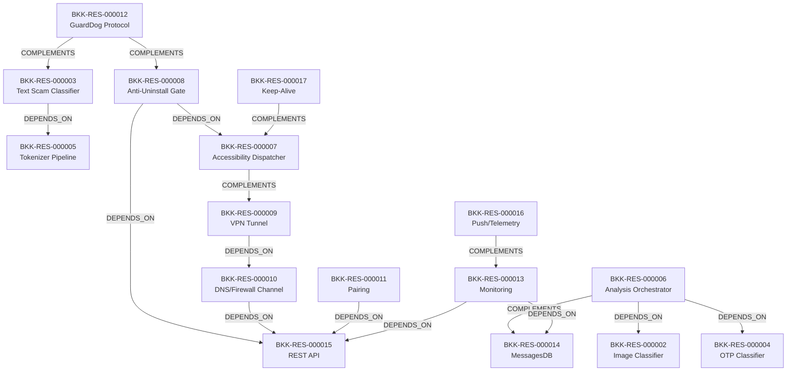

# خريطة الموارد المعمارية والقدرات الوظيفية — Bark Kids (T2 Resource Map)

> **المعرف:** `T2-BKK-MAP-001`
> **التطبيق:** Bark Kids (`bark-kids`) — `com.pt.bark`
> **إجمالي الموارد المعتمدة:** **18 مورداً معمارياً** (`BKK-RES-000001` إلى `BKK-RES-000018`)
> **إجمالي العلاقات البينية:** **16 علاقة** (`REL-000800` إلى `REL-000815`)
> **حالة التحقق:** `100% Schema Compliant`

---

## 1. الفهرس الشامل للموارد المعمارية الـ 18

| المعرف | اسم المورد المعماري | التصنيف المعياري | العمق الفني | استراتيجية إعادة الاستخدام | المصادر المرتبطة | الأدلة المرتبطة |
|---|---|---|:---:|---|---|---|
| `BKK-RES-000001` | Manifest Foundation (Single-APK Child Agent) | Android Platform Integration | T1 | Architectural Reference | `BKK-SRC-000003` | `BKK-EVD-000001` |
| `BKK-RES-000002` | ONNX Image Classifier (Adult/Explicit Media) | Algorithms | T3 | Cleanroom Reimplementation | `BKK-SRC-027764` | `BKK-EVD-000003` |
| `BKK-RES-000003` | ONNX Text Scam Classifier (12 Labels) | Algorithms | T3 | Cleanroom Reimplementation | `BKK-SRC-027766` | `BKK-EVD-000005` |
| `BKK-RES-000004` | OTP Short-Code Spam Classifier (TF-IDF + ONNX) | Algorithms | T3 | Cleanroom Reimplementation | `BKK-SRC-027774` | `BKK-EVD-000007` |
| `BKK-RES-000005` | HuggingFace Tokenizer + Text Preprocessing Pipeline | Algorithms | T2 | Cleanroom Adaptation | `BKK-SRC-027768` | `BKK-EVD-000006` |
| `BKK-RES-000006` | On-Device Analysis Orchestrator (AnalysisManager) | Engines & Services | T2 | Cleanroom Reimplementation | `BKK-SRC-024767` | `BKK-EVD-000008` |
| `BKK-RES-000007` | Accessibility Event Dispatcher (~57 Per-App Helpers) | Engines & Services | T3 | Cleanroom Adaptation | `BKK-SRC-024939` | `BKK-EVD-000011` |
| `BKK-RES-000008` | Device-Code Anti-Uninstall Gate | Security & Cryptography | T3 | Cleanroom Reimplementation | `BKK-SRC-024950` | `BKK-EVD-000012` |
| `BKK-RES-000009` | VPN Service + RLTUN Native Tunnel (Web Filtering) | Network & API | T3 | Architectural Reference | `BKK-SRC-024958` | `BKK-EVD-000014` |
| `BKK-RES-000010` | DNS/Firewall Verdict Channel (screentime API) | Network & API | T2 | Conceptual Reference | `BKK-SRC-000016` | `BKK-EVD-000014` |
| `BKK-RES-000011` | Device-Code Pairing & Activation Flow | Authentication & Authorization | T2 | Cleanroom Reimplementation | `BKK-SRC-024716` | `BKK-EVD-000015` |
| `BKK-RES-000012` | GuardDog Companion Protocol (Signed Broadcasts) | Realtime & Messaging | T2 | Architectural Reference | `BKK-SRC-027778` | `BKK-EVD-000016` |
| `BKK-RES-000013` | Monitoring Surface (19 Workers + Services) | Features & Business Rules | T2 | Cleanroom Adaptation | `BKK-SRC-024744` | `BKK-EVD-000017` |
| `BKK-RES-000014` | MessagesDB Local Store + Upload Queue | Synchronization & Offline | T2 | Cleanroom Reimplementation | `BKK-SRC-024744` | `BKK-EVD-000017` |
| `BKK-RES-000015` | REST API Surface (v2 + data + screentime) | Network & API | T2 | Conceptual Reference | `BKK-SRC-024891` | `BKK-EVD-000018` |
| `BKK-RES-000016` | Push & Crash Telemetry (OneSignal/FCM/Sentry) | Realtime & Messaging | T2 | Architectural Reference | `BKK-SRC-024898` | `BKK-EVD-000018` |
| `BKK-RES-000017` | Keep-Alive & Watchdog Package | Synchronization & Offline | T2 | Architectural Reference | `BKK-SRC-024958` | `BKK-EVD-000001` |
| `BKK-RES-000018` | Security Anti-Patterns Catalog (Explicitly Rejected) | Security & Cryptography | T2 | Rejected — Do Not Reuse | `BKK-SRC-000003` | `BKK-EVD-000018` |

> **ملاحظة المصادر:** `BKK-SRC-*` رموز منطقية تجمع ملفات؛ التفصيل الفيزيائي الكامل في `sources.json` (مدخلات `BKK-SRC-000001…`).

---

## 2. شبكة العلاقات البينية الـ 16 (Inter-Resource Relationships Graph)

### سجل العلاقات الـ 16:
- `REL-000800`: `BKK-RES-000003` (Text Scam Classifier) `DEPENDS_ON` `BKK-RES-000005` (Tokenizer Pipeline)
- `REL-000801`: `BKK-RES-000006` (Analysis Orchestrator) `DEPENDS_ON` `BKK-RES-000002` (Image Classifier)
- `REL-000802`: `BKK-RES-000006` (Analysis Orchestrator) `DEPENDS_ON` `BKK-RES-000004` (OTP Classifier)
- `REL-000803`: `BKK-RES-000006` (Analysis Orchestrator) `COMPLEMENTS` `BKK-RES-000014` (MessagesDB)
- `REL-000804`: `BKK-RES-000008` (Anti-Uninstall Gate) `DEPENDS_ON` `BKK-RES-000007` (Accessibility Dispatcher)
- `REL-000805`: `BKK-RES-000008` (Anti-Uninstall Gate) `DEPENDS_ON` `BKK-RES-000015` (REST API)
- `REL-000806`: `BKK-RES-000009` (VPN Tunnel) `DEPENDS_ON` `BKK-RES-000010` (DNS/Firewall Channel)
- `REL-000807`: `BKK-RES-000010` (DNS/Firewall Channel) `DEPENDS_ON` `BKK-RES-000015` (REST API)
- `REL-000808`: `BKK-RES-000011` (Pairing) `DEPENDS_ON` `BKK-RES-000015` (REST API)
- `REL-000809`: `BKK-RES-000013` (Monitoring) `DEPENDS_ON` `BKK-RES-000015` (REST API)
- `REL-000810`: `BKK-RES-000013` (Monitoring) `DEPENDS_ON` `BKK-RES-000014` (MessagesDB)
- `REL-000811`: `BKK-RES-000012` (GuardDog Protocol) `COMPLEMENTS` `BKK-RES-000008` (Anti-Uninstall Gate)
- `REL-000812`: `BKK-RES-000012` (GuardDog Protocol) `COMPLEMENTS` `BKK-RES-000003` (Text Scam Classifier)
- `REL-000813`: `BKK-RES-000007` (Accessibility Dispatcher) `COMPLEMENTS` `BKK-RES-000009` (VPN Tunnel)
- `REL-000814`: `BKK-RES-000017` (Keep-Alive) `COMPLEMENTS` `BKK-RES-000007` (Accessibility Dispatcher)
- `REL-000815`: `BKK-RES-000016` (Push/Telemetry) `COMPLEMENTS` `BKK-RES-000013` (Monitoring)
