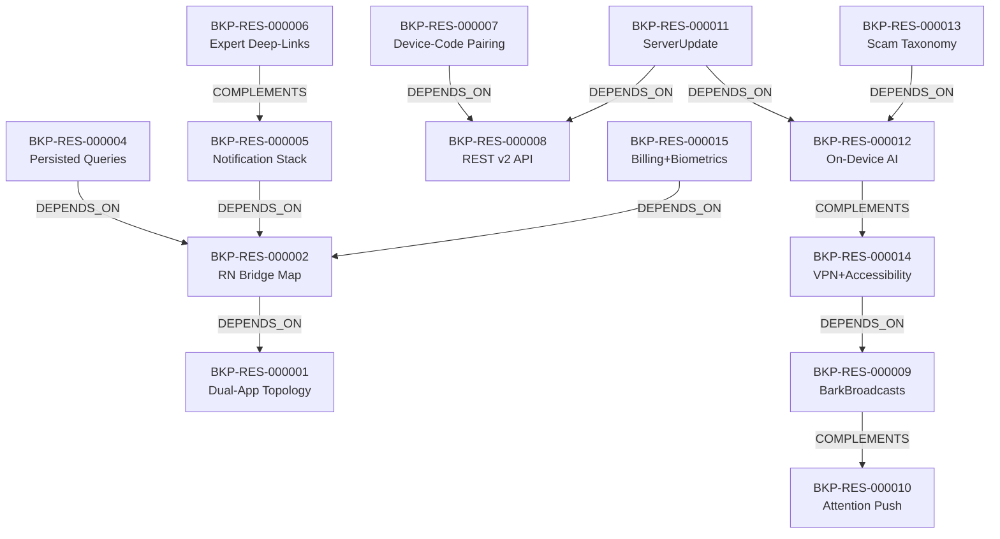

# خريطة الموارد المعمارية والقدرات الوظيفية — Bark (T2 Resource Map)

> **المعرف:** `T2-BKP-MAP-001`
> **التطبيق:** Bark Parental Controls (`bark`) — الأب (RN) + الطفل (Kotlin أصلي)
> **إجمالي الموارد المعتمدة:** **16 مورداً معمارياً** (`BKP-RES-000001` إلى `BKP-RES-000016`)
> **إجمالي العلاقات البينية:** **12 علاقة** (`REL-000300` إلى `REL-000311`)
> **حالة التحقق:** `Schema Compliant`

---

## 1. الفهرس الشامل للموارد المعمارية الـ 16

| المعرف | اسم المورد المعماري | التصنيف المعياري | العمق الفني | استراتيجية إعادة الاستخدام | المصادر المرتبطة | الأدلة المرتبطة |
|---|---|---|:---:|---|---|---|
| `BKP-RES-000001` | Dual-App RN+Native Topology (Parent RN / Child Kotlin) | Android Platform Integration | T1 | Architectural Reference | `BKP-SRC-P-MANIFEST` | `BKP-EVD-000001` |
| `BKP-RES-000002` | RN Bridge Package Map (20 Native Packages) | Android Platform Integration | T3 | Cleanroom Adaptation | `BKP-SRC-P-PACKAGELIST` | `BKP-EVD-000002` |
| `BKP-RES-000003` | RNCConfig Environment Bridge (BuildConfig Reflection) | Android Platform Integration | T3 | Cleanroom Reimplementation | `BKP-SRC-P-RNCCONFIG` | `BKP-EVD-000003` |
| `BKP-RES-000004` | GraphQL Persisted Queries (Apollo SHA256) | Network & API | T2 | Cleanroom Reimplementation | `BKP-SRC-P-BUNDLE` | `BKP-EVD-000004` |
| `BKP-RES-000005` | Parent Notification Stack (OneSignal + Iterable + Dual Sentry) | Realtime & Messaging | T2 | Conceptual Reference | `BKP-SRC-P-NOTIF` | `BKP-EVD-000005` |
| `BKP-RES-000006` | Expert-Content Deep-Link Graph (~140 bark.us Paths) | Features & Business Rules | T2 | Cleanroom Adaptation | `BKP-SRC-P-DEEPLINK` | `BKP-EVD-000006` |
| `BKP-RES-000007` | Device-Code Pairing Flow (POST login, password=code) | Authentication & Authorization | T3 | Cleanroom Reimplementation | `BKP-SRC-C-PAIRING` | `BKP-EVD-000007` |
| `BKP-RES-000008` | Bark REST v2 API (3 Hosts, Token Auth, 16 Endpoints) | Network & API | T3 | Cleanroom Reimplementation | `BKP-SRC-C-API` | `BKP-EVD-000008` |
| `BKP-RES-000009` | BarkBroadcasts Command Vocabulary (~50 Actions) | Realtime & Messaging | T3 | Cleanroom Adaptation | `BKP-SRC-C-BROADCASTS` | `BKP-EVD-000009` |
| `BKP-RES-000010` | Attention Push + Geofence Refresh (OneSignal Extension) | Realtime & Messaging | T3 | Cleanroom Reimplementation | `BKP-SRC-C-PUSH` | `BKP-EVD-000010` |
| `BKP-RES-000011` | ServerUpdate Upload Pipeline (Gates + Idempotency) | Synchronization & Offline | T3 | Cleanroom Reimplementation | `BKP-SRC-C-UPLOAD` | `BKP-EVD-000011` |
| `BKP-RES-000012` | On-Device AI Engine (ONNX Models + us.bark.sdk.analysis) | Algorithms | T3 | Cleanroom Reimplementation | `BKP-SRC-C-AI` | `BKP-EVD-000012` |
| `BKP-RES-000013` | Scam Taxonomy (12 Labels, 0.97 Threshold) | Data Models & Schemas | T3 | Cleanroom Adaptation | `BKP-SRC-C-TAXONOMY` | `BKP-EVD-000013` |
| `BKP-RES-000014` | VPN + Accessibility Dual-Stack Enforcement | Engines & Services | T2 | Architectural Reference | `BKP-SRC-C-ENFORCE` | `BKP-EVD-000014` |
| `BKP-RES-000015` | NitroIAP Billing + Biometric Parent Gate | Authentication & Authorization | T2 | Conceptual Reference | `BKP-SRC-P-BILLING` | `BKP-EVD-000015` |
| `BKP-RES-000016` | Security Anti-Patterns Catalog (Explicitly Rejected) | Security & Cryptography | T2 | Rejected — Do Not Reuse | `BKP-SRC-C-SECURITY` | `BKP-EVD-000016` |

> **ملاحظة المصادر:** `BKP-SRC-*` رموز منطقية تجمع ملفات؛ التفصيل الفيزيائي الكامل في `sources.json` (مدخلات `BKP-SRC-000001…`).

---

## 2. شبكة العلاقات البينية الـ 12 (Inter-Resource Relationships Graph)

| العلاقة | النوع | الوصف |
|---|---|---|
| `REL-000300` | DEPENDS_ON | خريطة الجسر الأصلي تعتمد طوبولوجيا الأب الـ RN |
| `REL-000301` | DEPENDS_ON | الاستعلامات المحفوظة تُنفَّذ عبر جسر RN |
| `REL-000302` | DEPENDS_ON | حزمة الإشعارات (OneSignal الأصلي) مربوطة عبر الجسر |
| `REL-000303` | COMPLEMENTS | روابط المحتوى الخبير تكمّل التنبيهات (تنبيه ← صفحة إرشاد) |
| `REL-000304` | DEPENDS_ON | الإقران برمز الجهاز يستخدم REST v2 |
| `REL-000305` | COMPLEMENTS | مفردات البث تكمّل الدفع الصامت (أوامر داخلية بعد إشارة خارجية) |
| `REL-000306` | DEPENDS_ON | خط الرفع يعتمد REST v2 |
| `REL-000307` | DEPENDS_ON | خط الرفع يحمل نتائج ذكاء الجهاز (`scores`) |
| `REL-000308` | DEPENDS_ON | تصنيف الاحتيال يعتمد محرك ONNX |
| `REL-000309` | DEPENDS_ON | الإنفاذ الثنائي يستهلك أوامر `BarkBroadcasts` |
| `REL-000310` | COMPLEMENTS | الذكاء على الجهاز يكمّل الإنفاذ (كشف ← إجراء) |
| `REL-000311` | DEPENDS_ON | الفوترة والبصمة وحدات أصلية عبر الجسر |

---

## 3. ملاحظات المعمارية العابرة للتطبيقين

1. **الأب "رقيق" عمداً:** كل الذكاء والإنفاذ في الطفل/السحابة — الأب مجرد عميل GraphQL + إشعارات. هذا يبسّط بوابة الأهل في Family OS.
2. **الطفل "سميك":** VPN + Accessibility + ONNX + REST + بثوث داخلية — وكيل متكامل يُقتبس كمرجع لوكيل Family OS (مع Device Owner بدل رمز الجهاز).
3. **السحابة هي العقد:** لا بروتوكول مباشر أب↔طفل في أي طبقة — حتى "وضع الانتباه" يمر عبر OneSignal.
