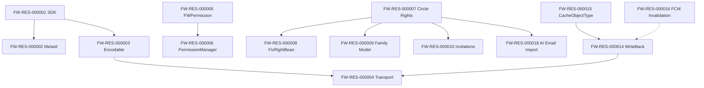

# خريطة الموارد المعمارية والقدرات الوظيفية — FamilyWall (T2 Resource Map)

> **المعرف:** `T2-FW-MAP-001`
> **التطبيق:** FamilyWall (`familywall`) — `com.familywall`
> **إجمالي الموارد المعتمدة:** **20 مورداً معمارياً** (`FW-RES-000001` إلى `FW-RES-000020`)
> **إجمالي العلاقات البينية:** **14 علاقة** (`REL-000400` إلى `REL-000413`)
> **حالة التحقق:** `Schema Compliant`

---

## 1. الفهرس الشامل للموارد المعمارية الـ 20

| المعرف | اسم المورد المعماري | التصنيف المعياري | العمق الفني | استراتيجية إعادة الاستخدام |
|---|---|---|:---:|---|
| `FW-RES-000001` | Typed Domain SDK Foundation (27 Namespaces) | Architecture & Layering | T1 | Cleanroom Reimplementation |
| `FW-RES-000002` | MetaId Unified Identity System (~90 Types) | Data Models & Schemas | T3 | Cleanroom Reimplementation |
| `FW-RES-000003` | @Encodable Codec Contract System | Network & API | T3 | Cleanroom Reimplementation |
| `FW-RES-000004` | IApiClientRequest Transport Abstraction | Network & API | T2 | Cleanroom Adaptation |
| `FW-RES-000005` | FWPermission OS-Permission UX Bundles (11) | Android Platform Integration | T3 | Direct Copy |
| `FW-RES-000006` | PermissionManager Enforcement Engine | Android Platform Integration | T3 | Direct Copy |
| `FW-RES-000007` | Server-Side Circle Rights (FamilyAdminRightEnum + IAdminApi) | Authentication & Authorization | T3 | Cleanroom Reimplementation |
| `FW-RES-000008` | FizRightBean Per-Object Rights Model | Authentication & Authorization | T2 | Direct Copy |
| `FW-RES-000009` | Family Data Model (IFamilyMember/IExtendedFamilyMember/CircleInfo) | Data Models & Schemas | T2 | Cleanroom Reimplementation |
| `FW-RES-000010` | Invitation State Machine (IInvitation + Statuses) | Features & Business Rules | T2 | Cleanroom Reimplementation |
| `FW-RES-000011` | RecurrencyDescriptor Recurrence Engine | Algorithms | T3 | Direct Copy |
| `FW-RES-000012` | Reminder/Attendee/Calendar Schema Set | Data Models & Schemas | T2 | Cleanroom Reimplementation |
| `FW-RES-000013` | Task & List Domain (TaskSuggestionBean, TaskListTypeEnum) | Features & Business Rules | T2 | Cleanroom Reimplementation |
| `FW-RES-000014` | WriteBack Sync Engine (4 SQLite Tables + Jobs Queue) | Synchronization & Offline | T3 | Direct Copy |
| `FW-RES-000015` | CacheObjectType Capability Matrix (~50 Types) | Synchronization & Offline | T3 | Cleanroom Reimplementation |
| `FW-RES-000016` | FCM Cache-Invalidation Push Plane | Realtime & Messaging | T2 | Cleanroom Adaptation |
| `FW-RES-000017` | OS Sync Adapters (Contacts + Calendar) | Android Platform Integration | T2 | Architectural Reference |
| `FW-RES-000018` | AI Email-to-Event Import (Family Email / iaimportemail) | Features & Business Rules | T2 | Cleanroom Reimplementation |
| `FW-RES-000019` | AccountManager Authentication Integration | Authentication & Authorization | T2 | Cleanroom Adaptation |
| `FW-RES-000020` | Security Anti-Patterns Catalog (Explicitly Rejected) | Security & Cryptography | T2 | Rejected — Do Not Reuse |

---

## 2. شبكة العلاقات البينية الـ 14

| المعرف | المصدر → الهدف | النوع | الوصف |
|---|---|---|---|
| `REL-000400` | FW-RES-000002 → FW-RES-000001 | DEPENDS_ON | الهوية الموحدة تُعرَّف داخل SDK النطاق |
| `REL-000401` | FW-RES-000003 → FW-RES-000001 | DEPENDS_ON | نظام الترميز يخدّم عقود الـ SDK |
| `REL-000402` | FW-RES-000004 → FW-RES-000003 | DEPENDS_ON | النقل يستهلك عقود الترميز |
| `REL-000403` | FW-RES-000006 → FW-RES-000005 | DEPENDS_ON | المحرك يستهلك حزم الـ enum |
| `REL-000404` | FW-RES-000008 → FW-RES-000007 | COMPLEMENTS | حقوق الكائن تكمّل حقوق الدائرة الخادمية |
| `REL-000405` | FW-RES-000007 → FW-RES-000009 | DEPENDS_ON | الحقوق تُمنح على كيانات نموذج العائلة |
| `REL-000406` | FW-RES-000010 → FW-RES-000007 | DEPENDS_ON | الدعوات تمنح `adminRights` عند الإصدار |
| `REL-000407` | FW-RES-000014 → FW-RES-000015 | DEPENDS_ON | WriteBack يُنفَّذ حسب مصفوفة قدرات الكاش |
| `REL-000408` | FW-RES-000016 → FW-RES-000014 | COMPLEMENTS | إبطال الدفع يكمّل الكتابة الراجعة |
| `REL-000409` | FW-RES-000014 → FW-RES-000004 | DEPENDS_ON | المزامنة تركب طبقة النقل |
| `REL-000410` | FW-RES-000018 → FW-RES-000007 | DEPENDS_ON | تفعيل Family Email مقيّد بمدير الدائرة |
| `REL-000411` | FW-RES-000011 → FW-RES-000012 | COMPLEMENTS | محرك التكرار يكمّل مخطط التقويم |
| `REL-000412` | FW-RES-000019 → FW-RES-000004 | DEPENDS_ON | المصادقة تغذّي طلبات النقل |
| `REL-000413` | FW-RES-000017 → FW-RES-000014 | COMPLEMENTS | محوّلات النظام تكمّل مخزن المزامنة |

---

## 3. ملاحظات التغطية

- الموارد `FW-RES-000002/3/5/6/7/11/14/15` عمق T3 (قُرئ كودها سطراً بسطر أو من smali الكامل).
- `FW-RES-000020` توثّق المرفوضات: `DebugReceiver` (4242)، المكوّنات المصدَّرة، مفاتيح الإعلانات.
