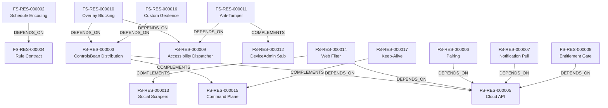

# خريطة الموارد المعمارية والقدرات الوظيفية — FamiSafe (T2 Resource Map)

> **المعرف:** `T2-FS-MAP-001`
> **التطبيق:** Wondershare FamiSafe (`famisafe`) — الأب + الطفل
> **إجمالي الموارد المعتمدة:** **18 مورداً معمارياً** (`FS-RES-000001` إلى `FS-RES-000018`)
> **إجمالي العلاقات البينية:** **14 علاقة** (`REL-000048` إلى `REL-000061`)
> **حالة التحقق:** `100% Schema Compliant`

---

## 1. الفهرس الشامل للموارد المعمارية الـ 18

| المعرف | اسم المورد المعماري | التصنيف المعياري | العمق الفني | استراتيجية إعادة الاستخدام | المصادر المرتبطة | الأدلة المرتبطة |
|---|---|---|:---:|---|---|---|
| `FS-RES-000001` | Dual-App Manifest Foundation (Parent + Child) | Android Platform Integration | T1 | Cleanroom Adaptation | `FS-SRC-P-MANIFEST` | `FS-EVD-000001` |
| `FS-RES-000002` | ScreenTimeTool Weekly Schedule Encoding Engine | Algorithms | T3 | Cleanroom Reimplementation | `FS-SRC-P-SCREENTIMETOOL` | `FS-EVD-000002` |
| `FS-RES-000003` | ControlsBean Cloud Distribution Model | Synchronization & Offline | T3 | Cleanroom Reimplementation | `FS-SRC-C-MAINSERVICE` | `FS-EVD-000003` |
| `FS-RES-000004` | Parent Rule Contract (DeviceRuleBean / App1 / ScreenTime1) | Data Models & Schemas | T2 | Cleanroom Reimplementation | `FS-SRC-P-RULEBEANS` | `FS-EVD-000004` |
| `FS-RES-000005` | Cloud REST API & MD5 Request Signing Layer | Network & API | T2 | Conceptual Reference | `FS-SRC-P-APICONSTANT` | `FS-EVD-000005` |
| `FS-RES-000006` | Match-Code Device Pairing Flow | Authentication & Authorization | T2 | Cleanroom Reimplementation | `FS-SRC-P-PAIRCODE` | `FS-EVD-000006` |
| `FS-RES-000007` | Parent Notification Pull Pipeline | Realtime & Messaging | T2 | Cleanroom Reimplementation | `FS-SRC-P-NOTIFY` | `FS-EVD-000007` |
| `FS-RES-000008` | Subscription & Entitlement Gate (isVip) | Authentication & Authorization | T2 | Conceptual Reference | `FS-SRC-P-BILLING` | `FS-EVD-000008` |
| `FS-RES-000009` | Child Accessibility Dispatcher (SCAccessibilityService + Manager) | Engines & Services | T3 | Cleanroom Reimplementation | `FS-SRC-C-ACCESS` | `FS-EVD-000009` |
| `FS-RES-000010` | Overlay Blocking Engine (No-Kill Policy) | Engines & Services | T3 | Cleanroom Adaptation | `FS-SRC-C-BLOCK` | `FS-EVD-000010` |
| `FS-RES-000011` | Anti-Tamper Battery (AppDefenceUtils, 9 Defences) | Security & Cryptography | T3 | Cleanroom Adaptation | `FS-SRC-C-DEFENCE` | `FS-EVD-000011` |
| `FS-RES-000012` | DeviceAdmin force-lock Stub Receiver | Android Platform Integration | T2 | Architectural Reference | `FS-SRC-C-DEVICEADMIN` | `FS-EVD-000012` |
| `FS-RES-000013` | Social Content Scrapers (~38 Package Monitors) | Features & Business Rules | T2 | Conceptual Reference | `FS-SRC-C-SCRAPERS` | `FS-EVD-000013` |
| `FS-RES-000014` | Server-Verdict Web Filter (10s Blocking Check) | Security & Cryptography | T2 | Cleanroom Reimplementation | `FS-SRC-C-WEBFILTER` | `FS-EVD-000014` |
| `FS-RES-000015` | FCM + WebSocket Command Plane (30 Actions) | Realtime & Messaging | T3 | Cleanroom Reimplementation | `FS-SRC-C-PUSH` | `FS-EVD-000015` |
| `FS-RES-000016` | Custom On-Device Geofence (No Google API) | Algorithms | T3 | Cleanroom Reimplementation | `FS-SRC-C-GEOFENCE` | `FS-EVD-000016` |
| `FS-RES-000017` | Keep-Alive & Battery-Evasion Package | Synchronization & Offline | T2 | Architectural Reference | `FS-SRC-C-KEEPALIVE` | `FS-EVD-000017` |
| `FS-RES-000018` | Security Anti-Patterns Catalog (Explicitly Rejected) | Security & Cryptography | T2 | Rejected — Do Not Reuse | `FS-SRC-P-SECURITY` | `FS-EVD-000018` |

> **ملاحظة المصادر:** `FS-SRC-*` رموز منطقية تجمع ملفات؛ التفصيل الفيزيائي الكامل في `sources.json` (مدخلات `FS-SRC-000001…`).

---

## 2. شبكة العلاقات البينية الـ 14 (Inter-Resource Relationships Graph)

### سجل العلاقات الـ 14:
- `REL-000048`: `FS-RES-000002` (Schedule Encoding) `DEPENDS_ON` `FS-RES-000004` (Rule Contract)
- `REL-000049`: `FS-RES-000003` (ControlsBean Distribution) `DEPENDS_ON` `FS-RES-000005` (Cloud API)
- `REL-000050`: `FS-RES-000003` (ControlsBean Distribution) `COMPLEMENTS` `FS-RES-000015` (Command Plane)
- `REL-000051`: `FS-RES-000010` (Overlay Blocking) `DEPENDS_ON` `FS-RES-000009` (Accessibility Dispatcher)
- `REL-000052`: `FS-RES-000010` (Overlay Blocking) `DEPENDS_ON` `FS-RES-000003` (ControlsBean Distribution)
- `REL-000053`: `FS-RES-000011` (Anti-Tamper) `DEPENDS_ON` `FS-RES-000009` (Accessibility Dispatcher)
- `REL-000054`: `FS-RES-000011` (Anti-Tamper) `COMPLEMENTS` `FS-RES-000012` (DeviceAdmin Stub)
- `REL-000055`: `FS-RES-000014` (Web Filter) `DEPENDS_ON` `FS-RES-000005` (Cloud API)
- `REL-000056`: `FS-RES-000014` (Web Filter) `COMPLEMENTS` `FS-RES-000013` (Social Scrapers)
- `REL-000057`: `FS-RES-000016` (Custom Geofence) `DEPENDS_ON` `FS-RES-000003` (ControlsBean Distribution)
- `REL-000058`: `FS-RES-000006` (Pairing) `DEPENDS_ON` `FS-RES-000005` (Cloud API)
- `REL-000059`: `FS-RES-000007` (Notification Pull) `DEPENDS_ON` `FS-RES-000005` (Cloud API)
- `REL-000060`: `FS-RES-000008` (Entitlement Gate) `DEPENDS_ON` `FS-RES-000005` (Cloud API)
- `REL-000061`: `FS-RES-000017` (Keep-Alive) `COMPLEMENTS` `FS-RES-000015` (Command Plane)
