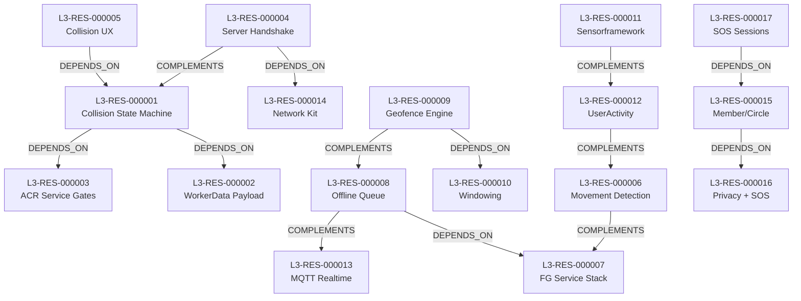

# خريطة الموارد المعمارية والقدرات الوظيفية — Life360 (T2 Resource Map)

> **المعرف:** `T2-L3-MAP-001`
> **التطبيق:** Life360 (`life360`) — `com.life360.android.safetymapd` v26.41.0
> **إجمالي الموارد المعتمدة:** **18 مورداً معمارياً** (`L3-RES-000001` إلى `L3-RES-000018`)
> **إجمالي العلاقات البينية:** **14 علاقة** (`L3-REL-200` إلى `L3-REL-213`)
> **حالة التحقق:** `100% Schema Compliant`

---

## 1. الفهرس الشامل للموارد المعمارية الـ 18

| المعرف | اسم المورد المعماري | التصنيف المعياري | العمق الفني | استراتيجية إعادة الاستخدام | المصادر المرتبطة | الأدلة المرتبطة |
|---|---|---|:---:|---|---|---|
| `L3-RES-000001` | Collision State Machine (WORK_STATE × 3 + Transitions) | Engines & Services | T3 | Cleanroom Reimplementation | `L3-SRC-WORKSTATE` | `L3-EVD-000001` |
| `L3-RES-000002` | CollisionResponseWorkerData (Gson State Payload) | Data Models & Schemas | T3 | Cleanroom Reimplementation | `L3-SRC-WORKERDATA` | `L3-EVD-000002` |
| `L3-RES-000003` | AutomaticCollisionResponseService (JobService Gates) | Android Platform Integration | T3 | Cleanroom Reimplementation | `L3-SRC-ACRSERVICE` | `L3-EVD-000003` |
| `L3-RES-000004` | Collision Server Handshake (GracePeriod + geofiltered) | Network & API | T3 | Cleanroom Reimplementation | `L3-SRC-HANDSHAKE` | `L3-EVD-000004` |
| `L3-RES-000005` | Collision UX Paths (Grace Countdown, Survey, CRASH_HELP) | Features & Business Rules | T3 | Cleanroom Adaptation | `L3-SRC-INTERACTOR` | `L3-EVD-000005` |
| `L3-RES-000006` | GPS-Free Movement Detection (WiFi BSSID + Cell Towers) | Algorithms | T3 | Cleanroom Reimplementation | `L3-SRC-MOVEMENT` | `L3-EVD-000006` |
| `L3-RES-000007` | Location Foreground Service Stack (EventController, :service) | Android Platform Integration | T2 | Architectural Reference | `L3-SRC-MANIFEST` | `L3-EVD-000007` |
| `L3-RES-000008` | Offline Location Queue (LocationRoomModel × 16 + LocationDao) | Synchronization & Offline | T3 | Cleanroom Reimplementation | `L3-SRC-LOCATIONROOM` | `L3-EVD-000008` |
| `L3-RES-000009` | GMS Geofence Engine (Dwell/Egress + 3 Receivers) | Engines & Services | T2 | Conceptual Reference | `L3-SRC-GEOFENCE` | `L3-EVD-000009` |
| `L3-RES-000010` | Geofence Windowing Config (exitGrace + reregister) | Algorithms | T3 | Cleanroom Reimplementation | `L3-SRC-WINDOWING` | `L3-EVD-000010` |
| `L3-RES-000011` | Sensorframework Event Abstraction (Parcelable Hierarchy) | Android Platform Integration | T2 | Architectural Reference | `L3-SRC-SENSORFW` | `L3-EVD-000011` |
| `L3-RES-000012` | UserActivity Taxonomy (8 States + is* Helpers) | Data Models & Schemas | T2 | Cleanroom Reimplementation | `L3-SRC-USERACTIVITY` | `L3-EVD-000012` |
| `L3-RES-000013` | Realtime Location over MQTT 5 (HiveMQ) | Realtime & Messaging | T3 | Cleanroom Adaptation | `L3-SRC-MQTT` | `L3-EVD-000013` |
| `L3-RES-000014` | l360networkkit (OkHttp + Interceptors + GPI) | Network & API | T2 | Architectural Reference | `L3-SRC-NETKIT` | `L3-EVD-000014` |
| `L3-RES-000015` | Member/Circle Data Model (role, isAdmin, CompoundCircleId) | Data Models & Schemas | T2 | Cleanroom Reimplementation | `L3-SRC-MEMBER` | `L3-EVD-000015` |
| `L3-RES-000016` | Privacy Settings + SOS Zone Deactivation | Authentication & Authorization | T2 | Cleanroom Reimplementation | `L3-SRC-PRIVACY` | `L3-EVD-000016` |
| `L3-RES-000017` | WatchOverMe SOS Session Contracts | Features & Business Rules | T2 | Conceptual Reference | `L3-SRC-SOS` | `L3-EVD-000017` |
| `L3-RES-000018` | Third-Party Dependency Catalog (Sentiance/Arity — Rejected) | Security & Cryptography | T2 | Rejected — Do Not Reuse | `L3-SRC-DEPS` | `L3-EVD-000018` |

> **ملاحظة المصادر:** `L3-SRC-*` رموز منطقية تجمع ملفات؛ التفصيل الفيزيائي الكامل في `sources.json` (مدخلات `L3-SRC-000001…`).

---

## 2. شبكة العلاقات البينية الـ 14 (Inter-Resource Relationships Graph)

### سجل العلاقات الـ 14:
- `L3-REL-200`: `L3-RES-000001` (Collision State Machine) `DEPENDS_ON` `L3-RES-000002` (WorkerData Payload)
- `L3-REL-201`: `L3-RES-000001` (Collision State Machine) `DEPENDS_ON` `L3-RES-000003` (ACR Service Gates)
- `L3-REL-202`: `L3-RES-000004` (Server Handshake) `DEPENDS_ON` `L3-RES-000014` (Network Kit)
- `L3-REL-203`: `L3-RES-000004` (Server Handshake) `COMPLEMENTS` `L3-RES-000001` (State Machine)
- `L3-REL-204`: `L3-RES-000005` (Collision UX) `DEPENDS_ON` `L3-RES-000001` (State Machine)
- `L3-REL-205`: `L3-RES-000006` (Movement Detection) `COMPLEMENTS` `L3-RES-000007` (FG Service Stack)
- `L3-REL-206`: `L3-RES-000008` (Offline Queue) `DEPENDS_ON` `L3-RES-000007` (FG Service Stack)
- `L3-REL-207`: `L3-RES-000008` (Offline Queue) `COMPLEMENTS` `L3-RES-000013` (MQTT Realtime)
- `L3-REL-208`: `L3-RES-000009` (Geofence Engine) `DEPENDS_ON` `L3-RES-000010` (Windowing)
- `L3-REL-209`: `L3-RES-000009` (Geofence Engine) `COMPLEMENTS` `L3-RES-000008` (Offline Queue)
- `L3-REL-210`: `L3-RES-000011` (Sensorframework) `COMPLEMENTS` `L3-RES-000012` (UserActivity)
- `L3-REL-211`: `L3-RES-000012` (UserActivity) `COMPLEMENTS` `L3-RES-000006` (Movement Detection)
- `L3-REL-212`: `L3-RES-000015` (Member/Circle) `DEPENDS_ON` `L3-RES-000016` (Privacy + SOS)
- `L3-REL-213`: `L3-RES-000017` (SOS Sessions) `DEPENDS_ON` `L3-RES-000015` (Member/Circle)
