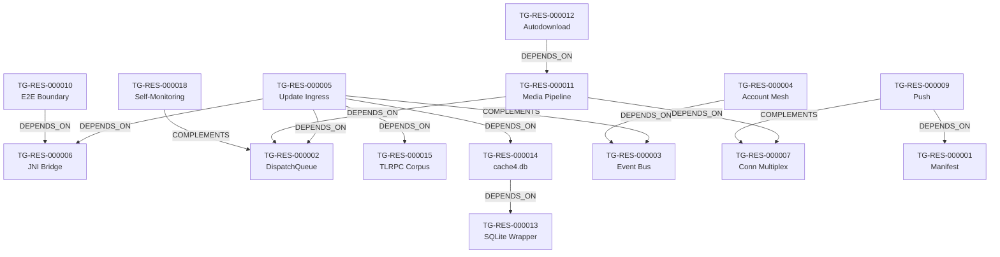

# خريطة الموارد المعمارية والقدرات الوظيفية — Telegram (T2 Resource Map)

> **المعرف:** `T2-TG-MAP-001`
> **التطبيق:** Telegram (`telegram`)
> **إجمالي الموارد المعتمدة:** **18 مورداً معمارياً** (`TG-RES-000001` إلى `TG-RES-000018`)
> **إجمالي العلاقات البينية:** **14 علاقة** (`TG-REL-100` إلى `TG-REL-113`)
> **حالة التحقق:** `100% Schema Compliant`

---

## 1. الفهرس الشامل للموارد المعمارية الـ 18

| المعرف | اسم المورد المعماري | التصنيف المعياري | العمق الفني | استراتيجية إعادة الاستخدام | المصادر المرتبطة | الأدلة المرتبطة |
|---|---|---|:---:|---|---|---|
| `TG-RES-000001` | Manifest Foundation (20A/31S/26R/7P/71perm) | Android Platform Integration | T1 | Architectural Reference | `TG-SRC-MANIFEST` | `TG-EVD-000001` |
| `TG-RES-000002` | DispatchQueue Managed-Thread Model | Concurrency & Threading | T3 | Cleanroom Reimplementation | `TG-SRC-DISPATCHQUEUE` | `TG-EVD-000002` |
| `TG-RES-000003` | NotificationCenter Event Bus (348 events) | Realtime & Messaging | T3 | Cleanroom Reimplementation | `TG-SRC-NOTIFCENTER` | `TG-EVD-000003` |
| `TG-RES-000004` | Multi-Account Singleton Mesh (AccountInstance[4]) | Architecture & Modularity | T2 | Cleanroom Reimplementation | `TG-SRC-ACCOUNT` | `TG-EVD-000004` |
| `TG-RES-000005` | Native Update Ingress Path (JNI→stageQueue→processUpdates) | Network & API | T3 | Cleanroom Reimplementation | `TG-SRC-INGRESS` | `TG-EVD-000005` |
| `TG-RES-000006` | ConnectionsManager JNI Bridge (27+ native_*) | Network & API | T2 | Architectural Reference | `TG-SRC-CMGR` | `TG-EVD-000006` |
| `TG-RES-000007` | Connection Multiplexing (5 types, 8 download conns) | Network & API | T2 | Cleanroom Reimplementation | `TG-SRC-CMGR` | `TG-EVD-000007` |
| `TG-RES-000008` | DNS-over-HTTPS Failover + DC Management | Network & API | T2 | Cleanroom Reimplementation | `TG-SRC-CMGR` | `TG-EVD-000008` |
| `TG-RES-000009` | Triple-Layer Push (native+FCM+Huawei, AES-IGE payloads) | Realtime & Messaging | T2 | Cleanroom Adaptation | `TG-SRC-PUSH` | `TG-EVD-000009` |
| `TG-RES-000010` | E2E Secret-Chat Crypto Boundary (AES-IGE, device-only keys) | Security & Cryptography | T3 | Cleanroom Adaptation | `TG-SRC-E2E` | `TG-EVD-000010` |
| `TG-RES-000011` | Media Pipeline (FileLoader: 32K/128K×4, prio queues) | Engines & Services | T3 | Cleanroom Reimplementation | `TG-SRC-MEDIA` | `TG-EVD-000011` |
| `TG-RES-000012` | Autodownload Policy Engine (per-network bitmasks) | Features & Business Rules | T2 | Cleanroom Reimplementation | `TG-SRC-MEDIA` | `TG-EVD-000012` |
| `TG-RES-000013` | Custom Native SQLite Wrapper (no ORM) | Data Models & Schemas | T2 | Cleanroom Reimplementation | `TG-SRC-SQLITE` | `TG-EVD-000013` |
| `TG-RES-000014` | cache4.db Schema + Hole Tracking (WAL, ~80 tables) | Data Models & Schemas | T3 | Cleanroom Reimplementation | `TG-SRC-DB` | `TG-EVD-000014` |
| `TG-RES-000015` | TLRPC Schema Corpus (80k lines, 2043 ctors) | Network & API | T2 | Conceptual Reference | `TG-SRC-TLRPC` | `TG-EVD-000015` |
| `TG-RES-000016` | 10M+ Scale Patterns Checklist (13 patterns) | Architecture & Modularity | T3 | Cleanroom Reimplementation | `TG-SRC-SCALE` | `TG-EVD-000016` |
| `TG-RES-000017` | VoIP Native Bridge (36 native methods) | Engines & Services | T2 | Architectural Reference | `TG-SRC-VOIP` | `TG-EVD-000017` |
| `TG-RES-000018` | Self-Monitoring (ANRDetector + getLastTaskTime) | Quality & Reliability | T2 | Cleanroom Reimplementation | `TG-SRC-QA` | `TG-EVD-000018` |

> **ملاحظة المصادر:** `TG-SRC-*` رموز منطقية تجمع ملفات؛ التفصيل الفيزيائي الكامل في `sources.json` (مدخلات `TG-SRC-000001…`).

---

## 2. شبكة العلاقات البينية الـ 14 (Inter-Resource Relationships Graph)

### سجل العلاقات الـ 14:
- `TG-REL-100`: `TG-RES-000005` (Update Ingress) `DEPENDS_ON` `TG-RES-000006` (JNI Bridge)
- `TG-REL-101`: `TG-RES-000005` (Update Ingress) `DEPENDS_ON` `TG-RES-000002` (DispatchQueue)
- `TG-REL-102`: `TG-RES-000005` (Update Ingress) `DEPENDS_ON` `TG-RES-000015` (TLRPC Corpus)
- `TG-REL-103`: `TG-RES-000005` (Update Ingress) `DEPENDS_ON` `TG-RES-000014` (cache4.db)
- `TG-REL-104`: `TG-RES-000005` (Update Ingress) `COMPLEMENTS` `TG-RES-000003` (Event Bus)
- `TG-REL-105`: `TG-RES-000004` (Account Mesh) `DEPENDS_ON` `TG-RES-000003` (Event Bus)
- `TG-REL-106`: `TG-RES-000011` (Media Pipeline) `DEPENDS_ON` `TG-RES-000002` (DispatchQueue)
- `TG-REL-107`: `TG-RES-000011` (Media Pipeline) `DEPENDS_ON` `TG-RES-000007` (Conn Multiplex)
- `TG-REL-108`: `TG-RES-000012` (Autodownload) `DEPENDS_ON` `TG-RES-000011` (Media Pipeline)
- `TG-REL-109`: `TG-RES-000009` (Push) `DEPENDS_ON` `TG-RES-000001` (Manifest)
- `TG-REL-110`: `TG-RES-000009` (Push) `COMPLEMENTS` `TG-RES-000007` (Conn Multiplex)
- `TG-REL-111`: `TG-RES-000010` (E2E Boundary) `DEPENDS_ON` `TG-RES-000006` (JNI Bridge)
- `TG-REL-112`: `TG-RES-000014` (cache4.db) `DEPENDS_ON` `TG-RES-000013` (SQLite Wrapper)
- `TG-REL-113`: `TG-RES-000018` (Self-Monitoring) `COMPLEMENTS` `TG-RES-000002` (DispatchQueue)
