# تقرير التغطية التحليلية وفجوات الأدلة لمنصة FamilyWall (Coverage & Gaps Report)
## الحزمة: BIP-03 — FamilyWall Full Inventory | المستودع: family-os-v2

> **تاريخ التقرير:** 2026-11-02  
> **مستوى الفحص:** T0–T3 Gap Analysis & Evidence Auditing  
> **التطبيق المستهدف:** FamilyWall (Android)  
> **حزمة المانيفست المعتمدة:** `com.familywall`  
> **الحجم الكلي الممسوح:** 962.15 MiB / 1,008.88 MB (1,008,882,813 بايت)  
> **المعرفات المرتبطة:** `FW-RES-000001` إلى `FW-RES-000015`, `FW-EVD-000001` إلى `FW-EVD-000015`

---

## 1. مصفوفة التغطية المادية والتحليلية (T0–T3 Coverage Matrix)

| المستوى | نطاق الفحص المستهدف | العدد المحقق | نسبة التغطية المادية | حالة التدقيق والاعتماد |
|---|---|---|---|---|
| **T0** | المسح الفيزيائي الشامل للمصادر | 103,133 ملفاً | **100%** | مسح قطعي شامل (58 Git Tracked / 103,075 Local Only)، لا توجد شواذ. الحجم: 962.15 MiB (1,008.88 MB). |
| **T1** | تشريح المانيفست والحاويات الهيكلية | 249 مكوناً + 2 ملف DEX | **100%** | فحص كامل لـ `AndroidManifest.xml` وحسم حقيقة ملفات DEX (2 في `_target_dex/` مقابل 11 في Smali). |
| **T2** | جرد الموارد والقدرات المعمارية | 16 مورداً معمارياً | **100%** | جرد شامل وتصنيف موحد لـ 16 قدرة معمارية (12 Level A، و 2 Level B، و 2 Level B/C). |
| **T3** | التحليل الجراحي للمحركات والـ APIs | 6 محركات + كتالوج API المصنف بالأقسام الأربعة | **100%** | فحص الكود المصدري الأصلي في `03_decompiled_src/` وتطهير الشوائب والـ 49 مدخلاً مشوهاً. |

---

## 2. حدود ومستويات الإثبات المعتمدة (Provenance Tier Boundaries)

تم فرض حدود صارمة بين مستويات الأدلة لضمان عدم حدوث أي تضليل أو خلط معرفي:

```mermaid
graph TD
    subgraph "Level A (أدلة أصلية مباشرة من APK)"
        LA1["AndroidManifest.xml (43 إذناً و 249 مكوناً)"]
        LA2["03_decompiled_src/ (7,032 ملف Java)"]
        LA3["_target_dex/ (classes6.dex و classes7.dex)"]
        LA4["_apktool_raw/ (11 مجلد smali و XML الموارد)"]
        LA5["الأصول: ألوان (1341)، لوتي (41)، رسومات (127)، صوتيات (10)"]
    end

    subgraph "Level B (نماذج مشتقة موجهة لـ Family OS)"
        LB1["04_extracted_algorithms/ (خوارزميات Kotlin الثلاث)"]
        LB2["05_data_models_and_schemas/local_db_schema.sql (11 جدولاً)"]
        LB3["05_data_models_and_schemas/api_dto_models.ts"]
    end

    subgraph "Level C (فرضيات واستنتاجات ذات أدلة جزئية)"
        LC1["[PARTIAL-EVIDENCE] عدم وجود موديول kid_account منفصل ككود أصلي"]
        LC2["[PARTIAL-EVIDENCE] خوادم السحابة وقواعد بيانات الخادم الخلفية"]
        LC3["[PARTIAL-EVIDENCE] التشفير الطرفي E2EE (غير مرصود في المفكك دون نفي قطعي)"]
        LC4["[PARTIAL-EVIDENCE] الامتثال التام لـ RFC 5545 (تطبيق ical4j أساسي دون حسم الحالات الشاذة)"]
    end

    LA1 --> INV["حزمة جرد FamilyWall (BIP-03)"]
    LA2 --> INV
    LA3 --> INV
    LA4 --> INV
    LA5 --> INV
    LB1 -. "نماذج موجهة لـ Family OS (لا تُعد دليلاً على APK)" .-> INV
    LB2 -. "نماذج موجهة لـ Family OS (لا تُعد دليلاً على APK)" .-> INV
    LB3 -. "نماذج موجهة لـ Family OS (لا تُعد دليلاً على APK)" .-> INV
    LC1 -. "تدقيق الفجوات والافتراضات" .-> INV
    LC2 -. "تدقيق الفجوات والافتراضات" .-> INV
    LC3 -. "تدقيق الفجوات والافتراضات" .-> INV
    LC4 -. "تدقيق الفجوات والافتراضات" .-> INV
```

---

## 3. حصر وتوثيق فجوات الأدلة المادية (Exact Evidence Gaps)

أثبت التدقيق الميداني وجود الفجوات والتحفظات التالية بدقة:

### 3.1. فجوة التفكيك الجزئي لحاويات Dalvik Executable (DEX Decompilation Gap)
- **الواقع المرصود:** حزمة التطبيق الأصلية احتوت على 11 ملف DEX (الموجودة ككود وسيط Smali في `_apktool_raw/smali` إلى `smali_classes11`).
- **الفجوة:** تم تشغيل أداة JADX فقط على الحاويتين `classes6.dex` و `classes7.dex` الموجودتين في `_target_dex/`، مما أنتج 7,032 ملف Java تغطي الأعمال المباشرة للتطبيق. أما بقية الحاويات (1-5 و 8-11) فلم تُترجم إلى Java وتوجد فقط بصيغة Smali.
- **الأثر على الجرد:** لا يوجد أثر سلبي على استيعاب المنطق الأساسي، حيث إن حزمة `com.familywall.*` بالكامل (2,436 كلاس) موجودة داخل Java في `03_decompiled_src/`.

### 3.2. فجوة بروتوكول الاتصال الشبكي Jeronimo FIZ RPC
- **الواقع المرصود:** صممت الشركة المطورة لـ FamilyWall طبقة اتصال ثنائية تدعى `com.jeronimo.fiz.*`.
- **الفجوة:** هذه الطبقة تقع داخل `smali_classes9` و `smali_classes10` ولم يتم تحويلها إلى Java. يتوفر فقط الكلاس المستدعي لها `ApiClientRequestFactory.java` في كود Java المفكك.
- **التوصية لـ Family OS:** لا يُنصح بفك تشفير أو محاكاة بروتوكول FIZ؛ إذ ستعتمد منصة Family OS على بروتوكولات معيارية موثوقة (REST / gRPC / WebSockets).

### 3.3. فجوة موديول حسابات الأطفال المفترض (`kid_account`)
- **الادعاء السابق:** افتراض وجود موديول برمجي أصلي مستقل في كود APK باسم `kid_account` يحتوي خوارزميات رمز PIN ذي الأربعة أرقام.
- **الفحص القطعي:** أثبت الفحص الشامل لـ `03_decompiled_src/` عدم وجود أي حزمة برمجية بهذا الاسم. منطق ترخيص حساب الطفل في الكود الأصلي (Level A) يتم عبر شاشة `EmailFromKidsAccountBottomSheetDialog.java` وإرسال طلب اعتماد لبريد الوالد. أما موديول الـ PIN والـ DTOs فهي نماذج هندسية مشتقة أُنشئت لـ Family OS (Level B).
- **التصنيف:** تم وسم هذه الفرضية بـ `[PARTIAL-EVIDENCE]` وإبقاؤها في Level C.

### 3.4. فجوة قواعد البيانات والخوادم الخلفية السحابية
- **الواقع المرصود:** الخوادم السحابية الخلفية (`api.familywall.com`) وقواعد البيانات المركزية هي أنظمة سحابية مغلقة خاصة بالشركة المطورة.
- **الفجوة:** لا يمكن فحص بنية قواعد بيانات الخادم أو منطقها الداخلي مباشرة من كود العميل.
- **التصنيف:** تم تصنيف كافة افتراضات الخادم كـ Level C، والاعتماد فقط على مخطط قاعدة البيانات المحلية SQLite (Level A/B) ومسارات واجهات البرمجة الموثقة (Level A).

### 3.5. تحفظ فحص التشفير الطرفي (E2EE Non-Conclusive Finding)
- **الواقع المرصود:** لم يظهر أي كود لتشفير طرفي معتمد (E2EE) في كود Java المفكك المتاح في `classes6.dex` و `classes7.dex`.
- **التحفظ العلمي:** **عدم الجزم بنفي E2EE قطعياً**؛ إذ لا يمكن استبعاد احتمال وجود آليات تشفير خاصة داخل حزم Jeronimo FIZ RPC المشفرة في كود Smali أو المكتبات الثنائية الأصلية C++. وعليه، يُصنف غياب E2EE كـ "عدم رصد في كود Java المفكك" وليس كـ "نفي قاطع".

### 3.6. تحفظ الامتثال التام لمواصفة التقويم RFC 5545
- **الواقع المرصود:** يستورد التطبيق مكتبة `ical4j` في `IcalEventTool.java` ويفسر حقول `VEvent`, `RRule`, `ExDate`, `RDate` للمزامنة مع أندرويد.
- **التحفظ العلمي:** **عدم الجزم بالامتثال الشامل لجميع تفاصيل ومعايير RFC 5545** (كالحالات الشاذة وحسابات المناطق الزمنية النادرة)؛ حيث إن الإثبات ينحصر في استدعاء المكتبة للأغراض المباشرة للتقويم العائلي.

---

## 4. تدقيق نتائج تطهير كتالوج نقاط النهاية (Purged Noise Audit)

تم عزل وتطهير كافة المداخل الـ 49 الملوثة السابقة في كتالوج الـ APIs وتوثيق أسباب استبعادها:
1. **استبعاد وسوم ومحددات HTML/CSS (30 مدخلاً):** نصوص شوائب مستخرجة من مكتبات معالجة الوسائط وضغط Brotli.
2. **استبعاد فضاءات تسمية XML (6 مداخل):** محددات أمان لمعالجات XML.
3. **استبعاد إرشادات معايير DASH (4 مداخل):** تابعة لمكتبة ExoPlayer.
4. **استبعاد روابط المحليات وروابط الاختبار (6 مداخل):** افتراضيات لمكتبات مفتوحة المصدر (`localhost:8080`, `dumblink.com`).
5. **استبعاد روابط الطرف الثالث (3 مداخل):** روابط خارجية ونوايا الخرائط.

---

## 5. الخلاصة وجاهزية بوابة الجودة

1. **سلامة T0–T3:** تم حصر وتوثيق كافة الأصول بنسبة 100% ومطابقتها على القرص بدقة (962.15 MiB / 1,008.88 MB).
2. **عزل مستويات الأدلة:** تم الفصل الكامل والواضح بين أدلة APK الأصلية (Level A)، ونماذج Family OS المشتقة (Level B)، والافتراضات التحليلية (Level C).
3. **الجاهزية التامة:** حزمة FamilyWall جاهزة بالكامل للاعتماد البرمجي الآلي والتحقق المستقل عبر `validate-program.py`.
