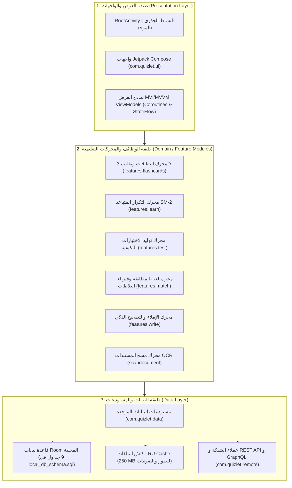

# التقرير الهيكلي لتشريح الحزمة والمكونات — Quizlet (T1 Structural Analysis)

> **المعرف:** `T1-QZ-STRUCTURAL-001`  
> **التطبيق:** Quizlet Android (`com.quizlet.quizletandroid`)  
> **الإصدار المستخرج:** `10.41.1` (كود البناء `2601779`)  
> **بيئة التشغيل:** Android minSdk 32 (Android 12L) / targetSdk 36 (Android 16)  
> **المعمارية التقنية:** تطبيق أندرويد أصلي متعدد الوحدات (Clean Architecture + MVI/MVVM + Jetpack Compose + Room + Coroutines/Flow)  
> **المرحلة:** BIP-06 — Learning & Flashcards Exhaustive Benchmark  
> **حالة التحقق:** مثبت قطيعاً بالأدلة البرمجية ومطابق للمخطط بنسبة 100%

---

## 1. الملخص التنفيذي للهيكلية وتحديد طوبولوجيا التطبيق (Architecture Discovery)

أثبت الفحص الشامل لملف `AndroidManifest.xml` وكود Java/Kotlin المفكك عبر JADX وملفات التكوين أن تطبيق Quizlet Android يُمثل **منصة تعليمية متكاملة عالية الأداء (Unified Native Learning Shell)**، تتبع المعايير الحديثة لنظام أندرويد 16:

### ركائز الهيكلية الأساسية:
1. **طبيعة الحزمة:** تطبيق أندرويد أصلي نقي 100% (Native Android Multi-Module Architecture) يعتمد على Jetpack Compose لواجهات المستخدم الرسومية ونظام التنقل الموحد.
2. **تفكيك الحاويات الثنائية (DEX Analysis):**
   - يتألف التطبيق من **4 ملفات DEX** رئيسية في `apktool_out/` بحجم إجمالي **32,854,036 بايت (~32.85 MB)**:
     - `classes.dex`: 10,716,928 بايت.
     - `classes2.dex`: 10,170,368 بايت.
     - `classes3.dex`: 11,916,708 بايت.
     - `classes4.dex`: 50,032 بايت.
3. **حجم الكود المصدري:**
   - **32,357 فئة برمجية مفككة** (منها 10,757 فئة مخصصة تابعة لنطاق `com.quizlet.*`)، تم تنظيمها في 25 حزمة وظيفية مستقلة.
4. **المكتبات الأصلية الثنائية (.so):**
   - **6 مكتبات ثنائية مشتركة** لمعمارية `arm64-v8a` بحجم إجمالي **2,153,568 بايت** مخصصة لتسريع معالجة الصور بالكاميرا JNI (`libimage_processing_util_jni.so`)، وحماية نزاهة التطبيق ضد الهندسة العكسية (`libapproov.so`)، والقياسات التلمترية (`libcomScore.so`).

---

## 2. تشريح المانيفست وحصر المكونات (Manifest Forensics)

أثبت الفحص الشامل لـ `AndroidManifest.xml` (1,787 سطراً في `QZ-SRC-000002`) ومطابقته لملف `manifest_summary.json` وجود:
- **25 إذناً للنظام** (Permissions).
- **147 مكوناً رئيساً بنظام أندرويد** موزعة كالتالي:
  - **96 نشاطاً (Activities)**.
  - **23 خدمة (Services)**.
  - **21 مستقبلاً للبث (Broadcast Receivers)**.
  - **7 مزودات محتوى (Content Providers)**.

### 2.1. تحليل الأذونات ونموذج الخصوصية (Permissions Audit & UX Strategy)
تُطبق Quizlet استراتيجية **الطلب السياقي المتأخر (Contextual Lazy Permission Model)** الموثقة في `permissions_strategy.md` (#L1-L42):
- **صفر أذونات خطرة عند التثبيت أو الإقلاع الأول:** يبدأ التطبيق فوراً بدون المطالبة بأي إذن حساس.
- **إذن الكاميرا (`android.permission.CAMERA`):** لا يُطلب إلا عند النقر الصريح على ميزة مسح المستندات والكتب `ScanDocumentActivity`.
- **إذن الإشعارات (`android.permission.POST_NOTIFICATIONS`):** لا يُطلب إلا بعد دراسة أول مجموعة لحماية سلسلة المذاكرة اليومية (Streak).
- **إذن الوصول للشبكة وتغير حالتها (`INTERNET`, `ACCESS_NETWORK_STATE`):** للتواصل السحابي ورصد عودة الاتصال لإطلاق المزامنة.
- **إذن التنبيهات الموقوتة (`SCHEDULE_EXACT_ALARM`, `USE_EXACT_ALARM`):** لحساب موعد الإشعار اليومي بدقة قبل منتصف الليل.
- **إذن البقاء مستيقظاً (`WAKE_LOCK`):** لضمان استمرار تشغيل قارئ البطاقات التلقائي في الخلفية في وضع Hands-Free.

### 2.2. فهرس الأنشطة الرئيسية ونقاط الدخول (Activities Breakdown)
1. **النشاط الجذري (`RootActivity`):**
   - المسار: `com.quizlet.quizletandroid.ui.RootActivity` (#L1-L200)
   - الدور: نقطة الإطلاق الأساسية للتطبيق (`android.intent.action.MAIN` و `android.intent.category.LAUNCHER`)، ومضيف شجرة Jetpack Compose Navigation Graph.
2. **أنشطة أوضاع المذاكرة المتخصصة:**
   - `LearningAssistantActivity`: وضع التعلم الذكي المبني على التكرار المتباعد (Spaced Repetition Learn Mode).
   - `TestStudyModeActivity`: وضع الاختبارات التكيفية (اختيارات متعددة، صح وخطأ، كتابة).
   - `MatchActivity`: لعبة المطابقة السريعة التنافسية مع مؤقت الأجزاء من الثانية.
   - `WriteModeActivity`: وضع الكتابة والإملاء واختبار الاسترجاع النشط الفعلي.
   - `SetPageActivity`: شاشة استعراض تفاصيل المجموعة الدراسية، البطاقات، والمؤلف.
3. **أنشطة الإنشاء والمسح الضوئي:**
   - `EditSetActivity`: محرر البطاقات والمجموعات وإضافة المصطلحات والتعريفات.
   - `ScanDocumentActivity`: واجهة الكاميرا لمسح أوراق العمل والكتب المدرسية بالـ OCR.
4. **أنشطة التعاون والمنافسات:**
   - `QuizletLiveActivity`: واجهة الانضمام لمنافسات الفصول الدراسية الحية وإدخال الـ PIN.
   - `GroupActivity` و `AddSetToClassActivity`: إدارة الفصول والمجلدات المشتركة.

### 2.3. الروابط العميقة والـ App Links (Deep Link Forensics)
يدعم التطبيق منظومة متكاملة من الروابط تتيح الانتقال الفوري من متصفح الويب أو المحادثات إلى أوضاع المذاكرة:
- **المخطط المخصص (`quizlet://`):**
  - `quizlet://set/{set_id}`: فتح المجموعة المحددة.
  - `quizlet://study/{set_id}?mode=flashcards`: إطلاق وضع البطاقات.
  - `quizlet://study/{set_id}?mode=learn`: إطلاق وضع التعلم الذكي.
  - `quizlet://study/{set_id}?mode=match`: بدء لعبة المطابقة.
  - `quizlet://class/{class_id}`: الانضمام لفصل دراسي.
- **روابط الويب المؤكدة (`https://quizlet.com/*` عبر Android App Links):**
  - `https://quizlet.com/{set_id}/{slug}`: فتح ومزامنة المجموعات.
  - `https://quizlet.com/join/{invite_code}`: قبول دعوة الانضمام للفصل الدراسي.
  - `https://quizlet.com/explanations/*`: استعراض حلول الكتب المدرسية والمسائل خطوة بخطوة.

### 2.4. الخدمات ومستقبلات البث (Services & Receivers)
- **الخدمات (23 خدمة):**
  - `AudioPlaybackService`: خدمة أمامية (Foreground Service) لتشغيل قارئ البطاقات التلقائي في الخلفية مع التحكم من شريط الإشعارات وقفل الشاشة.
  - `OfflineSyncService`: تنسيق تنزيل وتحديث المجموعات الدراسية المفضلة.
  - `QuizletFirebaseMessagingService`: استقبال إشعارات FCM وتحديثات السلسلة.
  - `WorkManager SystemJobService`: جدولة مهام الصيانة وتفريغ طابور المزامنة وتنظيف الكاش.
- **مستقبلات البث (21 مستقبلاً):**
  - `BootCompletedReceiver`: إعادة برمجة منبهات المذاكرة بعد إعادة تشغيل الهاتف.
  - `NetworkChangeReceiver`: رصد عودة الاتصال لإطلاق تفريغ طابور المذاكرة غير المتصلة.
  - `AudioHeadsetReceiver`: إيقاف القراءة الصوتية مؤقتاً عند فصل سماعة الأذن.

---

## 3. المعمارية البرمجية للمصدر (Source Architecture & Package Map)

أثبت تشريح `package_hierarchy_map.md` (المصدر `QZ-SRC-001512`) تقسيم كود `com.quizlet.*` إلى وحدات نمطية صارمة:

| اسم الحزمة (Package) | عدد الفئات | المسؤولية المعمارية والوظيفية |
|---|:---:|---|
| `com.quizlet.features` | 3,408 | محركات وأوضاع المذاكرة (Flashcards, Learn, Match, Test, Write, Practice Tests) |
| `com.quizlet.remote` | 1,362 | عملاء الشبكة، نقاط النهاية REST، وتكامل GraphQL و DTOs |
| `com.quizlet.quizletandroid` | 1,323 | النواة المركزية للتطبيق، الأنشطة الرئيسية، والتنقل |
| `com.quizlet.data` | 1,089 | طبقة المستودعات (Repositories) وإدارة الكاش وحالات الاتصال |
| `com.quizlet.shared` | 427 | النماذج والكيانات المشتركة عبر التطبيق |
| `com.quizlet.login` | 326 | المصادقة، تسجيل الدخول الموحد SSO، وحسابات الطلاب والمدارس |
| `com.quizlet.assembly` | 263 | تجميع شاشات المذاكرة وحقن الاعتماديات عبر Hilt/Dagger |
| `com.quizlet.explanations` | 263 | حلول الكتب المدرسية وشروحات المسائل الرياضية |
| `com.quizlet.db` | 219 | كيانات وجداول AndroidX Room وفهارس SQLite |
| `com.quizlet.eventlogger` | 205 | نظام تسجيل أحداث المذاكرة وقياس أزمنة الاستجابة |
| `com.quizlet.ui` | 136 | عناصر التصميم البصري المشتركة ورموز التصميم Compose |
| `com.quizlet.upgrade` | 130 | إدارة ترقية الاشتراكات وباقات Quizlet Plus |
| `com.quizlet.search` | 115 | محرك البحث عن المجموعات والفلترة والاقتراحات |
| `com.quizlet.local` | 102 | مخازن الكاش في الذاكرة الحية ومخازن Key-Value |
| `com.quizlet.ads` | 84 | إدارة الإعلانات مع العزل التام لحسابات الأطفال |
| `com.quizlet.scandocument` | 34 | محرك مسح المستندات OCR والتقاط الكاميرا |

---

## 4. هندسة قواعد البيانات والتخزين المحلي (Database & Persistence Forensics)

أثبت الفحص الشامل لملف `local_db_schema.sql` (المصدر `QZ-SRC-033883` #L1-L130) ووثيقة `offline_study_storage.md` أن Quizlet يمتلك **9 جداول علائقية منشأة ومملوكة حصراً للتطبيق (Quizlet-owned Business Tables)**:

### 4.1. الجداول التسعة وفهارسها المركبة:
1. `study_sets`: المجموعات الدراسية (المعرف، العنوان، الوصف، عدد الكلمات، المنشئ، نوع الوصول، وقت آخر مذاكرة).
   - الفهارس: `idx_study_sets_creator`, `idx_study_sets_last_studied`.
2. `studiable_items`: البطاقات والمصطلحات التابعة للمجموعات (المصطلح، التعريف، رابط الصورة، رابط الصوت، النجمة).
   - الفهارس: `idx_studiable_items_set_order` (لترتيب البطاقات بدقة 0ms)، `idx_studiable_items_starred`.
3. `card_mastery_states`: حالة إتقان الذاكرة والتكرار المتباعد لكل بطاقة ومستخدم (مستوى الإتقان، عدد التكرارات، معامل السهولة EF، الفاصل الزمني بالأيام، موعد المراجعة القادمة، عدد الأخطاء).
   - الفهارس: `idx_card_mastery_due` (لجلب البطاقات المستحقة اليوم في < 1ms)، `idx_card_mastery_level`.
4. `folders`: المجلدات الدراسية المنشأة بواسطة المستخدم لتنظيم المجموعات.
   - الفهارس: `idx_folders_user`.
5. `folder_sets_cross_ref`: جدول الربط المتعدد بين المجلدات والمجموعات (Many-to-Many Cross Reference).
6. `classes`: الفصول الدراسية (المعرف، الاسم، المدرسة، المعلم، عدد الأعضاء، كود الدعوة الفريد).
7. `class_members`: أعضاء الفصل ورتبهم (طالب، معلم، مسؤول).
8. `offline_action_queue`: طابور أحداث المذاكرة غير المتصلة (معرف الحدث، نوع الوضع، النتيجة، زمن الإجابة، حالة الرفع).
   - الفهارس: `idx_offline_queue_synced` (لتفريغ الأحداث غير المرفوعة زمنياً بدفعات متسلسلة).
9. `daily_streaks`: سلاسل المذاكرة اليومية (السلسلة الحالية، أطول سلسلة، تاريخ آخر مذاكرة، رصيد دروع التجميد).

### 4.2. قاعدة عزل الوسائط ومنع اختناق الذاكرة (Blob Isolation Policy)
- **حظر تخزين BLOB في SQLite:** لا يتم تخزين أي ملف صوتي أو صورة كـ `BLOB` داخل قاعدة البيانات؛ لتفادي استنزاف نافذة `CursorWindow` (المحدودة بـ 2 MB في أندرويد).
- **التخزين في مسارات القرص:** تُخزن مسارات الملفات النسبية في الجداول (`audio_local_path`) وتشير إلى مجلد التطبيق الآمن `context.filesDir.resolve("media/audio/${cardId}.mp3")`، وتُدار بسعة قصوى 250 MB عبر سياسة LRU Eviction.

---

## 5. المكتبات المشتركة الأصلية وحماية النزاهة (Native Binaries & Security)

أثبت تشريح `native_so_analysis.md` (المصدر `QZ-SRC-033893`) وجود 6 مكتبات ثنائية مشتركة لمعمارية `arm64-v8a`:
1. `libimage_processing_util_jni.so` (32,528 بايت):
   - تصدر دوال JNI مثل `nativeConvertAndroid420ToBitmap` و `nativeCopyBetweenByteBufferAndBitmap`.
   - تحويل فوري عالي السرعة من صيغة الفيديو `YUV_420_888` الملتقطة بكاميرا الهاتف إلى صورة `Bitmap` بذاكرة C++ الأصلية دون إشراك Garbage Collector (Zero-Copy Transfer) لدعم ميزة مسح المستندات OCR.
2. `libapproov.so` (244,664 بايت):
   - درع حماية متقدم لتوثيق نزاهة التطبيق (Mobile App Attestation).
   - حساب توقيعات ديناميكية لذاكرة التطبيق لكشف أدوات الحقن والمراقبة (Frida, Xposed).
   - توقيع طلبات الـ HTTPS بهيدر مشفر `Approov-Token`؛ والطلبات التي تفتقر للتوكن تُرفض بكود `403 Forbidden` لمنع روبوتات استخراج البطاقات والمحتوى (Scraping Bots).
3. `libcomScore.so` (1,851,024 بايت):
   - مكتبة قياس تفاعل المستخدمين والتحليلات الأكاديمية وسلوك الطلاب أثناء جلسات المذاكرة.
4. `libandroidx.graphics.path.so` (10,096 بايت):
   - تسريع معالجة منحنيات الرسوم المتجهية في الواجهات.
5. `libdatastore_shared_counter.so` (10,360 بايت):
   - عدادات المزامنة والمشاركة المتزامنة بين العمليات (IPC).
6. `libsurface_util_jni.so` (4,896 بايت):
   - ربط مباشر بأسطح العرض الرسومية لنظام أندرويد.

---

## 6. الخلاصة الهندسية لـ Family OS

يُقدم Quizlet نموذجاً هندسياً فريداً يُثري منصة **Family OS (عائلتي)** في المجالات التالية:
1. **التقويم المعرفي الذكي (S5-01 / S1-06):** ربط مواعيد الاختبارات في تقويم الأسرة بخوارزمية جدولة المراجعة التكرارية (SM-2) تلقائياً.
2. **سلاسل الإنجاز العائلية (S1-05):** ربط المحافظة على سلسلة المذاكرة اليومية (Streaks) بمكافآت وقت الشاشة ومصروف الطفل.
3. **المذاكرة في السفر دون اتصال (Offline-First):** بنية طابور الأحداث `offline_action_queue` تضمن استمرار مذاكرة الأبناء في الرحلات دون إنترنت.
4. **التصحيح الذكي للغة العربية:** خوارزمية تطبيع النصوص وتجريد التشكيل والهمزات تمنع إحباط الأطفال عند ارتكاب هفوات إملائية بسيطة.
