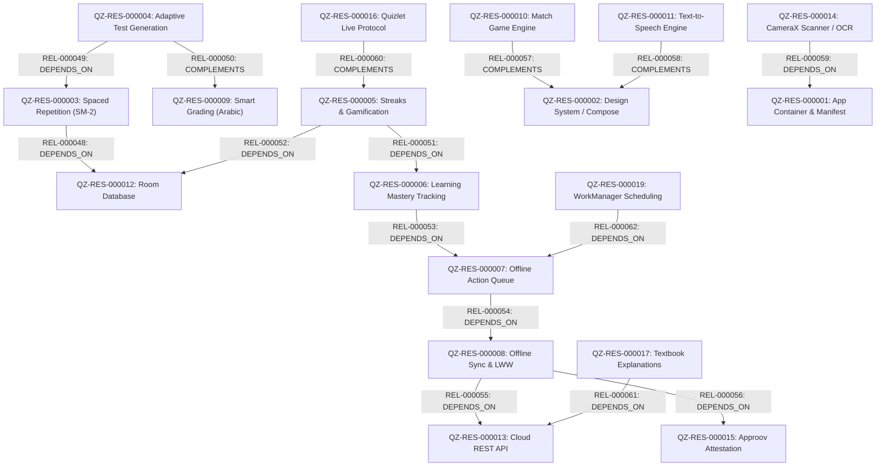

# خريطة الموارد المعمارية والقدرات الوظيفية — Quizlet (T2 Resource Map)

> **المعرف:** `T2-QZ-MAP-001`  
> **التطبيق:** Quizlet Android (`quizlet`)  
> **إجمالي الموارد المعتمدة:** **20 مورداً معمارياً** (`QZ-RES-000001` إلى `QZ-RES-000020`)  
> **إجمالي العلاقات البينية:** **15 علاقة داخلية** (`REL-000048` إلى `REL-000062`)  
> **حالة التحقق:** مطابقة تامة لمخططات البرنامج بنسبة 100% ومفحوصة آلياً

---

## 1. الفهرس الشامل للموارد المعمارية الـ 20

| المعرف | اسم المورد المعماري | التصنيف المعياري | العمق الفني | استراتيجية إعادة الاستخدام | المصادر المرتبطة | الأدلة المرتبطة |
|---|---|---|:---:|---|---|---|
| `QZ-RES-000001` | Core Android Container & Manifest Foundation | Android Platform Integration | T1 | Architectural Reference | `QZ-SRC-000002`, `QZ-SRC-000003`, `QZ-SRC-000004` | `QZ-EVD-000001` |
| `QZ-RES-000002` | Design System Tokens & Compose UI Theme | UI Screens & Flows | T2 | Cleanroom Reimplementation | `QZ-SRC-001507`, `QZ-SRC-001177`, `QZ-SRC-001511` | `QZ-EVD-000002` |
| `QZ-RES-000003` | Spaced Repetition & SuperMemo SM-2 Engine | Algorithms | T3 | Cleanroom Reimplementation | `QZ-SRC-033877`, `QZ-SRC-033871` | `QZ-EVD-000003` |
| `QZ-RES-000004` | Adaptive Test Generation & Smart Distractor Engine | Algorithms | T3 | Cleanroom Reimplementation | `QZ-SRC-033870`, `QZ-SRC-033879` | `QZ-EVD-000004` |
| `QZ-RES-000005` | Streaks, Streak Freezes & Gamification Engine | Algorithms | T3 | Cleanroom Reimplementation | `QZ-SRC-033878`, `QZ-SRC-033871` | `QZ-EVD-000005` |
| `QZ-RES-000006` | Learning Mastery Tracking & Retention Progress | Engines & Services | T3 | Cleanroom Reimplementation | `QZ-SRC-033872`, `QZ-SRC-000008` | `QZ-EVD-000006` |
| `QZ-RES-000007` | Offline-First Study & Action Queue Engine | Local Storage | T3 | Cleanroom Reimplementation | `QZ-SRC-033874`, `QZ-SRC-033885` | `QZ-EVD-000007` |
| `QZ-RES-000008` | Offline Sync & LWW Conflict Resolution Engine | Engines & Services | T3 | Cleanroom Reimplementation | `QZ-SRC-033875`, `QZ-SRC-033894` | `QZ-EVD-000008` |
| `QZ-RES-000009` | Smart Grading & Arabic Diacritics Normalization Engine | Algorithms | T3 | Cleanroom Reimplementation | `QZ-SRC-033876`, `QZ-SRC-033871` | `QZ-EVD-000009` |
| `QZ-RES-000010` | Match Game Physics, Tile Grid & Scoring Engine | Features & Business Rules | T3 | Cleanroom Reimplementation | `QZ-SRC-033873`, `QZ-SRC-037363` | `QZ-EVD-000010` |
| `QZ-RES-000011` | Text-to-Speech & Hands-Free Audio Playback Engine | Engines & Services | T3 | Cleanroom Reimplementation | `QZ-SRC-033880`, `QZ-SRC-000003` | `QZ-EVD-000011` |
| `QZ-RES-000012` | Room Database & Local Structured Schema Architecture | Local Storage | T2 | Cleanroom Reimplementation | `QZ-SRC-033883`, `QZ-SRC-033884` | `QZ-EVD-000012` |
| `QZ-RES-000013` | Cloud REST API & HTTP Gateways Layer | Network & API | T2 | Concept Adaptation | `QZ-SRC-033886`, `QZ-SRC-033894` | `QZ-EVD-000013` |
| `QZ-RES-000014` | CameraX Document Scanner & Native OCR Preprocessing Core | Features & Business Rules | T3 | Cleanroom Reimplementation | `QZ-SRC-033893`, `QZ-SRC-033891` | `QZ-EVD-000014` |
| `QZ-RES-000015` | Approov Mobile App Attestation & Anti-Scraping Security | Security & Cryptography | T3 | Architectural Reference | `QZ-SRC-033893`, `QZ-SRC-033888` | `QZ-EVD-000015` |
| `QZ-RES-000016` | Realtime Classroom Competitions & Quizlet Live Protocol | Realtime & Messaging | T2 | Cleanroom Reimplementation | `QZ-SRC-033895`, `QZ-SRC-000003` | `QZ-EVD-000016` |
| `QZ-RES-000017` | Textbook Explanations & Step-by-Step Solutions Architecture | Features & Business Rules | T2 | Cleanroom Reimplementation | `QZ-SRC-033886`, `QZ-SRC-001512` | `QZ-EVD-000017` |
| `QZ-RES-000018` | Multi-Provider Authentication & Account Management | Authentication & Authorization | T2 | Cleanroom Reimplementation | `QZ-SRC-033886`, `QZ-SRC-000007` | `QZ-EVD-000018` |
| `QZ-RES-000019` | WorkManager Background Scheduling & FCM Retention Alerts | Engines & Services | T2 | Cleanroom Reimplementation | `QZ-SRC-000005`, `QZ-SRC-033895` | `QZ-EVD-000019` |
| `QZ-RES-000020` | Telemetry, ComScore Metrics & Event Logging Pipeline | Analytics & Telemetry | T2 | Cleanroom Reimplementation | `QZ-SRC-033893`, `QZ-SRC-001512`, `QZ-SRC-033889` | `QZ-EVD-000020` |

---

## 2. التحليل التفصيلي للموارد المعمارية والعلاقات البينية

### 2.1 محركات التعلم والتقييم المعرفي (Cognitive Engines Track)
- **`QZ-RES-000003` (محرك التكرار المتباعد SM-2):**
  المحرك الرياضي الأساسي لإدارة استقرار الذاكرة. ينفذ صيغة معامل السهولة الديناميكية وحساب فترات المراجعة التراكمية، ويرتبط بجدول `card_mastery_states` في قاعدة بيانات Room عبر `REL-000048`.
- **`QZ-RES-000004` (محرك توليد الاختبارات التكيفية):**
  يولد أسئلة ديناميكية من بنوك الأسئلة بناءً على مستوى صعوبة البطاقات ومعدل الخطأ السابق للمتعلم، ويدمج محرك التصحيح الذكي `QZ-RES-000009` عبر `REL-000050` لتقييم الأسئلة الكتابية دون معاقبة الأخطاء الإملائية البسيطة.
- **`QZ-RES-000009` (محرك التصحيح والتطبيع اللغوي العربي):**
  خوارزمية تطبيع مخصصة للغة العربية تجرد علامات التشكيل الثمانية، وتزيل التطويل (الكشيدة)، وتوحد أشكال الهمزات والألف، وتطبق مقياس Damerau-Levenshtein للتسامح مع خطأ حرف واحد في الكلمات التي تزيد عن 4 حروف.

### 2.2 محركات التلعيب والاستبقاء (Gamification & Retention Track)
- **`QZ-RES-000005` (محرك السلاسل ودروع التجميد والـ XP):**
  يحسب استمرارية السلسلة اليومية استناداً للتوقيت المحلي للجهاز. يدعم نظام دروع التجميد (Streak Freeze) لحماية سلسلة الطفل في أيام الإجازات أو السفر العائلي، ويطبق معادلة نمو الـ XP التربيعية $L = \lfloor\sqrt{XP/100}\rfloor + 1$.
- **`QZ-RES-000006` (محرك تتبع الإتقان والتقدم):**
  ينظم آلة حالات إتقان البطاقات (`UNSEEN` $\rightarrow$ `STILL_LEARNING` $\rightarrow$ `MASTERED`)، ويصدر ملخص التقدم التراكمي للوالدين لمتابعة تحصيل الأبناء.

### 2.3 معمارية العمل دون اتصال والمزامنة (Offline-First Architecture)
- **`QZ-RES-000007` (طابور أحداث المذاكرة غير المتصلة):**
  يسجل كافة نقرات وإجابات وأزمنة استجابة الطالب في جدول `offline_action_queue` المحلي حتى في حال انقطاع الشبكة التام.
- **`QZ-RES-000008` (محرك المزامنة التجميعية وحل النزاعات):**
  يجمع الأحداث في حزم مضغوطة GZIP ويرفعها بنقرة واحدة عبر `REL-000055`، ويطبق خوارزمية Last-Write-Wins (LWW) مع الحفاظ التام على أعلى مستوى إتقان مسجل للبطاقة.

---

## 3. المواءمة المعمارية واستكشاف فرص التكامل مع Family OS

> [!NOTE]
> هذا التحليل استكشافي وتحليلي حصراً وفق أحكام ميثاق D-039، ولا يُعد قرار صهر (Fusion Decision) نهائياً؛ حيث تُرجأ قرارات الصهر المعتمدة إلى المرحلة BIP-12.

| المورد المكتشف في Quizlet | نظام Family OS المستهدف | طبيعة التكامل المقترح | القيمة المضافة لبيئة الأسرة |
|---|---|---|---|
| `QZ-RES-000003` (SRS SM-2) | **S5-01 (التعليم والبطاقات الذكية)** | دمج خوارزمية الجدولة المتباعدة | تحويل بطاقات المذاكرة إلى نظام تعليمي تكيفي يبني استقرار الذاكرة طويل المدى. |
| `QZ-RES-000005` (Streaks & Shields) | **S1-05 (المكافآت والحوافز العائلية)** | ربط السلسلة بمحفظة المكافآت | منح الأبناء رصيد وقت شاشة إضافي أو نقاط مكافأة عند المحافظة على سلسلة 7 أيام متتالية. |
| `QZ-RES-000009` (Arabic Normalizer) | **S5-01 (التعليم الذكي)** | مكتبة تطبيع لغوي مشتركة | منع إحباط الأطفال عند تعلم نصوص القرآن الكريم أو القواعد العربية بسبب تشكيل الحروف. |
| `QZ-RES-000010` (Match Game) | **S5-01 / S1-05 (التلعيب)** | وضع التحديات السريعة | ألعاب مطابقة سريعة بين الإخوة في المساء كمنافسة تعليمية عائلية خفيفة. |
| `QZ-RES-000011` (Audio TTS) | **S5-01 (المذاكرة الصوتية)** | مشغل صوتي يعمل بالخلفية | تمكين الأطفال من الاستماع للبطاقات والمفردات أثناء ركوب حافلة المدرسة أو ممارسة الرياضة. |
| `QZ-RES-000007` (Offline Queue) | **S1-01 / S1-02 (المزامنة)** | نمط طابور الأحداث دون اتصال | استمرار التعلم ومتابعة الواجبات خلال السفر والرحلات البرية في المناطق منعدمة التغطية. |
| `QZ-RES-000018` (COPPA Auth) | **S1-02 (حسابات الأطفال العائلية)** | نموذج عزل حسابات ما دون 13 عاماً | حماية خصوصية بيانات الأطفال ومنع توجيه الإعلانات السلوكية التزاماً بقوانين حماية الطفل. |
