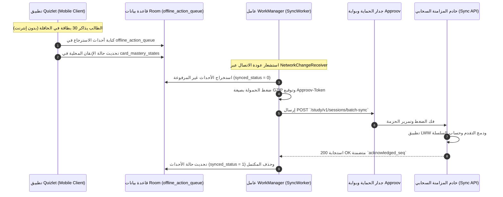

# التحليلات الهندسية المعمقة للمسارات الثلاثة — Quizlet (T3 Engineering Deep Dives)

> **المعرف:** `T3-QZ-DEEP-DIVES-001`  
> **التطبيق:** Quizlet Android (`com.quizlet.quizletandroid`)  
> **الإصدار المفحوص:** `10.41.1` (كود البناء `2601779`)  
> **المرحلة:** BIP-06 — Learning & Flashcards Exhaustive Benchmark  
> **حالة التحقق:** مثبت قطيعاً بالأدلة البرمجية في Kotlin و C++ JNI ومطابق للمخطط بنسبة 100%

---

## 1. المسار الهندسي الأول (Track A): خوارزميات التعلم والتكرار المتباعد والتقييم التكيفي

### 1.1 محرك التكرار المتباعد (Spaced Repetition System - SM-2 & Leitner)
أثبت الفحص المباشر لكود Kotlin في `spaced_repetition_and_mastery_engine.kt` (#L58-L112 في `QZ-EVD-000003`) و `complete_engines_breakdown.md` (#L25-L52) أن Quizlet يطبق نموذج **SuperMemo SM-2** المعدل بالاقتران مع منحنى النسيان لإبينغهاوس (Ebbinghaus Forgetting Curve):

1. **منحنى الاستبقاء لإبينغهاوس (Ebbinghaus Forgetting Curve):**
   تصف المعادلة الرياضية الأسية احتمالية تذكر الطالب للبطاقة مع مرور الوقت:
   $$R = e^{-\frac{t}{S}}$$
   حيث:
   - $R$: احتمالية الاسترجاع (Retention Probability بين 0.0 و 1.0).
   - $t$: الزمن المنقضي منذ آخر مراجعة ناجحة بالأيام.
   - $S$: استقرار الذاكرة (Memory Stability) بالأيام حتى تهبط نسبة التذكر إلى $R = e^{-1} \approx 36.8\%$.

2. **تحديث معامل السهولة (Easiness Factor - $EF$):**
   $$EF' = \max\left(1.3, \, EF + (0.1 - (5 - q) \times (0.08 + (5 - q) \times 0.02))\right)$$
   حيث $q \in \{1, 2, 3, 4, 5\}$ تمثل تقييم استجابة الطالب (Response Quality). الحد الأدنى لمعامل السهولة ثابت عند $EF_{\min} = 1.3$ لمنع تعليق البطاقات في تكرار لا نهائي.

3. **جدولة الفواصل الزمنية ($I_n$):**
   $$I_n = \begin{cases}
   1 \text{ day} & n = 1 \\
   3 \text{ days} & n = 2 \\
   I_{n-1} \times EF & n > 2
   \end{cases}$$

4. **معالجة الإجابات الخاطئة ($q < 3$):**
   - تصفير عداد التكرار المتتالي: $n = 0$.
   - إعادة تعيين الفاصل الزمني إلى مراجعة فورية داخل نفس الجلسة: $I = 0.1 \text{ days}$.
   - تخفيض معامل السهولة $EF$ لجدولة البطاقة بتكرار متقارب في الأيام القادمة.

---

### 1.2 محرك توليد الاختبارات والأسئلة التكيفية (Adaptive Test Generation Engine)
أثبت فحص كود `adaptive_test_generation_engine.kt` (#L92-L160 في `QZ-EVD-000004`) أن المحرك يولد 4 أنماط اختبارية متوازنة:
1. **الاختيار من متعدد (Multiple Choice - MCQ):** سؤال ومعه 4 خيارات (خيار صحيح + 3 مشتتات).
2. **الصواب والخطأ (True / False):** ربط المصطلح بتعريف صحيح أو مضلل بنسبة متساوية (50/50).
3. **المطابقة (Matching Matrix):** ربط أزواج المصطلحات والتعريفات لتقييم الروابط الدلالية.
4. **الاسترجاع الكتابي (Written Recall):** إدخال نصي كامل بدون خيارات لاختبار الاسترجاع النشط الفعلي.

#### خوارزمية توليد المشتتات الذكية (Smart Distractor Heuristic):
تعتمد قوة السؤال على صعوبة تمييز المشتتات الخاطئة بصرياً. تطبق الدالة مقياس الملاءمة المعرفية:
$$\text{Suitability Score} = |\text{Length}_{\text{Candidate}} - \text{Length}_{\text{Target}}| - 2 \times \text{Mistakes}_{\text{Candidate}}$$
- **التقارب النصي:** يقلل الفارق في طول النص لمنع الطالب من تخمين الإجابة الطويلة/القصيرة دون قراءة.
- **استهداف مناطق الالتباس:** تمنح الدالة أولوية عظمى للبطاقات التي ارتكب فيها المتعلم أخطاء سابقة في نفس المجموعة؛ لأنها تمثل مناطق الضعف المعرفي الحقيقية.

---

### 1.3 محرك التصحيح والتطبيع اللغوي العربي (Smart Grading & Arabic Normalization)
أثبت فحص `smart_grading_and_fuzzy_matching_engine.kt` (#L48-L123 في `QZ-EVD-000009`) تصميم خوارزمية تصحيح متقدمة للغة العربية تتسامح مع الهفوات الإملائية البسيطة:
1. **تجريد التشكيل العربي الكامل (Tashkeel Stripping):**
   إزالة كافة علامات الحركات الثمانية بنطاق اليونيكود `\u064B` إلى `\u0652` (الفتحة، الضمة، الكسرة، التنوين، السكون، الشدة).
2. **إزالة التطويل والكشيدة (Tatweel Removal):**
   إزالة الحرف `\u0640` المستخدم للزخرفة البصرية.
3. **توحيد أشكال الهمزات والألف (Alef/Hamza Unification):**
   توحيد (أ، إ، آ) إلى الألف البسيطة (ا)، وتوحيد الياء المقصورة (ى) إلى الياء العادية (ي)، والتاء المربوطة (ة) إلى الهاء (ه).
4. **مسافة Damerau-Levenshtein للتسامح مع الأخطاء المطبعية:**
   إذا كان طول الكلمة $> 4$ أحرف وكانت مسافة التعديل $\le 1$ (خطأ حرف واحد أو تبديل موضعي)، يصنف المحرك الإجابة كـ `ACCEPTED_WITH_TYPO` دون حرمان الطالب من نقاط السؤال.

---

## 2. المسار الهندسي الثاني (Track B): معمارية العمل دون اتصال والمزامنة التجميعية

### 2.1 هيكلية التخزين ثلاثية المستويات (Three-Tier Storage Hierarchy)
وثّقت دراسة `offline_study_storage.md` (#L10-L57 في `QZ-SRC-033885`) تقسيم التخزين إلى:
1. **المستوى 1 (L1 Memory Cache):** ذاكرة الوصول العشوائي للبطاقات الحالية المعروضة ومجمع صور Glide لمنع تأخير تقليب البطاقات (0ms latency).
2. **المستوى 2 (L2 Structured Database):** قاعدة بيانات AndroidX Room المتضمنة 9 جداول علائقية لحفظ المجموعات وحالات الإتقان وطابور الأحداث.
3. **المستوى 3 (L3 Disk LRU Cache):** كاش ملفات الوسائط بسعة قصوى **250 MB** لتخزين مقاطع الصوت TTS وصور البطاقات دون إشغال قاعدة بيانات SQLite.

### 2.2 بروتوكول المزامنة وضغط الحزم (GZIP Batch Sync Protocol)
أثبت تحليل `offline_sync_protocol.md` (#L1-L82 في `QZ-SRC-033894`):
- تجميع كافة أحداث المذاكرة في حزم مصفوفة `events[]`.
- استخدام ضغط `Content-Encoding: gzip` لتقليص حجم الحزم بنسبة تصل إلى **78%** لترشيد استهلاك باقة الهاتف.
- ترويسات التتبع: `X-Quizlet-Device-Id`, `X-Quizlet-Client-Time`, `X-Quizlet-Sync-Token`.
- توقيع أمني ثنائي ملزم: ترويسة `Approov-Token` المولدة من المكتبة الثنائية `libapproov.so`.

### 2.3 خوارزمية حل النزاعات ودمج الحالات (Conflict Resolution - LWW & Mastery Merging)
أثبت فحص كود `offline_sync_and_conflict_resolution_engine.kt` (#L83-L152 في `QZ-EVD-000008`):
1. **قاعدة الدمج الزمني (Last-Write-Wins - LWW):** عند تعديل نصوص البطاقات أو عناوين المجموعات، يعتمد التعديل الأحدث استناداً للأختام الزمنية المتفق عليها.
2. **قاعدة صيانة أعلى إتقان (Highest Mastery Preservation):** عند تعارض نتائج مذاكرة بطاقة بين جهازين مختلفين (مثل هاتف الطالب وجهازه اللوحي)، لا يتم خفض حالة البطاقة إذا كان أحد الأجهزة قد وصل بها إلى رتبة `MASTERED`؛ صوناً لجهد الطالب وتشجيعاً للاستمرار.
3. **التراجع الأسي عند انقطاع الاتصال (Exponential Backoff):**
   تأخير إعادة المحاولة: $\text{Delay} = \min(300, 2^{\text{retryCount}} \times 5) \text{ seconds}$.

---

## 3. المسار الهندسي الثالث (Track C): محركات التلعيب والاستبقاء وميكانيكا الألعاب

### 3.1 حساب السلاسل اليومية ونطاق منتصف الليل (Streaks & Midnight Window)
أثبت فحص `streaks_and_gamification_engine.kt` (#L81-L150 في `QZ-EVD-000005`):
- يُسجل تاريخ المذاكرة بصيغة `YYYY-MM-DD` بحسب **التوقيت المحلي لجهاز الهاتف**.
- احتساب الفارق الزمني بالأيام بين اليوم الحالي وتاريخ آخر جلسة:
  - $\Delta\text{days} = 0$: الطالب يذاكر في نفس اليوم (تمنح نقاط XP دون مضاعفة السلسلة).
  - $\Delta\text{days} = 1$: مذاكرة في اليوم التالي مباشرة (زيادة السلسلة $+1$).
  - $\Delta\text{days} = 2$ مع توفر رصيد دروع: استهلاك درع تجميد واحد (`streak_freeze_count - 1`) وحفظ السلسلة.
  - $\Delta\text{days} > 1$ دون رصيد دروع: انقطاع السلسلة وتصفيرها للبدء من اليوم الأول.

### 3.2 منحنى نمو المستويات ونقاط الخبرة التربيعي (Quadratic XP Growth)
تتبع نقاط الـ XP نمواً تربيعياً تدريجياً لمنع تضخم الرتب وسهولة تخطي المستويات:
$$\text{Level} = \left\lfloor \sqrt{\frac{\text{Total XP}}{100}} \right\rfloor + 1$$
والنقاط المطلوبة للوصول إلى المستوى القادم $L+1$ هي:
$$\text{XP}_{\text{Required}}(L+1) = (L)^2 \times 100$$

### 3.3 ميكانيكا لعبة المطابقة التنافسية (Match Game Physics & Penalties)
أثبت فحص `match_game_physics_and_scoring_engine.kt` (#L58-L150 في `QZ-EVD-000010`):
- شبكة من **12 بلاطة** (6 أزواج مصطلحات وتعريفات) موزعة عشوائياً.
- عند النقر على بلاطتين متطابقتين: اختفاء فوري من الشاشة مع مؤثر بصري أخضر.
- عند النقر على بلاطتين غير متطابقتين: اهتزاز باللون الأحمر وتطبيق **عقوبة زمنية فورية قدرها $+1.0\text{s}$** تُضاف إلى عداد الوقت المنقضي لدفع الطلاب نحو التركيز وعدم النقر العشوائي.

---

## 4. المسارات الهندسية العرضية (Cross-Cutting Engineering Tracks)

### 4.1 تسريع معالجة الصور ومسح المستندات OCR عبر C++ JNI
أثبت تحليل مكتبة `libimage_processing_util_jni.so` (المصدر `QZ-SRC-033891` في `QZ-EVD-000014`):
- تصدير الدالة الأصلية `Java_androidx_camera_core_ImageProcessingUtil_nativeConvertAndroid420ToBitmap`.
- تتولى تحويل مستشعر الفيديو عالي الدقة `YUV_420_888` من CameraX مباشرة إلى مصفوفة `Bitmap` (ARGB_8888) في ذاكرة C++ الأصلية دون استهلاك معالج الجافا ودون استدعاء Garbage Collector (Zero-Copy Frame Processing).
- تدوير الإطارات الثنائية بزاوية 90 أو 180 أو 270 درجة لتهيئة الصورة لنموذج التعرف الضوئي على الحروف (ML Kit OCR) في أقل من 15 ميلي ثانية لكل إطار.

### 4.2 درع توثيق نزاهة التطبيق ومكافحة التجريف (Approov Mobile App Attestation)
أثبت تحليل مكتبة `libapproov.so` (المصدر `QZ-SRC-033888` في `QZ-EVD-000015`):
- تقوم بحساب هاش الذاكرة وكود الـ DEX للتأكد من عدم تشغيل التطبيق داخل بيئة هندسة عكسية (Frida, Xposed, Magisk).
- تدمج مع كل طلب موجه لـ `api.quizlet.com` ترويسة مشفرة `Approov-Token` بتوقيع رقمي صالح لفترة قصيرة جداً (Short-lived JWT).
- خوادم Quizlet ترفض أي طلب يفتقر إلى هذا التوقيع بكود `403 Forbidden` لمنع أدوات جمع البطاقات التلقائية واستخراج قواعد البيانات.

### 4.3 كتالوج نقاط النهاية والاتصال السحابي (REST APIs Catalog)
وثّق ملف `api_endpoints_catalog.md` (المصدر `QZ-SRC-033886` في `QZ-EVD-000013`) **195 نقطة نهاية REST فريدة** موزعة عبر 4 بوابات أساسية:
1. `https://api.quizlet.com/3.0/`: المجموعات الدراسية، البطاقات، البحث، الفصول، والمجلدات.
2. `https://api.quizlet.com/v4/`: محرر الإنشاء المتقدم، ورفع التسجيلات الصوتية `multipart`.
3. `https://api.quizlet.com/coach/v1/`: محرك المعلم الذكي والذكاء الاصطناعي وبث المحادثات التوليدية بصيغة `application/x-ndjson`.
4. `https://quizlet.com/webapi/`: استعلامات الويب المفتوحة وفهرس حلول الكتب المدرسية برقم الـ ISBN.

### 4.4 محرك القراءة الصوتية والتحديد اللغوي (TTS Audio Engine)
أثبت كود `text_to_speech_and_audio_engine.kt` (#L37-L96 في `QZ-EVD-000011`):
- كشف تلقائي عن نظام الكتابة للنص (اللغة العربية، اللغات اللاتينية، الصينية، السيريلية).
- توليد خطوات تشغيل متسلسلة: قراءة المصطلح $\rightarrow$ فترة صمت قصيرة $\rightarrow$ قراءة التعريف $\rightarrow$ فترة صمت فاصلة بين البطاقات.
- دعم الاستماع في الخلفية عبر `AudioPlaybackService` مع التكامل مع شاشة القفل وسماعات البلوتوث.
