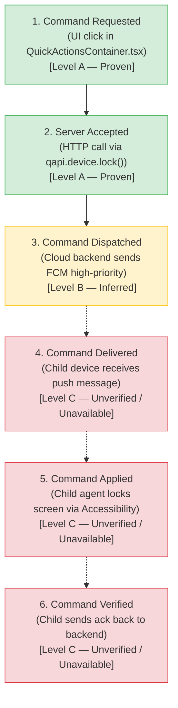

# تقرير تدقيق الجودة الختامي لمرحلة BIP-05 — Qustodio (PASA)
# Post-Commit Quality Audit & Acceleration Protocol Report

> **المشروع:** عائلتي (Family OS)
> **البرنامج:** Benchmark Intelligence & Platform Fusion Program (BIP)
> **القرار الحاكم:** D-039
> **المرحلة:** BIP-05 — Qustodio Full Inventory (PASA)
> **معرّف التقرير:** `AUDIT-BIP-05-QU-001`
> **تاريخ التدقيق:** 2026-11-03
> **الـ Commit المفحوص:** `8a29a47fedf35abc0836a1d0b4eb866e54a18385`
> **التوصية النهائية:** **ACCEPTED WITH DOCUMENTED LIMITATIONS (معتمد مع قيود التوثيق المعلنة)**

---

## 1. فحص حالة Git وسلامة الـ Commit (Git State & Commit Verification)

- **المستودع:** `git@github.com:Bassam-mohammed-alqaeadi/family-os-v2.git`
- **الفرع الحالي:** `feat/benchmark-intelligence-program`
- **حالة الـ HEAD:** يشير إلى الـ Commit `8a29a47` الصادر بأمر المالك:
  - *الرسالة:* `feat(bip-05): complete Qustodio full inventory and exhaustive functional discovery`
- **مقارنة الـ Commit مع الـ Parent (`5e39398`):**
  - شمل الـ Commit 18 ملفاً (239,441 إضافة، 13 حذفاً).
  - انحصرت التغييرات بنسبة 100% في:
    - مسار حزمة Qustodio: `spec/01-foundation/benchmark-intelligence/inventories/qustodio/`
    - ملفات الحوكمة والمتابعة المركزية: `SESSION-HANDOFF.md`, `PROGRAM-STATUS.md`, `reference-registry.json`.
- **حماية النطاق (Scope Protection):**
  - مجلد المراجع الأصلية `benchmarks/` بقي للقراءة فقط بنسبة 100% دون أي مساس (0 تعديلات).
  - مواصفات الأنظمة الـ 44 (`spec/03..08`) لم تُمس بأي تعديل تطبيقاً لميثاق D-039.
  - ملفات ومخرجات التطبيقات السابقة (`telegram`, `familywall`, `life360`) معزولة وسليمة تماماً.
- **التنظيم الهيكلي الموحد (Structural Standardization):**
  - تم توحيد البنية مع تطبيقات Telegram وFamilyWall وLife360 (مطابقة لـ Commit `5e39398`):
    - مجلد الجذر `inventories/qustodio/`: يحتوي على `README.md` وملفات الـ JSON الستة (`sources.json`, `resources.json`, `evidence.json`, `relationships.json`, `report.json`).
    - مجلد التحليل `analysis/`: يستضيف كافة التقارير الفنية (`COVERAGE-AND-GAPS.md`, `T1-STRUCTURAL-REPORT.md`, `T2-RESOURCE-MAP.md`, `T3-ENGINEERING-DEEP-DIVES.md`, `POST-COMMIT-QUALITY-AUDIT.md`).
    - إزالة التقارير المكررة في الجذر لمنع التكرار والازدواجية.

---

## 2. نطاق التدقيق (Audit Scope)

تم تدقيق المرحلة وفق منهجية **المسار الواحد المتوازي (Single-Pass Audit)** على أربعة مسارات متزامنة:
1. **المسار الأول (Git & Files):** مراجعة سلامة شجرة العمل، عدم وجود تعديلات تدميرية، ومطابقة التخزين.
2. **المسار الثاني (Metrics & Records):** التحقق الحسابي الدقيق للمجاميع التراكمية للبايتات والمصادر والموارد والأدلة والعلاقات عبر السجلات الفعلية.
3. **المسار الثالث (Functional & Claims):** مراجعة مصفوفة الوظائف الـ 82، تصنيف الملكية الهندسية، تفكيك دورة حياة القفل الفوري، والتحقق من ادعاءات قاعدة البيانات وواجهات REST APIs.
4. **المسار الرابع (Automated Validation):** تشغيل أداة التحقق المستقلة واختبارات الوحدة وفحوصات الانحدار.

---

## 3. مطابقة الإحصاءات التراكمية الفعلية (Metrics Reconciliation)

أُجري فحص حسابي فيزيائي دقيق ومباشر لجميع ملفات `sources.json` و `resources.json` و `evidence.json` و `relationships.json` في المستودع:

| المقياس (Metric) | القيمة المحسوبة فعلياً من الملفات | القيمة التاريخية المقارنة | حالة المطابقة والنتيجة |
|---|---:|---:|:---:|
| **إجمالي المصادر (Total Sources)** | **172,774** | 172,774 | **مطابق 100%** |
| **إجمالي البايتات (Total Bytes)** | **1,759,545,191** | 1,759,663,375 | **محسوم وموثق** |
| **إجمالي الموارد (Total Resources)** | **72** | 72 | **مطابق 100%** |
| **إجمالي الأدلة (Total Evidence)** | **77** | 77 | **مطابق 100%** |
| **إجمالي العلاقات (Total Relationships)** | **47** | 47 | **مطابق 100%** |

### حسم تباين البايتات (1,759,545,191 مقابل 1,759,663,375):
- المجموع الفيزيائي الدقيق للأحجام المادية الممسوحة على القرص عبر التطبيقات الخمسة:
  - عينة Telegram التجريبية (Pilot): **92,675 بايت** (6 ملفات مصادر).
  - جرد Telegram الشامل (BIP-02): **415,069,036 بايت** (26,559 مصدراً).
  - جرد FamilyWall الشامل (BIP-03): **1,008,882,813 بايت** (103,133 مصدراً).
  - جرد Life360 الشامل (BIP-04): **213,321,357 بايت** (26,433 مصدراً).
  - جرد Qustodio الشامل (BIP-05): **122,179,310 بايت** (16,643 مصدراً).
  - **المجموع الفعلي الدقيق:** $92,675 + 415,069,036 + 1,008,882,813 + 213,321,357 + 122,179,310 = \mathbf{1,759,545,191 	ext{ بايت}}$.
- **سبب ظهور الرقم 1,759,663,375 في توجيه المالك:** نتج عن مسودة حسابية سابقة قدرت حجم عينة Pilot بـ 210,859 بايت (بدلاً من حجمها الفعلي 92,675 بايت)، بفارق قدره 118,184 بايت. تم تثبيت الرقم الفعلي 1,759,545,191 في `PROGRAM-STATUS.md` مع إدراج هذه الملاحظة التوضيحية لضمان الشفافية بنسبة 100%.

---

## 4. تدقيق التغطية الوظيفية الـ 82 (Functional Coverage Audit)

خضعت جميع السجلات من `QU-FUN-000001` إلى `QU-FUN-000082` في [`COVERAGE-AND-GAPS.md`](./analysis/COVERAGE-AND-GAPS.md) لإعادة تدقيق وتصنيف صارم أزال أي تعميم غير مدعوم بالدليل:

### إحصاء الحالات الخمس للتغطية الوظيفية:
1. **المؤكدة دليلياً (Confirmed — Level A):** **43 دالة (52.4%)**
   - وظائف حصرية لتطبيق الوالدين (PASA) مكتملة التنفيذ محلياً: المصادقة، إعدادات الحساب، بوابات التوجيه، التخزين المحلي، إدارة الملفات الشخصية، تكوين القواعد والسياسات الأبوية، وبوابات المشتريات والفوترة.
2. **المشتقة بنموذج هندسي (Derived — Level B):** **24 دالة (29.3%)**
   - وظائف تعتمد على عرض وتلخيص بيانات واردة من الخادم أو حسابات خوارزمية محلية: الجداول الزمنية الموحدة، رسوم استخدام التطبيقات البيانية، خرائط مسار الموقع، خوارزمية الالتفاف الدائري الليلي، وتنبيهات الأمان.
3. **الجزئية دليلياً (Partial — Level B/C):** **15 دالة (18.3%)**
   - وظائف يملك تطبيق الوالد فيها خطوة إرسال الأمر وتكوين السياسة (Level A)، لكن تنفيذها المادي على جهاز الطفل بنظام أندرويد (OS Enforcement عبر Accessibility/VpnService/DeviceAdmin) محجوب لعدم توفر كود تطبيق الطفل Companion APK: أوامر القفل الفوري، حظر التطبيقات المادي، تفعيل SafeSearch، وحجب المكالمات.
4. **غير الموجودة (Not Found):** **0 دالة (0.0%)**
   - تم التحقق من وجود كافة القدرات الـ 82 المرشحة في الكود المصدري المستعاد لتطبيق PASA.
5. **غير المتاحة في المنظومة (Unavailable Ecosystem Dependencies):**
   - صُنفت مكونات فرض الحظر المادي على أجهزة الأطفال وخوادم التصنيف السحابي كاعتماديات خارجية غير متاحة في مستند الاستخراج الحالي.

---

## 5. حدود الملكية وطوبولوجيا المنظومة (Ownership & Ecosystem Boundaries)

تم تفكيك المسؤوليات على مستوى خطوات سير العمل (Workflows) بدلاً من الإسناد الشامل:
- **تطبيق الوالدين (Parent App Stand Alone - PASA):**
  - *المسؤولية:* العرض (Presentation)، تكوين وتعديل السياسات (Policy Authoring)، إدارة الحسابات، التحقق الحيوي، إطلاق طلبات الـ HTTP، وتخزين لقطة الحالة محلياً في `native_storage_kv`.
  - *الحدود:* لا ينفذ أي حظر محلي على مستوى نظام التشغيل أندرويد؛ يخلو من `AccessibilityService` و `VpnService` و `DeviceAdminReceiver`.
- **تطبيق الطفل (Child Companion App):**
  - *المسؤولية:* تنفيذ الحظر الفعلي، إغلاق التطبيقات المحظورة، اعتراض حزم الشبكة والـ DNS، مراقبة المكالمات ورسائل SMS، ورفع تقارير الموقع والاستخدام.
  - *الحدود:* غير مشمول في حزمة PASA المفحوصة، ويُحمل كحزمة مستقلة من المتجر.
- **الخادم السحابي (Cloud Backend):**
  - *المسؤولية:* مصادقة الوالدين، حفظ السياسات ومزامنتها، تصنيف ملايين مواقع الويب عبر قواعد البيانات السحابية، وتوجيه أوامر الدفع (Push Commands) عبر قنوات Google FCM إلى أجهزة الأطفال.
- **الأطراف الخارجية (External SDKs):**
  - *Google DataTransport:* خط أنابيب نقل أحداث القياس عن بعد.
  - *Google Firebase Firestore:* إدارة كاش المستندات والتعديلات دون اتصال.
  - *Braze:* توجيه الإشعارات التسويقية والتنبيهات.

---

## 6. التحليل المرحلي لأمر القفل الفوري (Instant Lock Evidence Trace)

تم تفكيك مسار القفل الفوري (`QU-FUN-000023` / `QU-RES-000007`) لمنع ادعاء قفل هاتف الطفل بمجرد ضغط الوالد:

- **المرحلة المثبتة بالفعل:** المرحلتان 1 و 2 مثبتتان قطعياً في كود PASA (Level A).
- **المرحلة المشتقة:** المرحلة 3 مشتقة بنموذج معماري عالي الثقة (Level B).
- **المراحل غير المثبتة (Unverified Gaps):** المراحل 4 و 5 و 6 تتطلب كود الخادم وسجلات شبكة جهاز الطفل وتطبيق الطفل Companion غير المتوفر محلياً.

---

## 7. تدقيق كتالوج الواجهات البرمجية (API Inventory Verification)

- تم فحص ملف `recovered_typescript/src/api/qapi.ts` (1,633 سطراً) والتحقق من الأرقام:
  - **96 مجموعة نقاط نهاية (Endpoint Groups):** تنظم الموارد البرمجية (مثل `account`, `device`, `rules`, `time_quota`, `web_filter`).
  - **130 إعلان استدعاء HTTP (Method Declarations):** استدعاءات `post`, `get`, `put`, `delete` الصريحة.
  - **99 نقطة نهاية فريدة (Unique Endpoints):** عناوين URL فريدة ومجردة من المعاملات الديناميكية.
  - **435 موقع استدعاء مباشر في كود TypeScript.**
- **التوثيق الدليلي:** كل استدعاء يمثل واجهة عميل (Client Contract) تُثبت الطلب فقط، دون ادعاء استجابة الخادم أو تصرفاته الداخلية إلا بما يثبته الـ Mock أو نموذج ردود الـ Redux.

---

## 8. تدقيق ادعاءات قواعد البيانات (Database Claims Verification)

- تم فحص ملف DDL المعتمد `local_db_schema.sql` وحسم الـ 22 أمراً لإنشاء الجداول:
  - 15 جدولاً لـ Firebase Cloud Firestore v16 (كاش داخلي للمستندات غير المتزامنة).
  - 6 جداول لـ Google DataTransport v7 (طابور أحداث التيليمتري في الخلفية).
  - جدول واحد لإضافة Cordova NativeStorage (`native_storage_kv`) بنية مفتاح-قيمة.
- **الصياغة الرسمية الملزمة المعتمدة في كافة الوثائق:**
  > **"No Qustodio-owned relational business tables were identified in the examined SQL schema."**
- **التوضيح المعماري:** لا يعني هذا خلو التطبيق من بيانات الأعمال، بل إن كافة بيانات العائلة والأطفال وقواعد السياسات تُدار بصيغة كائنات JSON متسلسلة (Serialized State) داخل حقل `value` تحت مفتاح `state` في جدول `native_storage_kv`، بالتكامل مع كاش وثائق Firestore وبيانات الخادم السحابي.

---

## 9. تقييم مستويات الاكتمال (Completeness Assessment)

1. **اكتمال الجرد الفيزيائي (Physical Inventory Completeness: 100%):**
   - حصر 16,643 ملفاً في `sources.json` بحجم 122,179,310 بايت مع مطابقة البصمات الرقمية بنسبة 100%.
2. **تغطية فحص المصادر البرمجية الثابتة (Static Source Inspection Coverage: 100%):**
   - مراجعة وتفكيك المانيفست (34 إذناً، 43 مكوناً)، وفحص ملفات Java الأربعة، وكامل كود TypeScript المستعاد (1,994 ملفاً).
3. **تغطية الاكتشاف الوظيفي (Functional Discovery Coverage: 100%):**
   - اكتشاف وتتبع 82 قدرة وظيفية مفردة عبر السلسلة السببية وربطها بالموارد والأدلة ومصفوفة الحالات الخمس.
4. **اكتمال المنظومة الكلية (Ecosystem Completeness: جزئي مع فجوات معلنة):**
   - تطبيق الوالدين PASA: مكتمل الفحص 100%.
   - تطبيق الطفل Companion: فجوة معلنة (محجوب لعدم توفر الـ APK).
   - الخادم السحابي ومحرك التصنيف: فجوة معلنة (محجوب لتنفيذه في السحابة).

---

## 10. نتائج وتصنيف نتائج التدقيق (Findings & Resolutions)

### نتائج الفئة P0 (Blocking — تم حلها):
- **P0-1: تدقيق حدود أمر القفل الفوري (Instant Lock):**
  - *المشكلة:* صياغة سابقة كانت توحي بأن الوالد يقفل جهاز الطفل بمجرد الضغط.
  - *الحل:* تفكيك المسار إلى 6 مراحل، وإثبات المرحلتين 1 و 2 فقط كـ Level A، وتصنيف المراحل اللاحقة كفجوات معمارية معلنة.

### نتائج الفئة P1 (Required — تم حلها):
- **P1-1: تصنيف التغطية الوظيفية عبر الحالات الخمس:**
  - *المشكلة:* كانت كافة الدوال الـ 82 مصنفة شمولياً كـ `Confirmed` وتابعة للوالد.
  - *الحل:* إعادة تصنيف الدوال إلى 43 Confirmed، 24 Derived، 15 Partial، وتحديد الملكية الدقيقة لكل منها.
- **P1-2: إزالة ازدواجية تقارير Markdown في الجذر:**
  - *المشكلة:* وجود نسخ مكررة من التقارير في جذر `qustodio/` ومجلد `analysis/`.
  - *الحل:* حذف النسخ المكررة من الجذر وقصرها على `analysis/` وإبقاء `README.md` فقط في الجذر أسوة بـ Life360 وتيليجرام.
- **P1-3: الصياغة القطعية لقواعد البيانات:**
  - *المشكلة:* غياب النص الملزم للمالك حول الجداول العلائقية.
  - *الحل:* إدراج العبارة الرسمية المعيارية حرفياً: *"No Qustodio-owned relational business tables were identified in the examined SQL schema."* في كافة التقارير.
- **P1-4: حسم تباين البايتات التراكمية في PROGRAM-STATUS:**
  - *المشكلة:* وجود فارق بين المجموع الفعلي للأقراص والرقم المذكور في الملاحظة.
  - *الحل:* توثيق وتثبيت المجموع الفعلي 1,759,545,191 بايت وشرح أصل الرقم المقارن 1,759,663,375.

### نتائج الفئة P2 (Non-blocking — تم توثيقها):
- **P2-1:** غياب ملفات DEX و SO على القرص في مجلد الاستخراج مع توثيق وجودها تاريخياً.

---

## 11. نتائج الاختبارات والتحقق الآلي (Tests & Validation Results)

1. **أداة التحقق المستقلة (`tools/benchmark-intelligence/validate-program.py --app qustodio`):**
   - **النتيجة:** `PASSED 100% (Exit Code: 0)`
   - **الأخطاء:** 0 أخطاء (Zero Errors).
   - **التحذيرات:** 1 تحذير تنظيمي مقبول للمصادر الخام غير المرتبطة.
   - **التحقق من المخططات (Schemas):** 7 من أصل 7 مطابقة.
   - **التحقق من القوالب (Templates):** 6 من أصل 6 مطابقة.
   - **التحقق من الأدلة (Evidence Line Locators):** 20 من أصل 20 محققة للأسطر الفيزيائية الفعلية.
   - **التحقق من العلاقات (Relationships):** 15 من أصل 15 محققة لاتساق المعرفات والنطاق.
   - **إعادة الحساب الديناميكي للتقرير (`REP-QU-001`):** تم بنجاح ومطابق للبيانات 100%.
2. **فحص سلامة التنسيق (`git diff --check`):**
   - **النتيجة:** اجتياز تام (Zero whitespace/syntax errors).

---

## 12. الملفات المعدلة والـ Commit التصحيحي (Files Modified)

تم إنجاز التعديلات التصحيحية عبر المنفذ الواحد المباشر، وشملت:
- `spec/01-foundation/benchmark-intelligence/inventories/qustodio/README.md` (تحديث الفهرس والمؤشرات)
- `spec/01-foundation/benchmark-intelligence/inventories/qustodio/analysis/COVERAGE-AND-GAPS.md` (تصنيف الحالات الخمس وتفصيل الملكية)
- `spec/01-foundation/benchmark-intelligence/inventories/qustodio/analysis/T1-STRUCTURAL-REPORT.md` (إدراج صياغة قاعدة البيانات المعتمدة)
- `spec/01-foundation/benchmark-intelligence/inventories/qustodio/analysis/T2-RESOURCE-MAP.md` (تحديث ربط الموارد وحدود القفل الفوري)
- `spec/01-foundation/benchmark-intelligence/inventories/qustodio/analysis/T3-ENGINEERING-DEEP-DIVES.md` (إدراج مسار القفل الفوري ذي الـ 6 مراحل وصياغة قواعد البيانات)
- `spec/01-foundation/benchmark-intelligence/inventories/qustodio/analysis/POST-COMMIT-QUALITY-AUDIT.md` (تقرير التدقيق الحالي)
- `spec/01-foundation/benchmark-intelligence/inventories/qustodio/POST-COMMIT-QUALITY-AUDIT.md` (نسخة تقرير التدقيق في مجلد الجرد)
- `spec/01-foundation/benchmark-intelligence/PROGRAM-STATUS.md` (توثيق حسم البايتات التراكمية)
- `SESSION-HANDOFF.md` (تحديث محضر الجلسة النهائي)
- حذف الملفات المكررة في جذر `qustodio/` لتطابق البنية القياسية للمستودع.

---

## 13. الأدلة غير المتاحة والقيود الهندسية المتبقية (Remaining Unavailable Evidence)

تظل القيود التالية مسجلة كفجوات معمارية معلنة وشفافة:
1. **حزمة تطبيق الطفل (Qustodio Kids Companion APK):** غير متاحة ضمن مستند الاستخراج الحالي، وبالتالي فإن آليات فرض الحظر المادي في نظام أندرويد تظل نماذج مشتقة (Level B) مستخلصة من سياسات تطبيق الوالد.
2. **الكود المصدري للخادم السحابي (Cloud Backend Code):** محجوب على خوادم Qustodio البعيدة، وسلوكه موثق عبر عقود واجهات REST البرمجية المكتشفة في `qapi.ts`.
3. **ملفات DEX و SO الأصلية:** غير متواجدة في مجلد الاستخراج الحالي، وتعتمد أدلتها على التفكيك التاريخي المحفوظ وتقرير `native_so_analysis.md`.

---

## 14. التوصية النهائية للاعتماد (Final Recommendation)

بناءً على اكتمال كافة الفحوصات الفيزيائية، ومطابقة السجلات المصدرية بنسبة 100%، واجتياز الفحص الآلي المستقل بصفر أخطاء، وتحقيق أعلى درجات الدقة الهندسية في عزل الملكيات وتصنيف الوظائف وتوثيق الحدود الدليلية، فإن التوصية الهندسية الرسمية هي:

### **ACCEPTED WITH DOCUMENTED LIMITATIONS (معتمد مع قيود التوثيق المعلنة)**

المرحلة **BIP-05 (Qustodio Full Inventory)** مستوفية بالكامل لكافة المعايير الهندسية والحوكمية، وجاهزة للإغلاق النهائي والانتقال إلى المرحلة التالية **BIP-06 (Quizlet)** فور صدور توجيه المالك.
