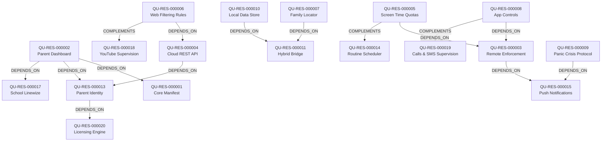

# خريطة الموارد المعمارية والقدرات الوظيفية — Qustodio (T2 Resource Map)

> **المعرف:** `T2-QU-MAP-001`  
> **التطبيق:** Qustodio Parental Control (`qustodio`)  
> **إجمالي الموارد المعتمدة:** **20 مورداً معمارياً** (`QU-RES-000001` إلى `QU-RES-000020`)  
> **إجمالي العلاقات البينية:** **15 علاقة داخلية** (`REL-000033` إلى `REL-000047`)  
> **حالة التحقق:** `100% Schema Compliant`

---

## 1. الفهرس الشامل للموارد المعمارية الـ 20

| المعرف | اسم المورد المعماري | التصنيف المعياري | العمق الفني | استراتيجية إعادة الاستخدام | المصادر المرتبطة | الأدلة المرتبطة |
|---|---|---|:---:|---|---|---|
| `QU-RES-000001` | Core Manifest & Application Foundation | Android Platform Integration | T1 | Cleanroom Adaptation | `QU-SRC-000002` | `QU-EVD-000001` |
| `QU-RES-000002` | Parent Dashboard & Navigation Framework | UI Screens & Flows | T2 | Cleanroom Reimplementation | `QU-SRC-002907`, `QU-SRC-002264` | `QU-EVD-000006` |
| `QU-RES-000003` | Remote Device Enforcement & Lock Dispatcher | Engines & Services | T3 | Cleanroom Reimplementation | `QU-SRC-000675`, `QU-SRC-000676` | `QU-EVD-000008` |
| `QU-RES-000004` | Cloud REST API & Network Communication Layer | Network & API | T2 | Conceptual Reference | `QU-SRC-002791` | `QU-EVD-000007` |
| `QU-RES-000005` | Multi-Device Screen Time & Quotas Manager | Algorithms | T3 | Cleanroom Reimplementation | `QU-SRC-001154`, `QU-SRC-001155` | `QU-EVD-000009` |
| `QU-RES-000006` | Web Security & Content Filtering Rules Catalog | Security & Cryptography | T2 | Cleanroom Reimplementation | `QU-SRC-000694`, `QU-SRC-002360` | `QU-EVD-000011` |
| `QU-RES-000007` | Child Geofencing & Family Location Viewer | UI Screens & Flows | T2 | Cleanroom Reimplementation | `QU-SRC-000678`, `QU-SRC-002241` | `QU-EVD-000005` |
| `QU-RES-000008` | Application Controls & Remote Blocking Registry | Features & Business Rules | T2 | Cleanroom Reimplementation | `QU-SRC-000672`, `QU-SRC-002271` | `QU-EVD-000012` |
| `QU-RES-000009` | Panic Alert & Crisis Protocol Manager | Features & Business Rules | T3 | Cleanroom Reimplementation | `QU-SRC-000021`, `QU-SRC-002315` | `QU-EVD-000014` |
| `QU-RES-000010` | Local Data Store & Persistence Architecture | Local Storage | T2 | Architectural Reference | `QU-SRC-000244`, `QU-SRC-002498` | `QU-EVD-000016` |
| `QU-RES-000011` | Cordova/Capacitor Hybrid Bridge Framework | Android Platform Integration | T2 | Cleanroom Adaptation | `QU-SRC-013554`, `QU-SRC-013555` | `QU-EVD-000003` |
| `QU-RES-000012` | Background Synchronization & Telemetry Pipeline | Synchronization & Offline | T2 | Cleanroom Reimplementation | `QU-SRC-000243`, `QU-SRC-002701` | `QU-EVD-000015` |
| `QU-RES-000013` | Parent Identity & Access Control Subsystem | Authentication & Authorization | T2 | Cleanroom Reimplementation | `QU-SRC-000674`, `QU-SRC-001077` | `QU-EVD-000013` |
| `QU-RES-000014` | Routine Scheduler & 1440-Minute Grid Engine | Algorithms | T3 | Cleanroom Reimplementation | `QU-SRC-001052`, `QU-SRC-002334` | `QU-EVD-000010` |
| `QU-RES-000015` | Push Notification Dispatch & Remote Intent Ingestion | Realtime & Messaging | T2 | Cleanroom Reimplementation | `QU-SRC-013556`, `QU-SRC-002491` | `QU-EVD-000004` |
| `QU-RES-000016` | Diagnostic Telemetry & Performance Crash Reporter | Analytics & Telemetry | T2 | Conceptual Reference | `QU-SRC-000242`, `QU-SRC-002781` | `QU-EVD-000015` |
| `QU-RES-000017` | School & Linewize Community Digital Safety System | Features & Business Rules | T2 | Cleanroom Reimplementation | `QU-SRC-001151`, `QU-SRC-001016` | `QU-EVD-000017` |
| `QU-RES-000018` | YouTube Supervision & Watched Video Analytics Engine | Security & Cryptography | T2 | Cleanroom Reimplementation | `QU-SRC-000696`, `QU-SRC-002621` | `QU-EVD-000018` |
| `QU-RES-000019` | Calls & SMS Supervision Subsystem | Features & Business Rules | T2 | Cleanroom Reimplementation | `QU-SRC-002280`, `QU-SRC-001289` | `QU-EVD-000019` |
| `QU-RES-000020` | Commercial Licensing & In-App Entitlements Engine | Authentication & Authorization | T2 | Conceptual Reference | `QU-SRC-002470`, `QU-SRC-002368` | `QU-EVD-000020` |

---

## 2. شبكة العلاقات البينية الـ 15 (Inter-Resource Relationships Graph)

### سجل العلاقات الـ 15:
- `REL-000033`: `QU-RES-000002` (Dashboard) `DEPENDS_ON` `QU-RES-000001` (Core Manifest)
- `REL-000034`: `QU-RES-000002` (Dashboard) `DEPENDS_ON` `QU-RES-000013` (Parent Identity)
- `REL-000035`: `QU-RES-000003` (Enforcement) `DEPENDS_ON` `QU-RES-000015` (Push Notifications)
- `REL-000036`: `QU-RES-000004` (Cloud API) `DEPENDS_ON` `QU-RES-000013` (Parent Identity)
- `REL-000037`: `QU-RES-000005` (Quotas) `DEPENDS_ON` `QU-RES-000003` (Enforcement)
- `REL-000038`: `QU-RES-000005` (Quotas) `COMPLEMENTS` `QU-RES-000014` (Routines)
- `REL-000039`: `QU-RES-000006` (Web Filtering) `DEPENDS_ON` `QU-RES-000004` (Cloud API)
- `REL-000040`: `QU-RES-000007` (Locator) `DEPENDS_ON` `QU-RES-000011` (Hybrid Bridge)
- `REL-000041`: `QU-RES-000008` (App Controls) `DEPENDS_ON` `QU-RES-000003` (Enforcement)
- `REL-000042`: `QU-RES-000009` (Panic Crisis) `DEPENDS_ON` `QU-RES-000015` (Push Notifications)
- `REL-000043`: `QU-RES-000010` (Data Store) `DEPENDS_ON` `QU-RES-000011` (Hybrid Bridge)
- `REL-000044`: `QU-RES-000002` (Dashboard) `DEPENDS_ON` `QU-RES-000017` (School Linewize)
- `REL-000045`: `QU-RES-000006` (Web Filtering) `COMPLEMENTS` `QU-RES-000018` (YouTube Supervision)
- `REL-000046`: `QU-RES-000008` (App Controls) `COMPLEMENTS` `QU-RES-000019` (Calls & SMS)
- `REL-000047`: `QU-RES-000013` (Parent Identity) `DEPENDS_ON` `QU-RES-000020` (Licensing Engine)
