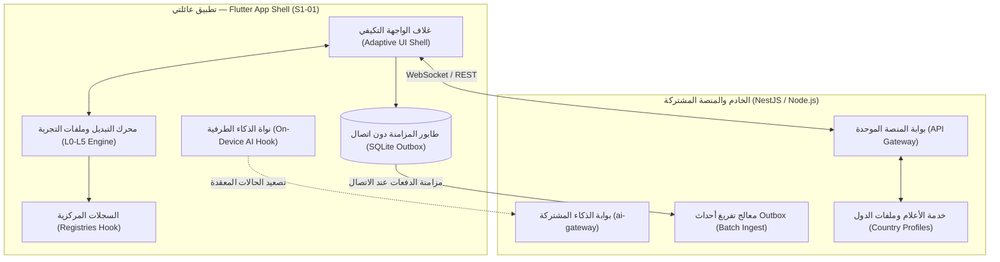

# S1-01: التحليل والمتطلبات (App Shell & Shared Platform)

> **النظام:** `S1-01 — app-shell-and-platform`  
> **الموقع المعماري:** بوابة النواة للمرحلة 1 (Phase 1 Entry Core)  
> **القرارات المرتبطة:** D-014 (إلزامية سطح التحكم)، D-024 (تصنيف التطبيق كعائلي)، D-026 (ملكية القدرات المشتركة)، D-027 (ترتيب م1)، D-028 (النبضتين)، D-029 (شريان الذكاء المركزي)، D-031 (ملفات الدول).

---

## 1. الغرض والرؤية المعمارية (Purpose & Vision)

يمثل نظام **S1-01** الهيكل العظمي والبنية التحتية الموحدة لمنصة **عائلتي (Family OS)**؛ فهو ليس مجرد واجهة مستخدم أو شريط تنقل، بل هو:
1. **غلاف التطبيق المتكيف (Adaptive App Shell):** الحاوية الديناميكية التي تستضيف واجهات المنصة وتغير تخطيطها فورياً بناءً على ملف التجربة (`ExperienceProfile`) المخصص لكل فرد في العائلة (من مركز القيادة الكامل للأب، وحتى الواجهة الآمنة المبهجة للأطفال الصغار).
2. **مالك القدرات المشتركة للمنصة (Shared Platform Capabilities Owner — D-026):** استضافة وإدارة المحركات الأفقية التي تخدم كافة الأنظمة الـ 44:
   - البنية التحتية لتوزيع الإشعارات (`Notifications Dispatcher`).
   - خط التحليلات والأحداث الصامتة المحفوظة الخصوصية (`Analytics Pipeline`).
   - شريان الذكاء المركزي (`ai-gateway` + On-Device AI Engine Hook — D-029).
   - نظام أعلام الميزات والإعدادات عن بُعد (`Feature Flags & Remote Config`).
   - السجلات المركزية الأربعة (`ControlRegistry`, `PermissionRegistry`, `WidgetRegistry`, `NotificationRegistry`).
   - معمارية المزامنة غير المتصلة أولاً (`Offline-First Outbox Sync`).
3. **التشغيل المحايد للدول (Country-Neutral Execution — D-031):** النواة خالية من أي افتراضات محلية، ويتم ضبط السلوكيات عبر `CountryProfile` (الخليج Tier A، اليمن Tier B مع وضع Low-Bandwidth).

---

## 2. مصفوفة الاستخلاص المرجعي من معايير Benchmarks `[REF:]`

تم تصميم هذا النظام وصهر أفضل الممارسات الهندسية المستخرجة من التطبيقات العالمية السبعة المفككة:

| التطبيق المرجعي | المسار المستخرج والرمز | الميزة المعمارية المستخلصة المعتمدة في S1-01 |
|---|---|---|
| **Telegram** | `[REF:benchmarks/extracted/telegram/]` | معمارية النشاط الواحد (`Single-Activity App Shell`) مع حافلة أحداث داخلية متزامنة عالية السرعة مستلهمة من `NotificationCenter.java`، ونظام المزامنة المتسلسلة `Sequential Packets` لضمان استقرار قنوات الـ WebSocket. |
| **Bark** | `[REF:benchmarks/extracted/bark/]` | معمارية آلة الحالات الخماسية (`FSM`) لإدارة أولويات الغلاف وشاشات الحظر وحارس الخصوصية، مع التخزين المؤقت المحلي السريع وتجنب أي تسريب للبيانات. |
| **FamilyWall** | `[REF:benchmarks/extracted/familywall/]` | محول الملفات الشخصية المتعددة السلس (`Multi-Profile Avatar Switcher`) بروابط ألوان الهوية الشخصية لكل فرد في العائلة. |
| **Quizlet** | `[REF:benchmarks/extracted/quizlet/]` | محرك المزامنة دون اتصال أولاً (`Offline Action Queue`) مع دعم التفريغ المجدول عبر `WorkManager` وتخزين الكاش بنظام LRU. |
| **Life360** | `[REF:benchmarks/extracted/life360/]` | معمارية مراقبة صحة الجهاز والخدمات الصامتة (`devicehealth`) لضمان عدم توقف خدمات الخلفية دون إزعاج المستخدم بنوافذ متكررة. |

---

## 3. النطاق الهندسي والحدود (System Scope Boundaries)

### 3.1 ما يقع داخل نطاق S1-01 (In Scope)
* **غلاف التطبيق متعدد المنصات (Flutter App Shell):** شريط التنقل السفلي التكيفي، شريط الحالة، القوائم الجانبية، وإدارة الانتقال بين الشاشات الرئيسية.
* **محول الهويات وملفات التجربة (Profile & Role Experience Switcher):** دعم التبديل السريع بين حسابات أفراد العائلة على نفس الجهاز مع بوابة حماية الوالدين (`Parent Gate`).
* **السجلات المركزية الأربعة (Core Registries):**
  1. `ControlRegistry`: تسجيل كافة مفاتيح التحكم وقواعد الدمج.
  2. `PermissionRegistry`: تسجيل الصلاحيات والخطورة والتفويض.
  3. `WidgetRegistry`: تسجيل بطاقات وودجات الشاشات الرئيسية.
  4. `NotificationRegistry`: تسجيل قنوات وفئات التنبيهات.
* **البنية التحتية لشريان الذكاء المركزي (D-029):** هيكل بوابة `ai-gateway`، تتبع الحصص، سجل التدقيق، ومفاتيح الإيقاف الطارئة (Kill-Switches) مع جاهزية الربط الطرفي.
* **معمارية عدم الاتصال والمزامنة (Offline Outbox):** جدول SQLite محلي لتسجيل الأحداث والطلبات المعلقة عند انقطاع الشبكة وإرسالها عند الاستعادة.
* **مستكشف صحة المنصة (Platform Health Monitor):** رصد أداء الذاكرة والاتصال ومستوى البطارية.

### 3.2 ما يقع خارج نطاق S1-01 (Out of Scope)
* **إدارة الحسابات والتسجيل الفعلي (Identity & Auth):** يقع ضمن اختصاص `S1-02` (التسجيل، OTP، وربط الأجهزة).
* **إدارة العائلة والأعضاء وتفويض الصلاحيات:** يقع ضمن اختصاص `S1-03`.
* **ميزات الذكاء الاصطناعي التوليدي التفاعلية:** تُبنى على شريان الذكاء وتُفعل مرحلياً من المرحلة 3 فصاعداً (D-029).
* **واجهات وأسوار الموقع الجغرافي:** تقع ضمن اختصاص `S1-07` و `S2-04`.

---

## 4. البنية المعمارية للقدرات المشتركة (D-026 & D-029)

---

## 5. متطلبات ملفات الدول والتكيف الإقليمي (D-031 Compliance)

1. **الاستقلالية التامة للنواة (Country-Agnostic Core):**
   - تُعرف واجهة برمجية `CountryProfileProvider` تقوم بتحميل إعدادات الدولة ديناميكياً من الخادم أو الكاش المحلي.
2. **مواصفات حزمة دول الخليج (Tier A — Gulf Pack):**
   - اتصال فائق السرعة، دعم إشعارات FCM عالية الأولوية، وربط العملات الخليجية (SAR, AED, KWD, QAR, BHD, OMR).
3. **مواصفات حزمة اليمن (Tier B — Yemen Pack):**
   - تفعيل إلزامي لنمط **النطاق الترددي المنخفض (Low-Bandwidth Mode)**:
     * ضغط حزم الاستجابة عبر Brotli / Gzip بنسبة تفوق 75%.
     * إيقاف التحديثات المستمرة التلقائية وتحويلها إلى استدعاء يدوي أو دفعات عند توفر الشبكة.
     * توفير قنوات استلام بديلة لرموز التحقق (WhatsApp Relay / Voice Call OTP).
     * دعم الدفع عبر المحافظ المحلية والتحويلات المعتمدة محلياً.

---

## 6. متطلبات الجودة والأداء والأمان (NFRs)

* **زمن إقلاع الغلاف (Cold Start Time):** أقل من 1.2 ثانية على الأجهزة المتوسطة عبر التهيئات غير المتزامنة (`AppStartupProvider`).
* **زمن تبديل الملف الشخصي (Profile Switching):** أقل من 250 ميلي ثانية (تحديث الحالة في الذاكرة دون إعادة تشغيل التطبيق).
* **العمل دون اتصال (Offline Resilience):** التطبيق يفتح ويعرض كافة البيانات المحفوظة محلياً دون إظهار شاشة خطأ، مع شريط علوي خفيف يشير إلى حالة عدم الاتصال.
* **أمان بوابة الوالدين (Parent Gate):** منع الأطفال (L4/L5) من الوصول إلى أي إعداد إداري عبر اختبار رياضي متعدد المتغيرات أو رمز PIN الشخصي للأب.
* **معيار تصنيف التطبيقات (D-024):** خلو تام من أي مكتبات إعلانية أو أدوات تتبع تنتهك خصوصية الطفل.
