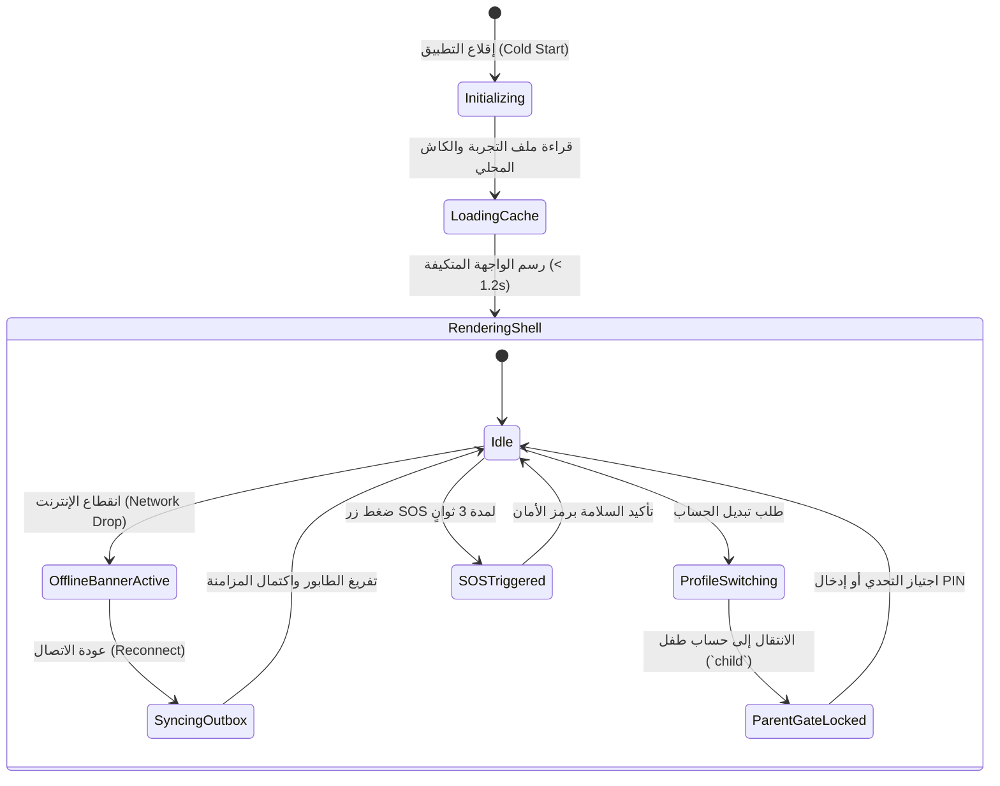

# S1-01: قواعد الأعمال ومصفوفة الصلاحيات (Business Rules & Permissions)

> **النظام:** `S1-01 — app-shell-and-platform`  
> **المرجع:** `spec/01-foundation/control-and-settings-architecture.md`, `role-experience-model.md`  
> **الاستخلاص المرجعي:** `[REF:benchmarks/extracted/bark/]` (آلة حالات FSM المقيدة)، `[REF:benchmarks/extracted/famisafe/]` (منع التلاعب وتأمين الخروج).

---

## 1. قواعد الأعمال المعمارية الصارمة (Core Business Rules)

### BR-SHELL-001: حتمية عزل ملفات التجربة (Role Experience Invariant)
* **القاعدة:** يجب أن يخضع تخطيط الشاشة وشريط التنقل السفلي والخيارات المتاحة بصورة قطعية لملف التجربة المخصص للدور النشط (`owner`, `adult`, `teen`, `child`) وفق D-038.
* **الإنفاذ:** يُمنع منعاً باتاً تسريب أي زر إداري أو تحكم رقابي أو رابط للإعدادات إلى واجهات الأطفال والمراهقين (`teen`, `child`). أي محاولة لطلب مسار غير مصرح به تعيد المستخدم تلقائياً إلى شاشته الرئيسية الآمنة مع تسجيل حدث تدقيق أمني.

---

### BR-SHELL-002: بوابة حماية الوالدين الإلزامية (Parent Gate Mandate)
* **القاعدة:** عند تفعيل وضع الأطفال (`child`)، يُقفل التطبيق داخلياً. ولا يمكن:
  1. التبديل إلى حساب شخص بالغ.
  2. الوصول إلى متصفح الويب أو الروابط الخارجية.
  3. الدخول إلى إعدادات النظام.
* **آلية الفك:** تتطلب إما:
  - إدخال رمز الأمان السري للوالد (Parent PIN 4-6 أرقام).
  - أو اجتياز التحدي الرياضي المعقد (مثال: ضرب رقمين من خانتين لا يستطيع الطفل حلهما عفوياً) مع التحقق بالبصمة الحيوية للوالد إن توفرت.

---

### BR-SHELL-003: موثوقية طابور العمليات غير المتصلة (Outbox Durability)
* **القاعدة:** أي إجراء ينفذه المستخدم أثناء انقطاع الإنترنت (مثل إنهاء مهمة، قراءة بطاقة، أو إرسال رسالة) يجب أن يُسجل فورياً في جدول SQLite المحلي (`platform_offline_outbox`) قبل تحديث واجهة المستخدم.
* **الإنفاذ:** يُمنع إظهار رسائل خطأ تفيد بعدم وجود شبكة للإجراءات التي تدعم المزامنة المؤجلة. يتم الحفظ محلياً وتحديث الواجهة تفاؤلياً (Optimistic UI Update).

---

### BR-SHELL-004: حصانة زر الاستغاثة الطارئ (SOS Absolute Availability)
* **القاعدة:** زر استغاثة الطوارئ SOS يجب أن يظل متاحاً وظاهراً في الغلاف لكافة الأدوار بلا استثناء، بما في ذلك الأطفال الصغار وحسابات المراهقين.
* **الإنفاذ:** لا يمكن لأي تحكم أبوي أو جدول نوم أو وقت شاشة أن يعطل أو يخفي زر SOS أو يمنع استخدامه تحت أي ظرف.

---

### BR-SHELL-005: التكيف الصامت مع ملفات الدول (Country-Profile Enforcement — D-031)
* **القاعدة:** عند تعيين `CountryProfile = TIER_B` (اليمن):
  1. يُفعل وضع النطاق الترددي المنخفض تلقائياً: ضغط كافة الحزم، إيقاف التنزيل التلقائي للصور عالية الدقة، وتقليص استعلامات الخلفية.
  2. يُمنع حظر المستخدم إذا تعذر وصول رسائل SMS الدولية؛ حيث تُفعل قنوات التحقق البديلة (واتساب / الاتصال الصوتي) كخيار أول.

---

## 2. مصفوفة الصلاحيات المركزية (Permission Matrix)

تسجل هذه الصلاحيات في سجل الصلاحيات المركزي `PermissionRegistry` كجزء من S1-01:

| كود الصلاحية (Permission Key) | الوصف | `owner` (المالك) | `adult` (البالغ) | `teen` (المراهق) | `child` (الطفل) | قابلة للتفويض؟ |
|---|---|:---:|:---:|:---:|:---:|:---:|
| `shell.profile.switch_any` | التبديل بين حسابات العائلة على الأجهزة المشتركة | ✅ | ✅ | ❌ | ❌ | نعم (بإذن المالك) |
| `shell.parent_gate.bypass` | تجاوز بوابة أمان الأطفال والوصول للإدارة | ✅ | ✅ | ❌ | ❌ | لا |
| `shell.settings.full_control`| إدارة إعدادات المنصة وأعلام الميزات | ✅ | ❌ | ❌ | ❌ | لا (للمالك فقط) |
| `shell.settings.self_view` | استعراض إعدادات الملف الشخصي الذاتية | ✅ | ✅ | ✅ | ❌ | لا تنطبق |
| `shell.offline.force_sync` | طلب مزامنة فورية لطابور العمليات المعلقة | ✅ | ✅ | ✅ | ✅ | نعم |
| `shell.sos.trigger` | إطلاق استغاثة الطوارئ العائلية | ✅ | ✅ | ✅ | ✅ | لا تنطبق (للجميع) |
| `shell.health.view_telemetry`| استعراض تقارير صحة الأجهزة والبطارية | ✅ | ✅ | ❌ | ❌ | نعم للبالغ المفوض |

---

## 3. آلة حالات الغلاف التكيفي (Shell Lifecycle FSM)

