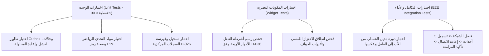

# S1-01: معايير القبول وسيناريوهات الاختبار (Acceptance Criteria & Test Matrix)

> **النظام:** `S1-01 — app-shell-and-platform`  
> **مرجع الجودة:** `spec/01-foundation/quality-and-testing-strategy.md`, `definition-of-done.md`

---

## 1. معايير القبول الصارمة (Acceptance Criteria - AC)

### AC-S1-01-01: إقلاع الغلاف والتكيف حسب الدور في أقل من 1.2 ثانية
* **المعيار:** عند تشغيل التطبيق (Cold Start)، يجب أن يتم تهيئة الغلاف واسترجاع ملف التجربة ورسم شريط التنقل السفلي الصحيح للدور في زمن لا يتجاوز **1.2 ثانية** على الأجهزة المتوسطة.
* **التحقق:** اختبار قياس الأداء الآلي (Benchmark Macrobenchmark) والتأكد من غياب أي تجميد للواجهة (Zero Frame Drops).

---

### AC-S1-01-02: التبديل السلس بين الملفات الشخصية في أقل من 250 ميلي ثانية
* **المعيار:** عند اختيار حساب آخر عبر محول الحسابات السريع (`SCR-S1-01-02`)، يجب أن تتبدل واجهة الغلاف وثيم الألوان والتبويبات في الذاكرة خلال **أقل من 250 ميلي ثانية** دون إعادة إقلاع التطبيق ودون وميض للشاشة (Zero Screen Flicker).
* **التحقق:** قياس زمن معالجة حدث تبديل الدور داخل `RoleExperienceNotifier`.

---

### AC-S1-01-03: إحكام بوابة حماية الوالدين (Parent Gate Integrity)
* **المعيار:** عند محاولة الخروج من تجربة الأطفال (`child`) أو محاولة فتح شاشة الإعدادات، يجب أن تنبثق بوابة `SCR-S1-01-03` فورياً.
* **شروط النجاح:**
  - الإجابة الخاطئة على المسألة الرياضية تغلق النافذة وتعيد الطفل لواجهته فوراً.
  - لا يمكن تجاوز البوابة بالضغط على زر الرجوع في أندرويد (Back Button Intercepted).
  - إدخال رمز PIN الصحيح للأب أو التحقق الحيوي بالبصمة يفتح الإدارة فورياً.

---

### AC-S1-01-04: مرونة العمل دون اتصال وتفريغ طابور Outbox التلقائي
* **المعيار:** عند تفعيل وضع الطيران والقيام بإجراءات كتابة (إنهاء مهمة أو تقليب بطاقات):
  1. تُسجل كافة الأحداث محلياً في جدول `platform_offline_outbox`.
  2. يظهر مؤشر شريط الحالة العلوي: *"وضع عدم الاتصال نشط"*.
  3. فور إعادة الاتصال بالإنترنت، يفرغ الطابور تلقائياً بدفعة واحدة مع استلام إقرار النجاح من الخادم، وتحديث شارة المؤشر إلى *"تمت المزامنة بنجاح"*.
* **التحقق:** اختبار تكاملي يقوم بفصل الاتصال برمجياً والتحقق من بقاء البيانات ومزامنتها.

---

### AC-S1-01-05: استجابة وحصانة زر الاستغاثة الطارئ SOS
* **المعيار:** الضغط المستمر لمدة 3 ثوانٍ على زر SOS من أي شاشة ولأي دور (بما في ذلك الأطفال) يجب أن:
  1. يُصدر اهتزازاً لمسياً تصاعدياً متسارعاً.
  2. يُطلق رسالة استغاثة عالية الأولوية حتى لو كان وقت الشاشة منتهياً أو الجهاز مقفلاً.
  3. لا يمكن لأي تحكم أبوي أن يُعطل أو يُخفي زر SOS.

---

### AC-S1-01-06: التكيف مع وضع النطاق الترددي المنخفض في اليمن (Tier B)
* **المعيار:** عند اكتشاف بيئة `CountryProfile = TIER_B`:
  1. تُضغط استجابات الخادم بنسبة تفوق 75% عبر Brotli.
  2. تُعطل دورات الاستعلام التلقائي عالية التردد في الخلفية لحفظ بطارية الهاتف وباقة البيانات.
  3. تتاح خيارات التحقق البديلة (واتساب / اتصال صوتي) بشكل صريح وسهل.

---

### AC-S1-01-07: سلامة وكفاءة السجلات المركزية الأربعة
* **المعيار:** تسجيل واسترجاع أي عنصر في السجلات المركزية (`ControlRegistry`, `PermissionRegistry`, `WidgetRegistry`, `NotificationRegistry`) يجب أن يتم في زمن يقل عن **1 ميلي ثانية** دون أي استهلاك للقرص.

---

## 2. مصفوفة الاختبارات الآلية (Automated Test Suites)

### خطة التغطية البرمجية:
* **تغطية الوحدات البرمجية الأساسية (Code Coverage):** لا تقل عن 90% لكافة دوال محرك `fos_shell`.
* **اختبارات الاستقرار (Stress Testing):** محاكاة تفريغ 500 حدث دفعة واحدة من طابور Outbox دون حدوث اختناق في الذاكرة (Zero Memory Leaks).
* **اختبارات إمكانية الوصول (A11y Tests):** فحص توافق ألوان الغلاف مع معايير WCAG AA وتباين الخطوط ودعم قراءات الشاشة الصوتية (Screen Readers).
