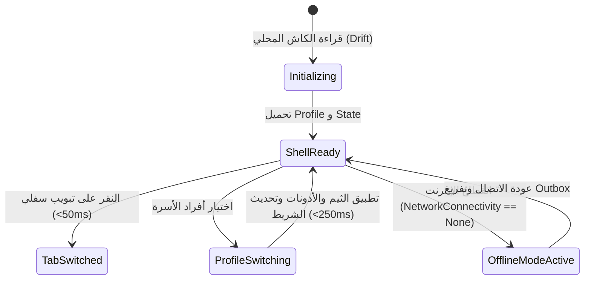

# SCR-S1-01-01: مواصفات الغلاف التكيفي الرئيسي (Main Adaptive App Shell)

> **النظام:** `S1-01 — app-shell-and-platform`  
> **معرف الشاشة:** `SCR-S1-01-01`  
> **مرجع التصميم:** `spec/02-design-system/navigation-patterns.md`, `spec/02-design-system/spacing-and-grid.md`  
> **الاستخلاص المرجعي:** `[REF: benchmarks/extracted/telegram/01_architecture_and_manifest/components_catalog.md]` (نمط النشاط الواحد Single-Activity Architecture مع Navigation Stack محلي خفيف وسريع).

---

## 1. الغرض وتجربة المستخدم (Purpose & UX)
الغلاف التكيفي هو الهيكل الجذري لتطبيق Flutter (`Root Scaffold`). يعمل كحاوية متكاملة ديناميكية تستضيف شاشات النظام الفرعية وتتغير بنيتها وعناصر التحكم فيها فوراً عند تبديل ملف التجربة النشط وفق نموذج الدور وقالب العرض (`Role & Display Template Model`) بحسب D-038 في زمن استجابة أقل من 250ms دون إعادة تشغيل التطبيق.

---

## 2. الهيكلية البصرية والتخطيط (Layout & Visual Hierarchy)

### أ) شريط الحالة والرأس (Header & Top App Bar)
- **الارتفاع:** `56dp` ثابت.
- **الجانب الأيمن (RTL):** زر استعراض محول الحسابات السريع (`FosAvatar` مصغر 36dp مع حلقة بلون الدور النشط وشارة الرصيد للأطفال).
- **الوسط:** شعار «عائلتي» المدمج مع اسم المساحة الحالية (`اسم العائلة` للأب والأم، أو اسم الطفل في وضع الأطفال).
- **الجانب الأيسر (RTL):** مؤشر الاتصال الشبكي المصغر وزر الطوارئ السريع SOS (`SCR-S1-01-05`).

### ب) منطقة المحتوى المستضاف (Hosted Content Body)
- مساحة ديناميكية تحتضن المكدس التنقلي الداخلي (`Nested Navigator`) للمسار المختار، مع الحفاظ التام على حالة التمرير (`PageStorageKey`) عند التبديل بين التبويبات.

### ج) شريط التنقل السفلي التكيفي (Adaptive Bottom Navigation Bar)
- **الارتفاع:** `64dp` (+ هامش حافة الأمان السفلية للأجهزة الحديثة).
- **الألوان والتأثيرات:** زجاجي ناعم ضبابي (`BackdropFilter` ضبابية 16px) مع خلفية بلون الأساس (`#FCFAED` في الفاتح، أو `#1A2238` في الداكن).
- **عناصر التبويب بحسب الدور النشط:**
  1. **owner (المالك):** 5 عناصر: [الرئيسية 🏠]، [الخريطة 📍]، [الدردشة 💬]، [التقويم والمهام 📅]، [الإعدادات ⚙️].
  2. **adult (البالغ):** 5 عناصر مهيأة بحسب الصلاحيات ونطاق التفويض.
  3. **teen (المراهق 13-17):** 4 عناصر: [مساحتي 🚀]، [الدردشة 💬]، [المهام والجوائز 🎯]، [المذاكرة 📚].
  4. **child (الطفل):** بنمطي عرض متكيفين (D-038):
     - **قالب قياسي (`standard` - 7-12 سنة):** 4 عناصر مبسطة بألوان باستيل وأيقونات مجسمة: [عالمي 🌟]، [البطاقات الذكية 🃏]، [مكافآتي 🎁]، [الأسرة 📞].
     - **قالب مصغر (`minimal` - دون 7 سنوات):** تبويبان عملاقان بنمط بطاقات لمسية كبيرة: [عالم الألعاب والأناشيد 🎨]، [الاتصال بماما وبابا 💚].

---

## 3. آلة الحالة والتفاعل (State Machine & Interactions)

---

## 4. قيود الأمان وإمكانية الوصول (Security & Accessibility)
- **حظر التنقل الالتفافي (Navigation Bypassing):** يُمنع تجاوز بوابة الحماية `SCR-S1-01-03` أو فتح أي شاشة إدارية عبر Intent خارجي أو Deep Link للأدوار غير المصرح لها؛ ويشمل الحظر الصارم **الأطفال والمراهقين معاً (`child` و `teen`)** وفق ثوابت D-038، بينما يعتمد وصول البالغين (`adult`) على الصلاحيات الفعلية المفوضة (`domain.action`) وليس مجرد فحص الدور فقط.
- **الوصولية (A11y):** كافة أزرار شريط التنقل توفر وسوم قراءة الشاشة (`Semantics label`) بالعربية الفصحى مع إعلان التبويب المختار، وأهداف اللمس لا تقل عن `48x48dp`.
