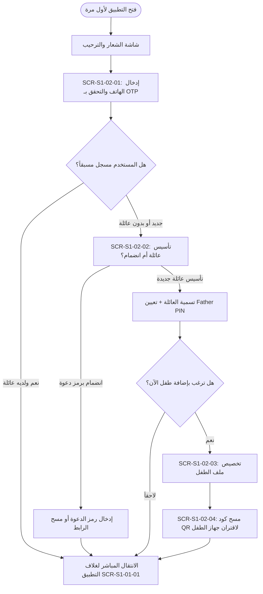

# S1-02: فهرس الشاشات والمكونات البصرية (Screens & UI Index)

> **النظام:** `S1-02 — identity-and-onboarding`  
> **مرجع نظام التصميم:** `spec/02-design-system/components.md`, `spec/02-design-system/color-tokens.md`  
> **الاستخلاص المرجعي:** `[REF: benchmarks/extracted/telegram/]` (بساطة واجهة إدخال الهاتف والتحقق)، `[REF: benchmarks/extracted/familywall/]` (خطوات إعداد دائرة الأسرة واختيار ألوان الأعضاء).

---

## 1. جدول الشاشات المعتمدة للنظام (Screens Master Index)

| معرف الشاشة (Screen ID) | مسمى الشاشة بالعربية والإنجليزية | نمط العرض (Display Mode) | ملفات التجربة المستهدفة | الوظيفة والمكونات الرئيسية |
|---|---|---|---|---|
| `SCR-S1-02-01` | **شاشة تسجيل الدخول بالهاتف والتحقق** `Phone & OTP Verification Screen` | شاشة كاملة متدرجة (Full Screen Scaffold) | البالغون والمراهقون (`owner`, `adult`, `teen`) والمستخدمون الجدد | إدخال رقم الهاتف مع محدد الدول التلقائي، واجهة إدخال رمز التحقق `FosOtpField` مع مؤقت التحويل لواتساب. |
| `SCR-S1-02-02` | **شاشة مسار الترحيب وتأسيس العائلة** `Family Circle Setup & Welcome` | شاشة كاملة متتابعة (Multi-step Wizard) | منشئ العائلة (المالك `owner` / الأب) أو المنضمون الجدد | اختيار مسار «تأسيس عائلة» أو «الانضمام برمز»، تسمية العائلة، وتعيين الاسم الشخصي والرمز السري `Father PIN`. |
| `SCR-S1-02-03` | **شاشة إنشاء وتخصيص حساب الطفل** `Child Profile Creation & Persona` | نافذة منبثقة أو شاشة تدفق (Wizard Screen) | المالك والبالغ (`owner`, `adult`) | تعيين الاسم المستعار للطفل، سنة الميلاد (لتحديد قالب العرض `standard` أو `minimal` تلقائياً)، اختيار الصورة الرمزية واللون المميز. |
| `SCR-S1-02-04` | **شاشة اقتران أجهزة الأطفال برمز QR** `Child Device Pairing via QR` | شاشة كاميرا ومسح تفاعلية (Interactive QR Scanner) | أجهزة الأطفال والأب | عرض كود الاقتران المؤقت المشفر على هاتف الأب، ومسحه بكاميرا هاتف الطفل لتوثيق الشهادة الأمنية فورياً. |
| `SCR-S1-02-05` | **شاشة مركز دعوة وإدارة أفراد العائلة** `Family Invitation & Circle Manager` | شاشة إدارية تفاعلية (Admin Overview Screen) | المالك والبالغ (`owner`, `adult`) | استعراض كود الدعوة المكون من 6 خانات، زر المشاركة عبر واتساب، قائمة الأعضاء المنضمين والمعلقين. |

---

## 2. تفصيل تدفق الشاشات (Screen Navigation Flow)

---

## 3. معايير التصميم والوصولية المطبقة
- **التباين البصري:** استخدام لون الأساس الكحلي الداكن (`#1F3A6B`) للنصوص والأزرار على خلفية كريمية مريحة (`#FCFAED`) مع تباين يتجاوز 7:1.
- **لوحة المفاتيح التلقائية:** فتح لوحة مفاتيح الأرقام (`TextInputType.phone` / `number`) تلقائياً فور فتح شاشة الهاتف ورمز الـ OTP لتوفير نقرة المستخدم.
- **التوجيه الصوتي:** نطق أرقام الرمز عند قراءتها من قارئات الشاشة لتسهيل وصولية ذوي الإعاقة البصرية.
