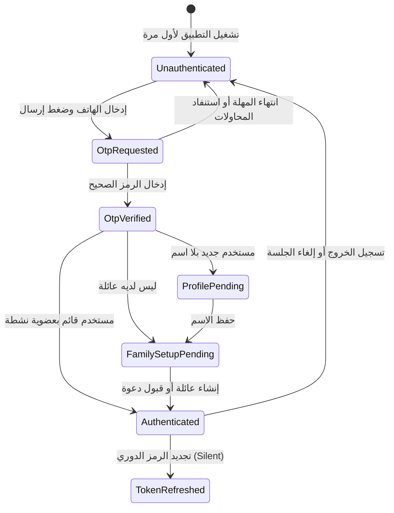

# S1-02: قواعد العمل والصلاحيات (Business Rules & Permissions)

> **النظام:** `S1-02 — identity-and-onboarding`  
> **القرارات المطبقة:** D-006 (حسابات الأطفال بقرار الأب فقط)، D-007 (الهاتف والـ OTP)، D-012 (الأدوار المرنة)، D-023 (الخصوصية بالسياسة والموافقة).

---

## 1. قواعد العمل الصارمة (Strict Business Rules)

### BR-ID-001: خصوصية الأطفال المطلقة وعدم جمع المعرّفات الشخصية (Zero Child PII)
- يُمنع منعاً باتاً مطالبة الطفل بأي رقم هاتف، بريد إلكتروني، أو بطاقة هوية وطنية.
- الحسابات المنشأة للأطفال تكون تابعة حصراً لحساب الأب أو الأم (`Parent-managed`).
- حذف حساب العائلة أو إلغاء ارتباط الطفل يؤدي فورياً إلى إتلاف كافة الرموز المرتبطة (`Cryptographic Shredding`) بحسب D-019 و D-023.

### BR-ID-002: خنق محاولات رمز التحقق (OTP Rate Limiting & Anti-Brute-Force)
- الحد الأقصى لإرسال رموز التحقق لنفس الرقم: **3 مرات كل 10 دقائق**، ثم تجميد لمدة **30 دقيقة**.
- صلاحية رمز الـ OTP تنتهي حتماً بعد **5 دقائق (300 ثانية)** من إصداره.
- الحد الأقصى للمحاولات الخاطئة لإدخال الرمز: **5 محاولات**، وبعدها يُلغى الرمز فورياً ويُلزم المستخدم بطلب رمز جديد.

### BR-ID-003: حصرية مالك العائلة (Single Family Owner Integrity)
- كل عائلة لها مالك رئيسي واحد فقط (`owner`) عند التأسيس.
- لا يمكن لمالك العائلة مغادرتها أو حذفها إلا بعد نقل الملكية صراحة لعضو بالغ (`adult`) أو حذف كامل مساحة العائلة بعد تأكيد مشدد بالرمز السري `Father PIN`.

### BR-ID-004: آليات انتهاء رموز الدعوة والاقتران (Invitation Expiry Rules)
- كود اقتران هاتف الطفل المعروض كـ QR Code تنتهي صلاحيته خلال **10 دقائق** لضمان عدم تسريبه.
- كود الدعوة العائلي العام (`Family Invite Code`) يظل صالحاً لمدة **48 ساعة** من تاريخ توليده، ويملك الأب صلاحية إبطاله فورياً وتوليد كود بديل بنقرة واحدة من مركز القيادة.

### BR-ID-005: التبديل الذكي لقنوات OTP بحسب الدولة (Tier B OTP Fallback)
- في دول Tier B (اليمن): عند طلب الرمز، يُتاح خيار «الإرسال عبر واتساب» كخيار بديل تلقائي بعد انقضاء 30 ثانية من المحاولة الأولى عبر SMS، لتفادي مشكلات الشبكة الأرضية والدولية.

---

## 2. مصفوفة الصلاحيات الخاصة بعمليات التهيئة (Permissions Matrix)

| العملية / الإجراء | `owner` (المالك) | `adult` (البالغ) | `teen` (المراهق) | `child` (الطفل) |
|---|:---:|:---:|:---:|:---:|
| **طلب رمز OTP والدخول بالهاتف** | ✅ متاح | ✅ متاح | ✅ متاح | ❌ ممنوع |
| **تأسيس عائلة جديدة** | ✅ متاح | ❌ (يصبح owner) | ❌ | ❌ |
| **توليد رمز دعوة للأعضاء** | ✅ متاح | ✅ (مفوض) | ❌ | ❌ |
| **إنشاء حساب طفل جديد** | ✅ متاح | ✅ (مفوض) | ❌ | ❌ |
| **عرض كود QR لاقتران جهاز الطفل** | ✅ متاح | ✅ (مفوض) | ❌ | ❌ |
| **تعديل وتعيين الرمز السري Father PIN** | ✅ متاح حصراً | ❌ | ❌ | ❌ |
| **مسح كود الاقتران من جهاز الطفل** | — | — | — | ✅ متاح عند التهيئة الأولى |

---

## 3. آلة حالة الجلسة والمصادقة (Authentication FSM)

