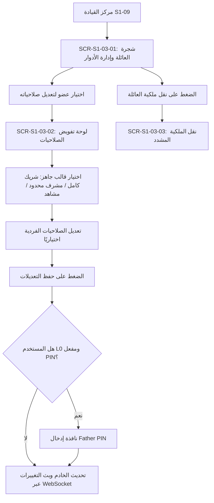

# S1-03: فهرس الشاشات والمكونات البصرية (Screens & UI Index)

> **النظام:** `S1-03 — family-roles-and-permissions`  
> **مرجع نظام التصميم:** `spec/02-design-system/components.md`, `spec/02-design-system/command-center-and-dashboards.md`  
> **الاستخلاص المرجعي:** `[REF: benchmarks/extracted/familywall/]` (لوحة شجرة العائلة)، `[REF: benchmarks/extracted/qustodio/]` (مفاتيح تحكم الصلاحيات المتقدمة).

---

## 1. جدول الشاشات المعتمدة للنظام (Screens Master Index)

| معرف الشاشة (Screen ID) | مسمى الشاشة بالعربية والإنجليزية | نمط العرض (Display Mode) | ملفات التجربة المستهدفة | الوظيفة والمكونات الرئيسية |
|---|---|---|---|---|
| `SCR-S1-03-01` | **شاشة شجرة العائلة وإدارة الأدوار** `Family Tree & Roles Overview` | شاشة لوحة قيادة تفاعلية (Dashboard View) | الأب والأم (L0, L1) | استعراض شجرة أفراد الأسرة، بطاقات الأعضاء `FosMemberCard`، شارات الرتب، زر إضافة عضو جديد. |
| `SCR-S1-03-02` | **لوحة تعديل وتفويض صلاحيات العضو** `Member Permission Editor & Grants` | صفحة إعدادات متدرجة (Settings Detail Page) | الأب حصراً (L0) أو الشريك (L1) | عرض القوالب الجاهزة (D-015)، تبديل مفاتيح الصلاحيات بالمجالات (المهام، التقويم، الموقع)، حقل حفظ مشفر بـ PIN. |
| `SCR-S1-03-03` | **شاشة نقل ملكية العائلة المشددة** `Family Ownership Transfer Screen` | شاشة تحذيرية معتمة (Critical Action Screen) | الأب المالك حصراً (L0) | اختيار المالك الجديد من الشركاء البالغين، مراجعة التبعات، التوثيق الثنائي المزدوج (PIN + OTP). |
| `SCR-S1-03-04` | **لوحة سجل الشفافية وتدقيق الصلاحيات** `Permission Audit Trail & Transparency` | شاشة قائمة زمنية تفاعلية (Timeline History View) | البالغون (L0, L1, L2) | استعراض تاريخ التغييرات على الصلاحيات، من قام بالتعديل، التاريخ والوقت، والصلاحيات المعدلة. |

---

## 2. تفصيل تدفق الواجهات وإدارة الصلاحيات (UI Flow)

---

## 3. معايير التصميم والوصولية المطبقة
- **شارات الأدوار الملونة (`Role Badges`):**
  - كحلي ملكي (`#1F3A6B`) للأب المالك (L0).
  - بنفسجي دافئ (`#6A4C93`) للأم الشريك (L1).
  - أزرق سماوي ناعم (`#4A90E2`) للبالغين (L2).
  - برتقالي نشط (`#CF5B2C`) للمراهقين (L3).
  - ذهبي براق (`#C8A24A`) للأطفال (L4/L5).
- **سهولة الفهم التربوي:** صياغة مسميات الصلاحيات بعبارات عربية فصيحة ومألوفة لرب الأسرة (مثال: «اعتماد إنجاز المهام وصرف المكافآت»، بدلاً من المصطلحات البرمجية الجافة).
