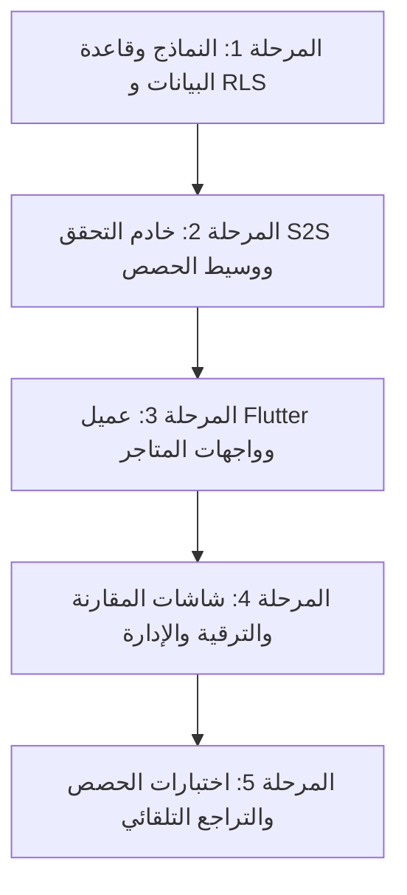

# S1-04: خطة التنفيذ بالخطوات — الخطط والاشتراكات العائلية (Implementation Plan)

> **النظام:** `S1-04 — plans-and-subscriptions`  
> **المرجع المعماري:** استخلاص هندسة التراخيص والتحقق السحابي المزدوج `[REF: benchmarks/extracted/qustodio/01_architecture_and_manifest/permissions_strategy.md]` و `[REF: benchmarks/extracted/familywall/01_architecture_and_manifest/00_EXECUTIVE_SUMMARY.md]`.  
> **التوافق مع D-027:** جاهزية معمارية كاملة للنظام مع تأجيل إطلاق الفوترة الحية لبوابات الدفع حتى ما قبل الإطلاق العام الميداني (GA).

---

## 1. حزم الاعتمادات والمكتبات البرمجية (Dependencies & Libraries)

### أ) تطبيق Flutter (الواجهة الأمامية)
- `in_app_purchase: ^3.2.0`: المكتبة الرسمية لدعم المشتريات الموحدة داخل التطبيق عبر Google Play Billing v6+ و Apple StoreKit 2.
- `in_app_purchase_android`: تفعيل مزايا إدارة الاشتراكات المتقدمة على متجر Google Play.
- `in_app_purchase_storekit`: التفاعل مع بروتوكول StoreKit 2 الحديث في بيئة iOS.
- `flutter_riverpod: ^2.5.1`: إدارة الحالة التفاعلية لخطة الأسرة النشطة وعرض بطاقات الحصص.
- `drift: ^2.18.0`: تخزين محلي لبيانات الخطة النشطة والحصص في قاعدة بيانات SQLite المحلية للعمل دون اتصال.

### ب) خادم Node.js / TypeScript (الواجهة الخلفية)
- `googleapis: ^140.0.0`: التحقق السحابي من اشتراكات متجر Google عبر `androidpublisher.purchases.subscriptionsv2`.
- `app-store-server-api: ^2.0.0` أو `@apple/app-store-server-library`: التعامل مع واجهة Apple App Store Server API الحديثة والتشفير الثنائي للرموز (JWS).
- `ioredis: ^5.4.1`: التخزين المؤقت فائق السرعة لكائن الخطة `cached_plan:{family_id}` لتغذية وسيط فحص الحصص `QuotaGuard`.
- `pg: ^8.11.5`: إدارة المعاملات المالية الموثوقة مع PostgreSQL وتفعيل عزل الصفوف RLS.

---

## 2. مراحل التنفيذ الهندسي (Execution Phases)

### المرحلة 1: إعداد قاعدة البيانات وعزل RLS (Server Foundation)
1. إنشاء المخطط `billing` والجداول الأربعة: `plans_catalog`, `family_subscriptions`, `purchase_receipts_log`, `quota_usage_counter`.
2. بذر البيانات الأولية (Seed Data) للباقات الثلاث:
   - `plan_free_starter`: الخطة الأساسية الدائمة (0.00 ر.س).
   - `plan_premium_monthly`: الاشتراك الشهري (مثلاً 29.99 ر.س / شهرياً).
   - `plan_premium_annual`: الاشتراك السنوي الموفر (مثلاً 249.99 ر.س / سنوياً).
3. تفعيل سياسات أمان الصفوف (RLS Policies):
   - قراءة الاشتراك متاحة لجميع أفراد الأسرة لنفس الـ `family_id`.
   - تعديل الاشتراك أو تقديم إيصالات الشراء محصور بالأب/المالك L0.

### المرحلة 2: محرك التحقق السحابي ووسيط الحصص (Server Verification Engine & Middleware)
1. بناء `StoreReceiptValidatorService`:
   - وحدة التحقق من إيصالات Google Play عبر ربط حساب الخدمة Google Cloud Service Account.
   - وحدة التحقق من توقيعات Apple StoreKit JWS عبر مفاتيح App Store Connect API Key.
2. تطوير وسيط التحقق من الحصص `QuotaGuardMiddleware`:
   - فحص استباقي للعمليات الحساسة لسقف الخطة (إضافة فرد أسرة جديد، إضافة جائزة جديدة في كتالوج المكافآت).
   - استثناء العمليات الحرجة والحفاظ على حصانة وعد الأمان D-025 (SOS والموقع الأساسي والدردشة ممررة دائماً).
3. معالج Webhook لإشعارات المتاجر الحية (Server Notifications):
   - استقبال أحداث التجديد التلقائي (RENEWAL).
   - استقبال أحداث الإلغاء والانتهاء (EXPIRED) وتفعيل التراجع اللبق (Graceful Downgrade).

### المرحلة 3: طبقة الشراء داخل التطبيق (Flutter In-App Purchases)
1. تهيئة موفر الشراء `InAppPurchaseProvider`:
   - الاستماع لتيار المشتريات `InAppPurchase.instance.purchaseStream`.
   - التعامل مع حالات الدفع: المعلقة (Pending)، المكتملة (Purchased)، الملغاة (Canceled)، والخطأ (Error).
2. إرسال الإيصال فوراً إلى خادم منصة عائلتي عبر `/api/v1/billing/subscriptions/verify-purchase` وتأخير إتمام الشراء محلياً `completePurchase` حتى تأكيد الخادم بحفظ المعاملة.
3. التخزين المحلي لخطة الأسرة في قاعدة بيانات العميل (Drift) لضمان معرفة العميل بحصته حتى في وضع عدم الاتصال.

### المرحلة 4: واجهات وتجارب المستخدم (UI Screens Implementation)
1. بناء شاشة مقارنة الخطط ومسار الترقية (`SCR-S1-04-01`):
   - جدول مقارنة واضح بين المجانية والمميزة.
   - إبراز مجانية زر الأمان SOS والموقع والدردشة كقيمة أصيلة.
2. بناء شاشة إدارة الاشتراك والفواتير (`SCR-S1-04-02`):
   - عرض حالة الاشتراك الحالية وموعد التجديد القادم.
   - روابط متجر Google Play / Apple ID لإدارة الاشتراك أو إلغاء التجديد.
3. بناء نافذة تجاوز الحصة المسموحة (`SCR-S1-04-03`):
   - حوار منبثق توضيحي لبق يوضح الحد الأقصى مع زر توجيه لشاشة الترقية دون مقاطعة العمليات الجارية.

### المرحلة 5: التكامل مع مركز القيادة والتحكم (Control Surface Integration)
1. تسجيل صفحة «الاشتراك والترقية» في مركز القيادة والإعدادات الموحد (`S1-09`).
2. ربط تنبيهات انتهاء الاشتراك وتجديده مع محرك الإشعارات بنظام `S1-08/S1-09`.

---

## 3. خطة التعامل مع حالات الفشل والتراجع (Rollback & Failure Recovery)

| سيناريو الفشل | الإجراء الفوري للتعافي |
|---|---|
| **فشل اتصال الخادم مع متجر التطبيقات أثناء التحقق** | وضع الإيصال في طابور محاولات إعادة (Retry Queue) مع منح المستخدم فترة سماح تجريبية مؤقتة (24 ساعة) دون تعطيل الميزات. |
| **محاولة احتيال بإيصال مزور أو مكرر** | رفض المعاملة فوراً، تسجيل محاولة الاحتيال في `billing.purchase_receipts_log`، والحفاظ على باقة الأسرة المجانية. |
| **انتهاء مدة الاشتراك المميز وعدم التجديد** | التراجع اللبق إلى الخطة المجانية: تجميد الوصول للميزات المتقدمة دون حذف أي أفراد، ولا حذف لأي بيانات، وبقاء زر SOS فعالاً 100%. |
| **فقدان اتصال شبكة الإنترنت عند فتح التطبيق** | اعتماد بيانات الخطة المخزنة محلياً في ذاكرة التخزين المؤقت، مع افتراض استمرار سريان الخطة حتى معاودة الاتصال. |
